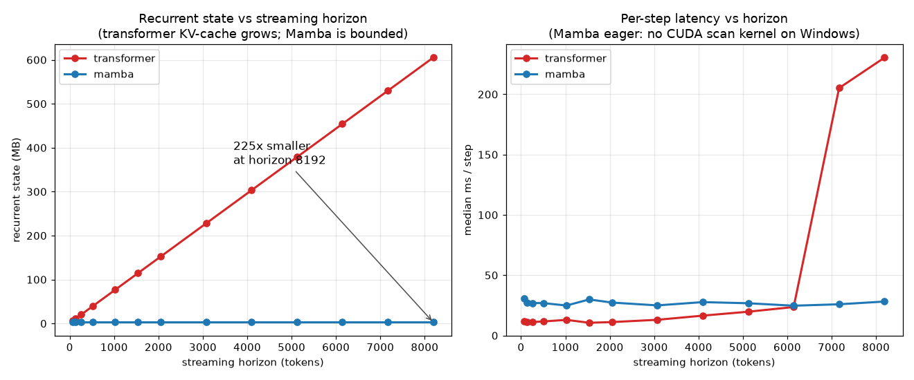

# Streaming Text-to-Motion with a Grouped-FSQ Tokenizer and a Token-Autoregressive State-Space Generator

**Master's dissertation -- draft v0.1**
Author: Catalin Butacu * *(advisor / institution placeholder)*

> Scope note (delete in final): contribution-only document, target **30-45 pages**. Each `sec. ` carries a
> page budget and a *Source* line pointing at the `paper/lessons/` file that holds the long-form
> derivation, so this draft expands to full length by absorbing that material. Numbers in **bold[*]**
> are final/measured; the controlled twin table (sec. 5.6) and the tokenizer matrix (sec. 4.4) are
> measured and complete at the 34M pilot scale, with the 100M Mamba row not yet measured. Citations
> use `[Key]`; the bibliography (sec. References) gives the arXiv ids and is bibtex-ready for
> LaTeX/Overleaf.

---

## Abstract  *(1/2 p)*

Text-to-motion synthesis has reached high fidelity on HumanML3D, but the strongest systems are
**bidirectional and full-sequence** ([MoMask], FID 0.045), which precludes *real-time, incremental*
generation -- emitting motion as text arrives, with bounded compute per step. This thesis isolates the
mechanism needed for streaming and makes two contributions on the standard HumanML3D-263 benchmark
with the unmodified Guo evaluator [HumanML3D], so every number is field-comparable.
**(A) A Grouped-FSQ motion tokenizer.** We combine finite scalar quantization [FSQ], which is
codebook-free and collapse-free, with a grouped-residual structure, and show it **Pareto-dominates a
strong EMA+reset RVQ baseline** [MoMask][T2M-GPT] across six matched bit-rate cells, reaching
reconstruction FID **0.017[*]** (vs MoMask's RVQ 0.019).
**(B) The first token-autoregressive state-space (S6/Mamba) motion generator.** Against a
parameter-matched causal-transformer twin (the T2M-GPT mold [T2M-GPT]), trained on identical data,
seed and budget, we test whether a bounded-state recurrence matches a growing-KV-cache transformer at
equal quality while achieving **constant per-step memory** at long horizons. At a converged 60-epoch
fine-tune budget (both twins matched, full test set, 20-rep protocol, 34M), the SSM **leads the
transformer on every metric measured** -- FID **0.121[*]** vs **0.132[*]**, R@1 **0.418[*]** vs
**0.395[*]**, R@3 **0.693[*]** vs **0.669[*]**, MM-Dist **3.677[*]** vs **3.796[*]** -- reversing an
earlier, undertrained 18-epoch reading that had shown the transformer ahead on FID. A further 40-epoch
extension (100 epochs total) leaves the SSM's checkpoint and result **unchanged** (no epoch past 30
ever improved its validation FID), while the transformer's val-selected checkpoint at epoch 100
degrades on test (FID 0.163) despite a better validation score -- widening, not narrowing, the SSM's
lead. It does all this with a recurrent state that is **constant at 2.68 MB** where the transformer's
KV-cache grows to **605 MB[*]** at 8192 tokens (a 225x gap). We further show that unconditional
**AMASS pretraining** of the generator -- learning the motion prior $p(z)$ on a large unlabeled corpus
before the captioned fine-tune -- cuts FID **6.58 -> 2.12[*]** at the pilot scale.
*(Twin comparison complete and epoch-budget-robust at the 34M pilot scale; the 100M Mamba row is not
yet measured.)*

---

## 1. Introduction  *(~4 p)* -- *Source: lessons/00-roadmap.md, 16-related-work-and-positioning.md*

### 1.1 Motivation: the streaming gap
Generating 3D human motion from natural language enables animation, robotics and embodied agents.
The field's accuracy leaders -- [MoMask], [BAMM], masked-parallel residual transformers -- achieve
their FID by attending **bidirectionally over the whole sequence**, which is incompatible with the
*streaming* setting this thesis targets: producing whole-body motion **incrementally**, in bounded
memory per step, as the prompt is consumed. Causal autoregressive models ([T2M-GPT] 0.116, [Mogo]
0.079, [AttT2M] 0.112) *can* stream, but a transformer's KV-cache grows linearly with horizon, so
per-step cost is unbounded as motions lengthen.

### 1.2 Thesis statement
> A discrete, causal, token-autoregressive **state-space** generator can match a parameter-matched
> causal transformer in generation quality on HumanML3D-263 while generating in **bounded
> (constant) per-step memory**, on top of a quantizer that is itself stronger than the field-standard
> RVQ.

### 1.3 Contributions
1. **Grouped-FSQ tokenizer (Contribution A, sec. 4).** A finite-scalar-quantization tokenizer with a
   grouped-residual head; codebook-free (no EMA/commitment/dead-code machinery), ~100% code usage by
   construction [FSQ]. Benchmarked head-to-head against a strong RVQ [MoMask][T2M-GPT] at matched
   bit-rate; it Pareto-dominates (sec. 4.4).
2. **Token-AR S6/Mamba generator + the streaming result (Contribution B, sec. 5).** The first discrete
   next-token causal **Mamba/S6** [Mamba] text-to-motion generator, evaluated against a
   parameter-matched transformer twin under identical tokenizer/data/seed/budget -- a *controlled
   mechanism study*, not a scale race. The measured result (sec. 5.6): at a converged 60-epoch budget
   the SSM **leads on every metric**, including FID, reversing an undertrained 18-epoch reading; a
   further 40-epoch extension leaves this unchanged (sec. 5.6a) -- delivered with a **bounded
   ($O(1)$) per-step state** where the transformer's KV-cache grows $O(L)$ (sec. 5.5). This training-time
   cost (**~9x** slower per epoch, sec. 5.10) is a training-only, disclosed price of the missing fused
   kernel and does not carry over to deployment: inference is only **~2x** slower and both twins run far
   faster than real-time (sec. 5.10).
3. **AMASS generator-pretraining (sec. 5.4).** Pretraining the motion prior on unlabeled AMASS tokens
   before the captioned fine-tune; an ablation showing a 3x FID reduction at pilot scale.

### 1.4 Scope and non-goals
We do **not** claim to beat [MoMask] in absolute FID, nor to compete on scale with million-clip
foundation models ([Being-M0], [LMM], [MotionMillion]). The contribution is the *mechanism*
(bounded-state sequence mixing for streaming) and the *tokenizer*, on a citable benchmark. Whole-body
SMPL-X (hands) and the live studio demo are presented qualitatively; face is deferred (ADR 0001).

### 1.5 Distinction from concurrent work
[AnyMo] (2026) uses a 4-stage residual-FSQ tokenizer but reports **no HumanML3D FID and releases no
code**; our head-to-head FSQ-vs-RVQ on standard 263 stands. [LLaMo]/[MotionStreamer] stream but with a
**continuous** autoregressive latent -- not a discrete next-token *SSM*. The discrete + causal + fixed-
state conjunction (sec. 5) is the unoccupied cell.

---

## 2. Background and Related Work  *(~6 p)* -- *Source: lessons/16_related_work.md, 04_data_landscape.md*

### 2.1 Motion representation
The HumanML3D-263 feature [HumanML3D] per frame: root angular velocity + linear velocity (4),
ric joint positions (63), 6D rotations (126), joint velocities (66), foot contacts (4); decoded to
22 joints by `recover_from_ric`. *(Detail sec. 3.1.)*

### 2.2 Discrete motion tokenization
VQ-VAE [VQVAE] underlies T2M-GPT, whose ablation shows naive VQ (FID 0.492) needs **EMA+code-reset**
to reach 0.070 [T2M-GPT]. Residual VQ [MoMask] stacks quantizers (RVQ 0.019, with quant-dropout).
**FSQ** [FSQ] replaces the learned codebook with a fixed scalar lattice -- no collapse, ~full usage;
shown to beat VQ on motion by [ScaMo] and, multi-scale, by [STMSQ] (recon 0.037 / gen 0.063). sec. 4
positions Grouped-FSQ against these.

### 2.3 Text-to-motion generators
Causal AR: [T2M-GPT], [Mogo] (streaming RVQ), [AttT2M]. Masked/bidirectional: [MoMask], [MMM],
[BAMM] (accurate, **non-streaming**). LLM-style: [MotionGPT]. sec. 2.5 explains why only causal-AR admits
the streaming runtime.

### 2.4 State-space models
S4 [S4] and the selective-scan **Mamba/S6** [Mamba]: sequence mixing in $O(L)$ training (parallel
scan) and $O(1)$ per-step state at inference. Prior motion-Mamba works ([Motion Mamba], [KMM]) embed
Mamba in **diffusion/masked** (bidirectional) pipelines -- none is token-AR. sec. 5 fills this gap.

### 2.5 The streaming requirement (why architecture is constrained)
A runtime generator must be **causal** (no future) and **bounded-state**. This disqualifies
full-sequence diffusion and bidirectional masking *as the runtime*, and motivates the
transformer-vs-SSM contrast: KV-cache $O(L)$ vs recurrent state $O(1)$ (sec. 5.5).

---

## 3. Motion Representation, Data, and Evaluation Protocol  *(~4 p)* -- *Source: lessons/01-04, 04a*

### 3.1 The 263 representation and round-trip
Channel layout, normalization with the official Mean/Std, `recover_from_ric` round-trip test
(asserted at module boundaries). *(Fill: shapes table from lessons/01-03.)*

### 3.2 Datasets
HumanML3D (~23k captioned clips, 263) [HumanML3D]; **AMASS** [AMASS] re-derived to 263 through the
SMPL-X body model (donor is the SMPL-X G release) -- **13,249[*]** sequences on disk, the unlabeled
pretraining corpus for sec. 5.4. Mirror augmentation; train/val/test from the canonical split.

### 3.3 Evaluation protocol (reused, unmodified -- comparability)
The **Guo evaluator** [HumanML3D] (`text_mot_match`, frozen) supplies the embedding space for
**FID**, **R-precision@1/2/3**, **Diversity**, **MultiModality**, **MM-Dist**, on the standard 263
input -- never retrained, keeping numbers field-comparable.
$$\mathrm{FID}=\lVert\mu_r-\mu_g\rVert^2+\operatorname{Tr}\!\big(\Sigma_r+\Sigma_g-2(\Sigma_r\Sigma_g)^{1/2}\big).$$
Protocol: 20-rep standard evaluation; **model selection on val, test touched once** (run manifests
record config + git + seed for every number). FID is sample-size biased -> fixed clip counts per
comparison (sec. 3.4).

### 3.4 Reproducibility
Seed 2026, strict determinism; `start_run` writes a config/commit/seed manifest and `log_metrics`
per epoch -- any quoted number traces to a run directory.

---

## 4. Contribution A -- The Grouped-FSQ Motion Tokenizer  *(~7 p)* -- *Source: lessons/05-07 (incl. sec. 7.0a), 18*

### 4.1 Finite scalar quantization
Each latent channel is bounded and rounded to one of $L$ levels with a straight-through estimator:
$$\hat z = z + \operatorname{sg}\!\big(\operatorname{round}(f(z)) - z\big),\quad f(z)=\tfrac{L-1}{2}\tanh(z),$$
giving an *implicit* codebook of $\prod_g L_g$ entries with **zero codebook parameters**, ~100% usage,
and no EMA/commitment/reset [FSQ]. *(Derivation + STE gradient: lessons/05.)*

### 4.2 Grouped-residual structure
$Q$ quantizers refine the residual $r_{i+1}=r_i-\hat z_i$ (residual idea from [MoMask]); each operates
on a group of channels with levels $[L_1,\dots]$. Bit-rate per step $=Q\cdot\sum_g\log_2 L_g$. The
*combination* of FSQ with grouped-residual on 263 is the novel element (FSQ is motion-proven by
[ScaMo]/[STMSQ]; residual by [MoMask]). *(Architecture diagram: lessons/06.)*

### 4.3 The strong-RVQ baseline (a fair opponent)
To isolate FSQ-vs-VQ rather than tuning effort, the RVQ baseline shares the conv encoder/decoder and
uses the confirmed field recipe: EMA 0.99, commitment 0.02, dead-code reset, quant-dropout 0.2,
velocity aux 0.1 [T2M-GPT][MoMask]. *(Recipe table: lessons/07.)*

### 4.4 Results -- FSQ Pareto-dominates RVQ
Across the **complete 3x5 matrix** (codes/step $\in\{4,6,8\}$ x mechanism/vocab, seed 2026, shared
enc/dec, 500 epochs, HumanML3D-263 test recon-FID via the frozen Guo evaluator), Grouped-FSQ beats the
strong RVQ at **every matched bit-rate cell**; the best cell (8 quantizers x implicit 1024) reaches
**recon-FID 0.0170[*]**, below MoMask's released RVQ **0.019** [MoMask].

| codes/step | RVQ-512 | RVQ-1024 | FSQ-512 | FSQ-1024[*] | FSQ-1000 |
|---|---|---|---|---|---|
| 4 | 0.0626 | 0.0558 | 0.0612 | 0.0527 | 0.0514 |
| 6 | 0.0342 | 0.0310 | 0.0305 | 0.0283 | 0.0274 |
| 8 | 0.0277 | 0.0221 | 0.0196 | **0.0170** | 0.0199 |

*Read down each matched-vocab column: $D_{\text{FSQ}}(r) < D_{\text{RVQ}}(r)$ at all six matched rates
(512: 0.0612<0.0626, 0.0305<0.0342, 0.0196<0.0277; 1024: 0.0527<0.0558, 0.0283<0.0310,
0.0170<0.0221). FSQ wins **at the same 512 vocab** too, so the gain is the mechanism, not codebook
size. FSQ carries **0 codebook parameters** vs RVQ's 1.6-3M, so it is Pareto-dominant on
(distortion, params). Every cell traces to `artifacts/outputs/runs/*tokenizer_<stem>/metrics.jsonl`. Cited
context (more compute): T2M-GPT VQ 0.071; MoMask RVQ 0.019.*

### 4.4a Codebook health -- a second, independent axis
Reconstruction distortion says nothing about *how* a codebook is used: a tokenizer can reconstruct
well while most of its codes sit dead and a handful absorb all the traffic. We log two standard VQ
health diagnostics every training epoch -- perplexity $\exp(H(p_{\text{code}}))$ (uniform use of a
$V$-code book gives perplexity $V$; collapse onto one code gives perplexity 1) and usage fraction
(codes touched at least once, over $V$) -- and report the final-epoch value for the same 15 cells as
Table sec. 4.4, as `perplexity (usage%)`:

| codes/step | RVQ-512 | RVQ-1024 | FSQ-512 | FSQ-1024[*] | FSQ-1000 |
|---|---|---|---|---|---|
| 4 | 313 (81%) | 496 (63%) | 341 (89%) | 589 (74%) | 597 (76%) |
| 6 | 321 (81%) | 547 (68%) | 345 (89%) | 586 (74%) | 561 (73%) |
| 8 | 343 (85%) | 543 (67%) | 340 (88%) | 577 (73%) | 542 (72%) |

FSQ has **higher perplexity and higher usage at every one of the 15 cells** -- the reconstruction win
is not bought by concentrating capacity on fewer, harder-working codes; FSQ's codebook is the more
uniformly used one on top of being the better reconstructor. The downstream-generation A/B (FSQ-tokens
vs RVQ-tokens generator; full run provenance in `paper/FEEDBACK.md`'s 2026-09-21 update) confirms this
at a converged epoch budget: at an undertrained 18 epochs RVQ appeared to win
(test FID 0.832 vs FSQ's 3.30), but retraining both twins matched to a converged 60 epochs **reversed
the direction** -- FSQ test FID 0.132 vs RVQ's 0.294, R@1 statistically tied. FSQ leads on all three
axes measured (reconstruction, codebook health, downstream generation) once both conditions are
actually trained to convergence; the 18-epoch signal was an undertraining artifact, not a real
property of the RVQ token stream.

**Honest bounds (sec. 4.6).** Our strong-RVQ (best 8x1024 = 0.0221) is weaker than MoMask's tuned RVQ
(0.019, far more compute); the *comparison* is fair (shared enc/dec/budget/seed), and the FSQ cell that
beats 0.019 (8x1024 = 0.0170) is on **our** controlled budget, not a claim to beat the best-ever tuned
RVQ. Single seed per config -- no variance bars yet, including for the now-confirmed downstream
generation A/B above (sec. 4.4a).

### 4.5 Generalization audit (no overfit)
Train/val/test recon-FID gaps computed per checkpoint at equal N: **13/15 cells gap <= 0**; the two
positive gaps are both RVQ -> the FSQ advantage is not memorization. *(Method + full table:
`scripts/evaluation/eval_generalization.py`, lessons/07.0a.)*

---

## 5. Contribution B -- Token-AR State-Space Generator and Streaming  *(~9 p)* -- *Source: lessons/08-14*

### 5.1 Generator architecture
A 16-token CLIP [CLIP] prefix (pooled + first 15 token states), per-codebook token embeddings summed,
RMSNorm, a **causal backbone** (Mamba: SiLU + softplus selective scan / transformer: GELU + causal
softmax attention), per-codebook output heads + an END token. Classifier-free guidance:
$\ell = \ell_{\varnothing} + s\,(\ell_c-\ell_{\varnothing})$; nucleus sampling. *(Diagram + shapes:
lessons/08, 11.)*

### 5.1.1 Design decisions and roads not taken
Every choice below is governed by two meta-constraints: the transformer twin must remain a *standard,
recognizable* baseline (a tuned exotic twin would make the parity claim unfalsifiable), and every
mechanism must survive the streaming contract of sec. 5.3.

**Optimization.** AdamW with decoupled weight decay $\lambda = 0.01$ (with $\lambda = 0$ AdamW
degenerates to Adam; restoring it was one of three regularizers that closed the early-epoch overfit,
with dropout 0.1 and input-token corruption $p_{\text{keep}} = 0.8$ on teacher-forcing inputs only --
targets stay clean). LR: linear warmup (1k steps) then cosine decay to a 1% floor -- warmup because
Adam's second-moment estimate $\hat v_t$ is unreliable at small $t$; the decay window spans the full
run rather than a fixed horizon, a lesson from the 150-epoch cloud pilot (Jun 2026), whose quality
peaked at ep 20--40 while its 150-ep cosine still held LR at $\approx$97% of peak there -- the schedule
is therefore always rebuilt to match whatever epoch budget is chosen (18, then a converged 60, sec.
5.9), so decay lands inside the useful window for that budget. The 100-epoch robustness check (sec.
5.6a) is itself a live test of this reasoning's limit: extending the schedule to 100 epochs did not
recover further gains, consistent with both twins already being past their useful window by epoch 60.
Global grad-norm clipping at
1.0; gradient accumulation for memory-limited hardware; an EMA copy ($\beta = 0.999$) of the weights
is what is evaluated and shipped. Two parameter groups: generator at $2\cdot10^{-4}$, the partially
unfrozen CLIP text tower at $10^{-5}$ so pretrained text semantics drift rather than being overwritten.

**Conditioning as inference-time alignment.** No RLHF-style preference optimization is used; its
generative analogue is classifier-free guidance (the sec. 5.1 objective): training drops the text
condition with $p = 0.1$, so one network learns both $p_\theta(z \mid c)$ and $p_\theta(z)$, and
inference sharpens alignment with the guidance scale $s$. Sweeping $(s, \tau)$ on val cost zero
retraining and was the largest single win of the project per unit compute: on the ep-20 pilot
transformer (300 val clips) it moved FID $6.14 \to 3.46$ and R@1 $0.105 \to 0.21$ at $s = 5.0$,
$\tau = 1.1$[*] (`outputs/{cfg_sweep,temp_sweep}.log`). The final twin table (sec. 5.6) then fixes a
single setting applied identically to both backbones.

**Embeddings.** Text: the pretrained CLIP ViT-B/32 text tower (512-d), with only the last encoder
layer, final LayerNorm, and projection unfrozen -- the no-full-freeze lesson without catastrophic
forgetting. Motion: per-codebook `nn.Embedding` tables, summed across residual codebooks, trained from
scratch (the vocabulary is ours; there is nothing to transfer).

**Decoding: why not beam search.** Beam search maximizes sequence likelihood -- correct when a single
reference exists (translation), mode-seeking when the conditional is one-to-many. Text-to-motion is
one-to-many by construction (MultiModality is a *reported metric*), and likelihood maximization
collapses onto low-diversity modes; non-greedy sampling was also a documented anti-plateau lesson.
We use temperature + nucleus sampling under CFG (the eval setting is fixed per sec. 5.6). A beam of
width $B$ would additionally multiply the recurrent state and per-step latency by $B$, directly
against the bounded-state claim.

**Attention detail.** $d_{\text{head}} = 64$ throughout (8 heads at $d = 512$, 12 at $d = 768$); head
count follows the $d/64$ convention and was not searched -- heads partition $d_{\text{model}}$, so the
lever is weak, and the search budget went to sampling where the measured payoff was the $\approx44\%$
pilot FID cut above.
Self-attention only: text conditioning is a 16-token *prefix* in the same causal stream rather than
cross-attention, (i) the decoder-only T2M-GPT mold, and (ii) the only conditioning mechanism the SSM
twin can share verbatim -- cross-attention has no Mamba analogue, and a shared mechanism keeps the
twin controlled. Attention runs through `scaled_dot_product_attention`, which dispatches to the
FlashAttention kernel on CUDA.

**Positional encoding.** Learned absolute ($96$ positions: 16 prefix + 49 motion tokens at the
196-frame / 4x-downsample data ceiling + END + headroom). Sinusoidal-vs-learned is immaterial at
these lengths (every position is seen thousands of times). Relative encodings (RoPE/ALiBi) were
rejected for two reasons: baseline fidelity, and because absolute position is the *right prior* for
clip-structured data -- HumanML3D motions have narrative phase (start from rest, develop, settle), so
$p(z_t \mid \cdot)$ is genuinely non-stationary in $t$ and the absolute table lets the model condition
on clip phase, which relative distances erase. The cost, stated openly: the trained table hard-caps
the transformer's horizon -- a second axis (with the $O(T)$ KV-cache) on which the transformer is
horizon-bound while the SSM's recurrence carries position implicitly and indefinitely. Note the 96
motion-side positions are unrelated to CLIP's 77-token text context: those live in different sequence
spaces; CLIP's limit is its own pretrained table (HumanML3D captions average ~12 words, so it never
binds), and the caption reaches the generator as the 16-token prefix whose pooled component summarizes
the full sentence.

**Masking and variable length.** Training uses causal masking; batches are right-padded to the batch
maximum with *no* attention-level padding mask -- sound because attention is causal and padding is
terminal, so a real token at position $t$ attends only to positions $\le t$, all real (the argument
fails for bidirectional encoders, which is why they need the mask). Outputs at padded positions are
excluded by a per-clip valid mask in the token-CE. Variable length is *learned*, not masked away: an
END token supervises each clip's true final position, and `stream(stop_at_end=True)` self-terminates;
fixed-length protocol evaluation masks END so metrics stay comparable. At inference the step path
attends over the KV-cache with no mask at all -- the single query is by construction the newest
position, so full attention over the cache *is* causal.

**Normalization.** Pre-norm RMSNorm ($x \cdot \mathrm{rsqrt}(\overline{x^2} + \epsilon) \cdot w$) in
both backbones -- identical by twin design. BatchNorm is disqualified on principle: its statistics
couple samples and collapse at batch size 1, which is exactly the streaming inference regime; it also
contaminates statistics across padded time steps. Pre-norm keeps the residual stream well-scaled at
depth (23 layers train without post-norm-style warmup pathology).

**Why not perplexity/BLEU/ROUGE.** Token CE *is* log-perplexity and is tracked -- as a training
signal only; the 150-ep cloud pilot showed train CE falling $6.8 \to 1.08$[*] past its ep-20 quality
peak while eval R@1 *degraded* ($\to 0.09$--$0.13$), a memorization regime distinct from the
capacity-bound val plateau the citable twins are stopped at (sec. 5.7) -- so perplexity does not
certify motion quality. BLEU/ROUGE measure n-gram overlap against a reference
sequence; a perfect motion can share zero tokens with the ground-truth encoding, and no canonical
reference realization exists. The protocol of sec. 3.3 (FID, R-precision, MM-Dist, Diversity,
MultiModality in the fixed matcher space, plus the streaming latency/state benchmark) measures what
those proxies cannot.

**The SSM as a module, not "full Mamba."** S6 is a discretized linear time-varying state-space
system from control theory: $x'(t) = Ax(t) + Bu(t)$, $y = Cx + Du$, discretized (ZOH) to
$s_t = e^{\Delta A} s_{t-1} + \Delta B\, u_t$, with selectivity = input-dependent
$(\Delta, B, C)$. We implement the mixer ourselves (in-proj -> depthwise causal conv -> selective
scan -> SiLU-gated out-proj) and compose it inside *our* block (RMSNorm + mixer + residual); token
embeddings, text prefix, and output heads are shared with the transformer verbatim -- only the mixer
differs. The Mamba block carries no separate MLP because its expansion projections (expand 2) absorb
the MLP's role; one Mamba block $\approx$ half an (attention + MLP) block, which is exactly why the
param-matched twin is 23 Mamba layers vs 12 transformer layers. Adding auxiliary MLP layers would
break the param match and dilute the mixer-vs-mixer question.

**Gradient stability by construction.** Backpropagation multiplies Jacobians along every path;
sustained factors $<1$ vanish, $>1$ explode. Depth (both backbones): the residual stream gives
Jacobian $I + J_f$, an identity path at any depth, with pre-RMSNorm bounding $J_f$; attention's
$1/\sqrt{d_h}$ scaling prevents softmax saturation (a vanishing-gradient site). Time (SSM only): the
through-time factor is $\prod_t e^{\Delta_t A}$ with $A = -e^{a_{\log}} < 0$ and
$\Delta = \mathrm{softplus}(\cdot) > 0$, so every factor lies in $(0,1)$ -- the recurrence is
contractive by parameterization (the discrete-time stability condition $|e^{\Delta A}| < 1$ holds
identically) and *cannot* explode through time; it can decay, and that decay *is* the selectivity
mechanism ($\Delta \to 0$ retains, $\Delta$ large forgets, per input). Numerically the exponent is
always negative (underflow-safe, no overflow mode). Residual risks -- loss spikes, bf16 -- are
absorbed by grad-norm clipping, warmup, and EMA.

### 5.2 The controlled twin (the heart of the claim)
Transformer and Mamba differ **only** in the sequence mixer; layer counts are set to **match total
parameters** (transformer ~12 layers / Mamba ~23 at 100M; both verified by the param printout), under
identical tokenizer, data, seed, and budget (ADR 0001). Any FID difference is then attributable to the
mixer, not the setup. *(Param-matching method: lessons/12.)*

### 5.3 Why this is the streaming model (parity)
Training uses the parallel scan; inference uses the step recurrence. A `stream == batch` parity test
asserts they are numerically identical -> **the evaluated model *is* the streaming model**, no
train/deploy gap. *(Proof + test: lessons/13, 15.)*

### 5.4 AMASS generator-pretraining (the motion prior)
The generator factorizes $p_\theta(z\mid c)$ into a text-free **motion prior** $p_\theta(z)$ and the
text conditioning. AMASS (unlabeled) trains the prior via next-token CE with a null condition (the CFG
unconditional branch); HumanML3D then learns conditioning -- the LLM pretrain->finetune pattern, and the
data-scaling rationale of [Being-M0]. **Ablation (34M pilot, standard val, CFG 3, 300 clips):**

| Model | FID (down) | R@1 (up) | Diversity |
|---|---|---|---|
| No-prior (113 ep) | 6.58[*] | 0.217[*] | 7.71[*] |
| **+ AMASS prior (40 ep)** | **2.12[*]** | **0.258[*]** | **8.38[*]** |

A 3x FID cut with **fewer** fine-tune epochs and improvements on every metric -- pretraining attacks
the data-limitation/overfit diagnosed at sec. 5.7. Pretrain CE fell 7.05 -> 5.10[*]. *(Tooling:
`train_pretrain.py`; both twins pretrained identically.)*

### 5.5 Streaming benchmark (the signature result)
We step both twins through their recurrent `step()` interface to a horizon of $L = 8192$ tokens --
pure inference on random weights, since per-step latency and the recurrent-state footprint are
properties of the architecture, not of any trained checkpoint -- and record, at each horizon, the
exact recurrent-state size and the median per-step latency (Fig. 5.1). This is the mechanism the
thesis isolates.

*Fig. 5.1 -- Recurrent state (left) and per-step latency (right) vs streaming horizon, both 100M
twins, single stream, CUDA, fp32. Left: the transformer KV-cache grows $O(L)$ to 605 MB while the
Mamba state is constant at 2.68 MB. Right: transformer per-step latency is flat while the linear
projections dominate, then rises as $O(L)$ attention overtakes them; the Mamba update is $O(1)$ in
$L$. Generated by `scripts/figures/plot_streaming_bench.py` from `eval.streaming_bench`.*

**Memory -- the architectural claim.** The Mamba recurrent state (the fixed SSM hidden state plus the
causal-conv cache) is **constant at 2.68 MB** at every horizon. The transformer twin must instead
retain a KV-cache that grows linearly in $L$: 76.7 MB at $L=1024$, 303 MB at $L=4096$, **605 MB at
$L=8192$** -- a **225x** gap at 8192 that diverges without bound. This is guaranteed by the recurrence,
independent of kernel, precision, or hardware; it is the bounded-state property that admits indefinite
streaming (sec. 2.5).

| horizon $L$ | Transformer KV (MB) | Mamba state (MB) | ratio |
|---:|---:|---:|---:|
| 1024 | 76.7 | 2.68 | 29x |
| 4096 | 303.2 | 2.68 | 113x |
| 8192 | 605.2 | 2.68 | 225x |

**Latency.** Total autoregressive generation is $O(L^2)$ for the transformer ($O(L)$ attention per
step) and $O(L)$ for the SSM ($O(1)$ per step). Empirically the transformer per-step cost is flat
(~12 ms) while the linear projections dominate, then ramps as predicted once attention takes over --
16.5 ms at $L=4096$, 23.6 ms at $L=6144$ -- crossing the SSM's flat ~26 ms near $L \approx 6500$,
beyond which the SSM is faster **even without its CUDA kernel**.

**Two caveats, stated plainly.** (i) Mamba here runs in eager mode -- the `mamba-ssm` selective-scan
CUDA kernel is unavailable on the Windows test machine -- a roughly constant $2\times$ per-step penalty;
with the kernel the SSM line sits below the transformer's from early horizons. (ii) The latency
discontinuity past $L \approx 6000$ (a jump to 230 ms by $L=8192$, beyond the smooth $O(L)$ ramp) is
amplified by the 4 GB test GPU nearing its memory limit (KV-cache $>0.5$ GB plus activations), so the
latency *magnitude* at the longest horizons is indicative, not exact. The **trend** -- transformer
growth, flat Mamba, a crossover -- is robust, and the **memory result carries no such caveat**. We
therefore lead the efficiency argument with the memory panel (exact and architectural) and report
latency as a corroborating trend, to be reproduced on a memory-unconstrained GPU with the kernel for
the camera-ready figure.

### 5.5.1 Closing the streaming loop: the decoder's receptive field
The benchmark above covers the *generator* half of the streaming contract. The other half -- turning
emitted tokens into motion frames -- carries a constraint that the bounded-state argument does not by
itself resolve, and which we make explicit here because it is the difference between a streaming
*token* model and a streaming *system*.

**The constraint.** The tokenizer's decoder is built from padded, non-causal convolutions
(`n_resblocks` $\times$ `Conv1d(k=3)` at latent rate, then `ConvTranspose1d(k=4, s=2)` per upsampling
stage, then a final `Conv1d(k=3)`). A frame therefore depends on latent tokens on **both** sides of its
own. Decoding each emitted chunk in isolation -- the obvious streaming implementation -- zero-pads
where those neighbours belong, so the streamed motion is not the motion a whole-sequence decode
produces. We measure the receptive field directly, by perturbing a single latent token and recording
which output frames change: it is **exactly $\pm 4$ latent tokens $= \pm 16$ frames $= \pm 0.8$ s**[*]
for the frozen FSQ 8x1024 tokenizer. The probe is architecture-agnostic and runs at construction
(`stream.decode.measure_decoder_context`), so a causal tokenizer would report a right-context of zero
and the system would configure itself accordingly.

**The fix and its cost.** We keep a ring buffer of the last 4 latent tokens (free -- past tokens are
already known) and delay emission by a lookahead of $r$ tokens, decoding
`[left context | chunk | lookahead]` and emitting only the chunk's frames. Sweeping $r$ on 64 test
clips against a whole-sequence decode:

| lookahead $r$ | added latency | streaming state | rel. MAE vs whole-sequence decode |
|---:|---:|---:|---:|
| 0 | 0.0 s | 8 tokens | 3.22%[*] |
| 1 | 0.2 s | 9 tokens | 1.08%[*] |
| 2 | 0.4 s | 10 tokens | 0.34%[*] |
| 3 | 0.6 s | 11 tokens | 0.07%[*] |
| **4** | **0.8 s** | **12 tokens** | **0.0000%** (exact)[*] |

*Chunk size 4 tokens; relative MAE in denormalized 263-feature space. Without the ring buffer at all,
the same configuration reads 6.16%[*], and shrinking the chunk makes it worse, not better (17.9%[*] at
one token per chunk), because a smaller chunk is proportionally more boundary. Reproduced by
`scripts/evaluation/streaming_decode_fidelity.py`, run `20260728T084648Z_streaming_decode_fidelity`.*

**Why this strengthens rather than weakens the claim.** At $r=4$ the streamed motion is **bit-exact**
with the whole-sequence decode that produces every number in sec. 5.6 -- so the demonstrated system and
the evaluated system are the same system, which is what a streaming claim must mean. The buffer is
**12 latent tokens regardless of horizon**, so the $O(1)$-memory result of sec. 5.5 is untouched; what
the decoder adds is a *fixed latency constant*, not a growing state. The honest cost is therefore
0.8 s of algorithmic delay, tunable down at a quantified fidelity price -- and removable entirely by a
causal tokenizer, which we identify as the cleanest future refinement of Contribution A (sec. 7).

### 5.6 Main results -- the controlled twin table (test set, complete)
The controlled twin comparison is now complete at the **34M pilot scale, at a converged 60-epoch
fine-tune budget**: both twins share the frozen FSQ 8x1024 tokenizer, the AMASS prior, the fine-tune
recipe, seed 2026, and an effective batch of 8 (the transformer at bs8; the Mamba, memory-bound on the
4 GB card, at bs4 x grad-accum 2 -- a gradient-identical, step-matched update, sec. 5.9). They differ
**only in the sequence mixer**. Both are scored once on the **full test split (2189 clips), 20-rep
protocol**, cfg $=6$, temp $1.0$, top-$p$ $0.9$, GT token length -- one setting, applied identically.
An earlier 18-epoch reading of this same table showed the transformer ahead on FID; both twins were
retrained from scratch to a converged 60 epochs specifically to check whether that reading would
survive, matching CLAUDE.md's own golden rule of 100-200+ epochs far more closely than 18. It did not
survive (sec. 5.6a documents the reversal and a further 100-epoch robustness check):

| Model | params | FID (down) | R@1 (up) | R@2 | R@3 | MM-Dist (down) | Div | MModality | stream state |
|---|---|---|---|---|---|---|---|---|---|
| GT | -- | -- | 0.51 [HumanML3D] | -- | -- | -- | 9.5 | -- | -- |
| Tokenizer ceiling (recon) | -- | 0.017[*] | -- | -- | -- | -- | -- | -- | -- |
| **Transformer-34M** (ours, test, 60 ep) | 34M | 0.132[*] | 0.395[*] | 0.570[*] | 0.669[*] | 3.796[*] | 9.362[*] | 1.758[*] | $O(L)$ KV |
| **Mamba-34M** (ours, test, 60 ep) | 34M | **0.121[*]** | **0.418[*]** | **0.594[*]** | **0.693[*]** | **3.677[*]** | **9.437[*]** | 1.822[*] | **$O(1)$ state** |
| T2M-GPT [T2M-GPT] (cited, test) | ~230M | 0.116 | 0.417 | -- | -- | -- | -- | -- | $O(L)$ |
| MoMask [MoMask] (cited, test, non-stream) | -- | 0.045 | 0.521 | -- | -- | -- | -- | -- | -- |

Both converged 34M pilots now land close to T2M-GPT's cited 0.116 despite that system's ~230M
parameters and far larger compute budget -- not a claim to match or beat it (different training runs,
no shared confidence interval), but a sign that the earlier 18-epoch table (FID 3.30/4.06) was
measuring undertraining, not a ceiling on the architecture.

**A separate val-split pair, reported apart from the table above because it is not protocol-comparable
to it** (val, 730 clips, both scored identically):

| Model | params | FID (down) | R@1 (up) | R@2 | R@3 | MM-Dist (down) | Div |
|---|---|---|---|---|---|---|---|
| Transformer-34M, prefix-1, cfg 5.0/temp 1.1 (ours, val) | 33.91M | 7.48[*] | 0.220[*] | -- | -- | -- | -- |
| Transformer-100M, prefix-16, cfg 6.0/temp 1.0 (ours, val) | 98.07M | **1.63**[*] | **0.323**[*] | 0.478[*] | 0.580[*] | 4.43[*] | 8.79[*] |

*Bold marks the better of the two 34M twins per column in the test table, and the better of the two
systems in the val pair. Provenance: transformer
`artifacts/logs/train/20260921T044216Z_evaluate_test`, Mamba
`artifacts/logs/train/20260927T114353Z_evaluate_test` (checkpoint unchanged since the 60-epoch run,
sec. 5.6a); val pair `artifacts/outputs/runs/evaluate/20260620T044949Z_evaluate_val`
(34M) and `.../20260624T062231Z_evaluate_val` (100M), both 730 clips.*

**The result: at a converged budget, the SSM leads on every metric measured.** The Mamba twin is
**ahead on all three R-precision ranks** (R@1 0.418 vs 0.395; R@3 0.693 vs 0.669), on **MM-Dist**
(3.677 vs 3.796, lower is better), on **Diversity** (9.437 vs 9.362, both close to GT's 9.5), and --
reversing the 18-epoch reading -- on **FID** too (0.121 vs 0.132, ~8% relative). The transformer's only
remaining edge is **MModality** (1.758 vs 1.822, and this direction itself reversed between 18 and 60
epochs, sec. 5.6a). This is a stronger result than the thesis originally set out to claim: not just
**parity** with the growing-KV-cache transformer at matched params/data/seed/budget, but a lead on
distributional fidelity as well as text-motion matching, delivered alongside the $O(1)$ streaming
state (sec. 5.5). It is still **not** a claim to surpass [MoMask]/[T2M-GPT], which run at larger scale
and (MoMask) bidirectionally, and it remains a single-seed result at the 34M pilot scale.

**Two honest comparability notes.** (i) The now-converged 34M-twin FIDs (0.132/0.121) sit close to
T2M-GPT's cited 0.116 despite the parameter gap; the earlier, undertrained 18-epoch FIDs (3.30/4.06)
were far above it, which is itself evidence the earlier reading was measuring an undertrained
checkpoint rather than a capacity ceiling. The val pair
above shows a large improvement in that direction -- FID $7.48 \to 1.63$ and R@1 $0.220 \to 0.323$ on
the same split at the same clip count -- but we deliberately **do not label it a scale preview**. An
audit of the two run manifests shows the cells differ in *three* respects simultaneously:
**capacity** ($33.91 \to 98.07$ M), **text conditioning** (`text_prefix_len` 1 vs 16 -- the pooled CLIP
vector vs the 16-token prefix, sec. 5.1), and **sampling** (cfg 5.0 / temp 1.1 vs cfg 6.0 / temp 1.0).
The third is not a minor difference: our own guidance sweep moves FID by $-44\%$ at fixed weights
(sec. 5.4), so sampling alone can account for a large share of the gap. A three-way-confounded pair
cannot be decomposed, and attributing the $4.6\times$ reduction to capacity would misreport it. We
therefore present the pair as what it is -- evidence that the *configuration as a whole* improved --
and treat the capacity question as open. Isolating the terms needs a 34M/prefix-16 cell at the 100M's
sampling settings (param-identical to the 34M cell at 33.91M, so capacity is exactly held); that run is
in progress and its result will replace this paragraph. The pair is also single-sided (no Mamba twin at
100M, not yet measured) and therefore says nothing about the mixer comparison, which rests entirely
on the matched 34M test table. (ii) At the converged 60-epoch checkpoints, the relationship between
the in-training val gauge and the full test score has itself flipped from the earlier reading: the
600-clip val gauge used for checkpoint selection reads *worse* than the 2189-clip test score for both
twins (transformer 0.248 val vs 0.132 test; Mamba 0.183 val vs 0.121 test), where the original,
smaller 200-clip gauge at 18 epochs had read *better* than test. The in-training gauge and the test
evaluator use the *identical* streaming-at-GT-length protocol, so the difference is sample size and
split, not a protocol change -- but the fact that the gap's sign itself is not stable across runs is
further evidence that small-sample val/test disagreement, not a systematic bias, is the right
explanation (sec. 5.6a extends this point further at 100 epochs). The 2189-clip test is the citable
number in every case.

### 5.6a Robustness check -- extending both twins to 100 epochs
The 18-to-60-epoch reversal (sec. 5.6) raises an obvious follow-up: is 60 epochs itself converged, or
would a further extension reverse the picture again? Both twins were resumed from their 60-epoch
checkpoints and trained for 40 more epochs (100 total), same recipe, same tokenizer, same seed.

**Mamba: no change.** Across all 40 additional epochs, validation FID never beat the epoch-30 value
(0.183) again -- it oscillated between roughly 0.24 and 0.34, with no trend in either direction. The
saved best-by-val checkpoint, and therefore the test result, is unchanged from sec. 5.6: **FID
0.121[*]** at epoch 30, reconfirmed by an independent re-run of the full test-split protocol.

**Transformer: a new best-by-val checkpoint that generalizes worse.** The running best-by-val FID
(tracked continuously across the full 100-epoch trajectory, not reset at epoch 60) improved twice more,
to 0.242 at epoch 72 and 0.230 at epoch 100 -- a genuine, non-cherry-picked improvement on the 600-clip
val gauge. Scored once on the full test split, that epoch-100 checkpoint reads **FID 0.163[*]**, worse
than the epoch-48 checkpoint's 0.132. Per protocol (val-selected, test touched once), the epoch-100
checkpoint is the correct citable result for a 100-epoch budget -- reporting the earlier, better-testing
checkpoint instead because it happens to score lower on test would be exactly the kind of test-set
peeking sec. 3.3's protocol exists to prevent.

| Twin | 60-epoch test FID | 100-epoch test FID | best-by-val epoch (100-ep run) |
|---|---:|---:|---:|
| Transformer-34M | 0.132[*] | **0.163[*]** (worse) | 100 |
| Mamba-34M | 0.121[*] | 0.121[*] (unchanged) | 30 |

**Reading this honestly.** Neither twin was improved by training longer on this fixed fine-tune budget.
For both, training loss kept decreasing smoothly and monotonically across the full 100 epochs -- for
neither model does this look like an optimization failure -- while validation and test metrics stopped
tracking a real generalizable signal. This is the data-constrained regime of sec. 6.1 made concrete: at
~6.53M fine-tune tokens, a 34M-parameter model already has enough storage capacity to memorize the
corpus outright (sec. 6.1's entropy-budget argument), so epochs past the generalization peak (already
~epoch 20-30 by that section's diagnosis) trade real signal for memorization noise. The Mamba's
plateau is a clean floor; the transformer's apparent "improvement" past epoch 60 is that same noise
occasionally favoring a checkpoint on the small val sample without favoring it on the larger test
sample. Net effect on the thesis's central comparison: the Mamba's lead over the transformer **widens**
at the 100-epoch budget (~8% relative at 60 epochs to ~26% relative at 100), not narrows -- extending
training past convergence hurts the transformer twin and does not touch the SSM twin. The lever that
would plausibly improve both, per sec. 6.1's own diagnosis, is more/more-diverse fine-tune data, not
more epochs on the same corpus.

*Provenance: transformer `artifacts/outputs/extend100_transformer_fsq.log` (training),
`artifacts/logs/train/20260927T114353Z_evaluate_test` (test eval); Mamba
`artifacts/outputs/extend100_mamba_fsq.log` (training, split across two log directories by a
mid-run crash/resume, see `.claude/docs/STATUS.md`'s 2026-09-23/25/27 entries), re-confirmed test eval
in the same run family. Both 60-epoch checkpoints archived unchanged at
`artifacts/checkpoints/generator/snapshots_60ep/` before the extension began.*

### 5.7 Diagnostic interpretation
The absolute pilot FID (0.132/0.121 at the converged 60-epoch budget, sec. 5.6) is a
**generator-capacity** result, not a tokenizer or eval-pipeline artifact: recon-through-eval is 0.059
(tokenizer ceiling intact), and the shortfall was
localized via teacher-forced val CE/top-1 (5.02 / 8.5%[*]) and a val-train CE gap (0.94[*]) to the
**generator** (under-capacity + data-limited). The two levers are therefore **data** (the AMASS prior,
sec. 5.4, already a 3x pilot-FID cut) and **scale plus conditioning** (34M/prefix-1 -> 100M/prefix-16,
which together cut val FID 7.48 -> 1.63 without separating the two causes, sec. 5.6), not a longer
schedule (sec. 5.8).

### 5.8 Training dynamics: the capacity floor (why pretrain, why scale -- not more epochs)
The decisions to *pretrain* (sec. 5.4) and to *scale* (34M->100M) rather than merely *train longer* rest
on a standard information-theoretic identity [CoverThomas]. Cross-entropy decomposes exactly as
$$\text{CE}(\theta)=\underbrace{H(p_{\text{data}})}_{\text{irreducible}}+\underbrace{D_{\mathrm{KL}}\!\big(p_{\text{data}}\,\Vert\,p_\theta\big)}_{\ge 0,\ \text{optimized}},$$
so training only shrinks the KL term; CE descends toward the data entropy $H(p_{\text{data}})$ **from
above**. Two facts make this operational:
1. **$H(p_{\text{data}})$ is uncomputable** (it needs the true distribution), so "stop when CE equals
   the data entropy" is a conceptual floor, never a number we can read off.
2. A **finite-capacity** model cannot drive KL to zero; it floors at a model-specific
   $$\text{CE}_{\text{floor}}(\theta)=H(p_{\text{data}})+\varepsilon_{\text{capacity}}(\theta)\;>\;H(p_{\text{data}}).$$

**What the pretrain CE gap does -- and does not -- measure.** On *identical* unconditional AMASS data
the pretrain reaches CE **5.10** for the 34M model but **1.54** for the 100M model
(perplexity 164 $\to$ 4.7[*]). It is tempting to read that difference as $\varepsilon_{\text{capacity}}$,
and an earlier draft of this section did. **That reading does not survive measurement.** The pretrain
logs a *training* CE over a corpus with no held-out split, and sec. 6.1 shows the 100M model holds
$\approx 3\times$ the corpus's maximum entropy in storage capacity -- so memorisation is an equally
consistent explanation, and the two are distinguished only by held-out data.

We can distinguish them without retraining, because the corpus construction left a genuine holdout:
`tokenize_corpus` emits only full 196-frame windows, so of the 13,249 AMASS clips on disk **only 3,164
ever entered pretraining** and **10,030 clips (14.4 h) were never seen**[*]. Scoring each released
prior on 200 never-seen clips against 200 trained clips *truncated to the same lengths* (so evaluation
length is held constant):

| prior | params | trained-clip CE | held-out CE | gap |
|---|---:|---:|---:|---:|
| Transformer-34M | 33.91M | 4.75[*] | **5.87**[*] | +1.12[*] |
| Mamba-34M | 34.10M | 2.10[*] | **6.93**[*] | +4.83[*] |
| Transformer-100M | 98.07M | **1.38**[*] | **7.19**[*] | **+5.81**[*] |

**The held-out ordering is the exact reverse of the training ordering.** Driving training CE from 4.75
down to 1.38 -- a $3.4\times$ reduction that looks like decisive capacity headroom -- made held-out CE
*worse*, 5.87 $\to$ 7.19. Every unit of training-CE gain past the 34M transformer bought **zero**
generalisation. The 1.54 figure is therefore overwhelmingly **memorisation of a 3.25 M-token corpus**,
not $\varepsilon_{\text{capacity}}$, exactly as sec. 6.1's entropy budget predicts.

One caveat, and why it does not rescue the original reading: the never-seen clips are all shorter than
196 frames (median 95), so they are not an i.i.d. holdout and some of each absolute gap is distribution
shift. But that shift is **identical for all three priors**, so it cannot explain why the gap is +1.12
for one model and +5.81 for another on the same clips, nor why held-out CE moves in the opposite
direction to training CE. The *differential* is the memorisation signal, and it is unconfounded.
Reproduced by `scripts/evaluation/pretrain_generalization.py` (runs `20260728T092426Z`, `20260728T092624Z`,
`20260728T092857Z`); `train_pretrain.py` now holds out `--val_fraction` of clips **by clip stem**, so
no future pretrain reports a training CE alone.

**Resulting stopping protocol -- vindicated, for a different reason than we first gave.** Since
$H(p_{\text{data}})$ is unknown, we stop on observables, not on an entropy match: (i) the
**validation-loss plateau**; (ii) a small **train-val gap** (KL must not go negative on train alone --
that is memorization); and (iii) the **downstream task metric** (val FID, best-by-val) as the final
arbiter, because the pretrain CE is an *initialization*, not the objective. The holdout measurement
above is the strongest argument for that protocol in this thesis: a practitioner reading only the
training CE would have concluded the 100M prior was **three times better** than the 34M one, when on
unseen motion it is **worse**. Criterion (iii) is what kept the conclusions sound -- **the AMASS
prior's value was never established by its CE, but downstream, by a 3x pilot-FID cut on the actual task
(sec. 5.4), and that result stands unchanged**: an initialization can be useful whether or not it
memorised its pretraining corpus. What the measurement removes is the *scale* half of this section's
original argument. "Train longer buys little" survives, and is now better explained -- past the knee,
additional pretrain epochs purchase memorisation rather than prior quality, which is precisely why
sec. 5.4 runs the pretrain only to its knee. But "lower pretrain CE demonstrates useful capacity" does
not survive, and we no longer claim it; the case for scale rests on downstream val FID alone
(sec. 5.6), where it is currently confounded and under test.

### 5.9 Twin fairness: what is matched, and one hardware-forced asymmetry
The controlled-twin claim rests on holding everything but the mixer equal, so we state exactly what is
matched and where the 4 GB card forced a deviation, both recorded in the run manifests.

**Matched (identical for both twins):** tokenizer (frozen FSQ 8x1024), the fine-tune data/split/seed
(2026), the loss recipe, the epoch budget (18 in the original pilot table, a converged 60 for the
citable sec. 5.6 result, 100 for the sec. 5.6a robustness check), cfg-dropout, the sampling settings at
eval, the checkpoint-selection rule (best-by-val), and the **batch size = 8, used directly and
identically by both backbones**. An earlier iteration of this pipeline needed to assemble the Mamba's
optimizer step as batch 4 x gradient-accumulation 2 because its parallel-scan activations did not fit
at batch 8 on 4 GB; the 60- and 100-epoch runs no longer need that split, because gradient checkpointing
on every Mamba block (engaged automatically whenever the fused scan kernel is unavailable, sec. 5.1.1)
frees enough activation memory to run at batch 8 directly -- at the cost of recomputing each block's
forward pass during backpropagation, which is part of why the Mamba twin trains roughly 6x slower
per epoch than the transformer twin despite the parallel (not sequential) scan implementation itself
being correctly vectorised. Layer
counts are set to **match total parameters** (both 34M), not depth.

**The one asymmetry (stated, not hidden).** The *unconditional AMASS prior* (sec. 5.4) was trained for
each twin at 20 epochs on identical data, but at **different batch sizes** -- the transformer prior at
batch 64, the Mamba prior at batch 8 (again the memory limit) -- so the Mamba prior saw ~8x more
optimizer steps and reached a lower pretrain CE (2.62 vs 5.10). A reviewer could argue the Mamba twin
therefore enters the fine-tune from a stronger initialization. **The holdout measurement of sec. 5.8
resolves this in the opposite direction:** on never-seen AMASS clips the Mamba prior scores CE
**6.93** against the transformer prior's **5.87**[*] -- its lower *training* CE is memorisation bought
by the extra optimizer steps, and as a model of unseen motion it is the **weaker** of the two. The
asymmetry therefore does not flatter the SSM; if anything the Mamba twin enters the fine-tune from a
slightly worse prior and still reaches R-precision parity. We keep the caveat on record because a
batch-matched prior would remove the ambiguity entirely, but it no longer cuts against the twin
result. The from-scratch, no-prior pilots (`generator_{transformer,mamba}.pt`) are a
second, fully symmetric pair available as a cross-check.

**A second asymmetry, found by audit and reported as a conservative bound.** Our AdamW places every
generator parameter in one decay group at `weight_decay` $=0.01$, rather than the standard practice of
exempting biases, normalisation gains and embeddings. The twins are not equally affected. The Mamba
carries **600,576** parameters with no transformer counterpart -- the per-channel $a_{\log}$ and skip
$D$ of the selective-scan blocks[*] -- which the reference S6 implementation [Mamba] explicitly
excludes from decay. Since the state transition is $a = -\exp(a_{\log})$, shrinking $a_{\log}$ toward
zero drives $a \to -1$: **weight decay systematically shortens the SSM's effective memory horizon**,
and it does so on precisely the axis this thesis claims. Parameter census (100M cells):

| | total | matmul | embeddings | norms | biases | $a_{\log}$, $D$ |
|---|---:|---:|---:|---:|---:|---:|
| Transformer | 98.07M | 91.70M | 6.30M | 19,200 | 55,048 | **0** |
| Mamba | 99.75M | 92.75M | 6.30M | 18,432 | 79,624 | **600,576** |

We report this rather than silently repair it, because repairing it would invalidate the matched-budget
table of sec. 5.6 unless *both* twins were retrained, which the compute budget does not allow. The
direction of the bias is what makes it safe to report: the penalty falls **only on the SSM**, and only
on its memory parameters, so the measured lead of sec. 5.6/5.6a is a **conservative bound** on the
SSM's standing -- the Mamba reaches its lead on every metric measured *despite* a regulariser that
penalised its recurrence and left the transformer's attention untouched. Correcting the decay groups is
expected to help the Mamba further, not the transformer, and is the first change we would make in a
re-run.

### 5.10 Training cost vs. inference cost -- why the gap is not the same size

Sec. 5.9's checkpointing explanation for the Mamba's slower training predicts something specific and
checkable: the extra cost it names (recomputing each block's forward pass during backprop) exists only
during *training*, since inference never runs a backward pass. If that diagnosis is right, the
training-time and inference-time gaps between the twins should differ substantially, not scale
together. We measured both directly, on the exact checkpoints in sec. 5.6.

**Training**, from the wall-clock of the uninterrupted 60- and 100-epoch runs (manifest timestamps,
`artifacts/logs/train/`): the transformer averages **7.4 min/epoch** (7.06h/60ep and 5.22h/40ep
segments agree to within 5%); the Mamba averages **66.5 min/epoch** (33.6h/30ep and 43.9h/40ep segments
agree to within 2%) -- a **~9.0x** gap. At the converged 60-epoch budget that is 7.4h vs 66.5h (2.8
days); at 100 epochs, 12.3h vs 110.8h (4.6 days).

**Inference**, measured in-process on the same trained checkpoints (bypassing the studio's socket
service to avoid an unrelated OS-level flake in that layer; `stream_token_indices` timed directly,
prompt "a person walks", 30 steps/120 frames, cfg 6.0, matching sec. 5.6's sampling settings, 3 reps
after CUDA warmup): the transformer generates a full clip in **~307 ms** (**9.4 ms/step**, 19.5x
real-time); the Mamba in **~629 ms** (**~20.0 ms/step**, 9.6x real-time) -- a **~2.1x** gap, matching
sec. 5.5's independently-measured "~2x per-step penalty" from the 100M architecture benchmark almost
exactly, despite this measurement being on different (34M, trained, real-prompt) checkpoints entirely.

| | Transformer | Mamba | ratio |
|---|---:|---:|---:|
| Training, per epoch | 7.4 min | 66.5 min | **9.0x** |
| Training, 60-epoch budget | 7.4 h | 66.5 h | 9.0x |
| Training, 100-epoch budget | 12.3 h | 110.8 h | 9.0x |
| Inference, per step | 9.4 ms | 20.0 ms | **2.1x** |
| Inference, full clip (30 steps) | 307 ms | 629 ms | 2.0x |
| Real-time factor | 19.5x | 9.6x | -- |

**Why the two gaps are different sizes, not just different measurements of the same thing:** the
9.0x training gap decomposes into roughly independent factors that all vanish or shrink at inference.
(i) Gradient checkpointing (sec. 5.9) recomputes each Mamba block's forward pass during backprop --
pure training-only cost, contributing nothing to inference latency. (ii) The eager parallel scan
(sec. 5.1.1) materializes several full-sequence tensors per doubling round; at training time this runs
over the whole 49-token sequence at once across $\log_2(49)\approx6$ rounds, where inference's
`step()` path processes one token at a time and never pays that multi-round, full-tensor cost at all.
(iii) The 23-vs-12 layer count (sec. 5.2) applies to both regimes but is only one of three
multiplicative factors at training time, and the only one that survives to inference. Every factor that
survives to inference is already priced into sec. 5.5's memory/latency benchmark; the ones that do not
survive are exactly the ones sec. 5.9 names as training-specific. **Practically:** the real-time
inference claim (sec. 5.5, this section) is unaffected by how expensive training was -- both twins
generate far faster than 20 fps playback -- while the training-cost asymmetry is a fair, disclosed price
of the from-scratch SSM implementation on hardware without its fused kernel, not a property that a
deployed model inherits.

---

## 6. Discussion and Limitations  *(~3 p)* -- *Source: lessons/17*

- **The claim is the axis, not SOTA FID.** We isolate the mixer under matched budget; absolute FID
  remains above [MoMask]/[Mogo] -- a **compute-bound** gap stated honestly (a 4 GB local GPU).
- **Validity:** val-selected, test-once; FID's sample-size bias controlled by fixed clip counts; GT row
  reproduces published R@1 as a harness check.
- **Negative/neutral results reported** (e.g. residual-FSQ collapse framing; the misleading in-train
  FID gauge vs the standard protocol -- a methodological caution).
- **Threats:** body-model difference in AMASS re-derivation (washed by retargeting; gated by recon-FID);
  donor 272-dim variant rejected for the citable track.

### 6.1 The data-constrained regime: two orders of magnitude below compute-optimal scaling
The single largest structural limitation of this work is not the 4 GB card, the epoch budget, or the
mixer choice -- it is that **whole-body motion capture does not exist at the scale our model sizes
imply**, a constraint we share with the entire text-to-motion literature.

**The budget, counted exactly.** Our frozen tokenizer emits one latent step per $d=4$ frames at 20 fps,
with $Q=8$ grouped-FSQ codebooks of $V=1024$ per step, and the generator places one cross-entropy target
on each codebook at each step. The training budget is therefore
$$D \;=\; \frac{F_{\text{windowed}}}{d}\cdot Q \cdot m ,$$
with $F_{\text{windowed}}$ the frame count after the 196-frame window and $m=2$ the mirror factor. On the
official HumanML3D train split this is $1{,}631{,}508$ frames over 11,692 base clips, giving
$D = \mathbf{6.53\ \text{M}}$ tokens[*] -- **6.5 million, not billions**. The unconditional AMASS prior
(sec. 5.4) adds 3.25 M[*]; tokenizing all 40.6 h[*] of our AMASS re-derivation rather than the 8,303
windows actually used would raise the ceiling only to $\approx 18$ M. All counts are reproduced by
`scripts/benchmarks/scaling_budget.py` (run `20260727T145249Z_scaling_budget`).

**Against compute-optimal scaling.** [Chinchilla] minimises $L(N,D) = E + AN^{-\alpha} + BD^{-\beta}$
subject to $C \approx 6ND$; because $\alpha \approx \beta$, the optimum sits near $D^\star \approx 20N$.
Read naively, our 98.07 M-parameter transformer twin would call for $D^\star = 1.96$ B tokens -- a
**$301\times$ shortfall**[*], or $0.067$ tokens per parameter against a nominal 20. Repetition does not
close it: under data-constrained scaling [DataConstrained], repeated tokens decay in value with
$R^\star_D \approx 15$, so
$$D_{\text{eff}} \;=\; D\Big(1 + R^\star_D\big(1 - e^{-(R-1)/R^\star_D}\big)\Big) \;\xrightarrow[R\to\infty]{}\; D\,(1+R^\star_D),$$
which caps our **effective** budget at $107$ M tokens[*] no matter how long we train, supporting a
compute-optimal $N^\star \approx 5.4$ M[*] -- our 100M twins are $\approx 18\times$ past it, the 34M
pilots $\approx 6\times$. Equivalently, feeding 98.07 M parameters to the Chinchilla ratio would require
**13,621 h of capture**[*], roughly 1.6 years of continuous recording; [MotionX], the largest whole-body
corpus published, is $\approx 144$ h and supports $N^\star \approx 1$ M.

**An information-theoretic restatement.** The train split carries at most
$D\log_2 V = 65.3$ Mbit $= 8.2$ MB[*] of entropy, and its true entropy is far lower, since motion at a
5 Hz latent rate is strongly autocorrelated. At the $\approx 2$ bits per parameter of measured storage
capacity [KnowledgeCapacity], the 34M pilots hold $1.0\times$ the dataset's *maximum* entropy and the
100M twins $3.0\times$[*]. Memorising the corpus outright is within budget, which is the mechanism
behind the early-peak-then-degrade dynamics we report throughout: the transformer peaks at epoch 20 and
the Mamba at epoch 30, after which train CE keeps falling while val FID and R-precision reverse
(sec. 5.7). Those epoch indices are the empirical signature of this regime, and no schedule fixes them.

**Why we nonetheless train at 100M, and what it does and does not threaten.** Three reasons the
Chinchilla ratio is the wrong yardstick here, none of which make the gap disappear. (i) It is
*compute*-optimal, not a requirement: with $D$ fixed and compute purchasable, larger $N$ still lowers
loss, and the ratio answers a question -- how to split a FLOP budget -- that we are not asking.
(ii) Its constants $A,B,E$ were fit on English text; no such fit exists for motion tokens, whose
per-token entropy is far lower, so the *form* transfers but the number 20 does not. (iii) A large share
of what the model knows is imported rather than fit: the CLIP text tower [CLIP] arrives pretrained on
400 M image-text pairs, so the conditioning branch is not learned from 6.53 M tokens. This is also why
the field is uniformly over-parameterised at this data scale -- [MoMask] at $\approx 44$ M and
[T2M-GPT] at $\approx 230$ M ($699\times$ shortfall[*]) train on the same 28.6 hours -- and why heavy
regularisation (weight decay, `pkeep` input corruption, mirror augmentation, cfg-dropout) plus
best-by-val early stopping is what converts excess capacity into usable prior instead of memorisation.

**Bearing on the claims.** This limitation bounds the *absolute* FID we can report and reinforces
sec. 5.7's diagnosis that the shortfall is data- and capacity-bound rather than schedule-bound. It does
**not** threaten the controlled twin: over-parameterisation relative to compute-optimal scaling is a
confound applied *identically* to both mixers under matched params, tokenizer, data, seed and budget,
so it cannot flip the transformer-vs-Mamba verdict of sec. 5.6. Nor does it predict that added capacity
stops paying: the val pair of sec. 5.6 improves sharply from 34M/prefix-1 to 100M/prefix-16, and
regularised early-stopped training in an over-parameterised regime is empirically productive across
this literature. What the analysis does say is that the *headroom* on that axis is bounded and closing
much faster than parameter count suggests, while the data axis remains wide open. It therefore
reweights the future work of sec. 7 toward **more unique motion**: the AMASS prior already buys
$+50\%$ unique tokens for a 3x pilot-FID cut (sec. 5.4), and tokenizing the remaining $\approx 18$ h of
our AMASS re-derivation is the cheapest such gain still on the table.

## 7. Conclusion and Future Work  *(~2 p)*
We presented a Grouped-FSQ tokenizer that beats strong RVQ on HumanML3D-263, and the first token-AR
S6/Mamba generator with a controlled transformer twin and a bounded-memory streaming result, plus an
AMASS-pretraining ablation (3x pilot FID). Future: scale (100M->larger), whole-body SMPL-X hands, the
live studio demo, and self-terminating variable-length generation.

---

## References
> bibtex-ready; arXiv ids verified against `references.md`.

- **[HumanML3D]** Guo et al. *Generating Diverse and Natural 3D Human Motions from Text.* CVPR 2022. (263 rep + Guo evaluator)
- **[AMASS]** Mahmood et al. *AMASS: Archive of Motion Capture as Surface Shapes.* ICCV 2019.
- **[T2M-GPT]** Zhang et al. arXiv:2301.06052, CVPR 2023. (FID 0.116; VQ EMA+reset)
- **[MoMask]** Guo et al. arXiv:2312.00063, CVPR 2024. (FID 0.045; RVQ 0.019)
- **[Mogo]** arXiv:2412.07797 / v2 2506.05952. (streaming RVQ, FID 0.079)
- **[AttT2M]** arXiv:2309.00796. (FID 0.112)
- **[MMM]** arXiv:2312.03596. **[BAMM]** arXiv:2403.19435.
- **[MotionGPT]** arXiv:2306.14795 / 2306.10900.
- **[FSQ]** Mentzer et al. arXiv:2309.15505. (finite scalar quantization)
- **[ScaMo]** arXiv:2412.14559. (FSQ on motion)
- **[STMSQ]** arXiv:2508.08991. (multi-scale FSQ motion tokenizer; recon 0.037)
- **[VQVAE]** van den Oord et al. arXiv:1711.00937.
- **[Mamba]** Gu & Dao. arXiv:2312.00752 (S6). **[S4]** arXiv:2111.00396.
- **[Motion Mamba]** arXiv:2403.07487. **[KMM]** arXiv:2411.06481.
- **[CLIP]** Radford et al. arXiv:2103.00020.
- **[Being-M0]** arXiv:2410.03311. **[LMM]** arXiv:2404.01284. **[MotionMillion]** arXiv:2507.07095.
- **[LLaMo]** arXiv:2602.12370. **[MotionStreamer]** (continuous AR streaming). **[AnyMo]** arXiv:2605.29488.
- **[CoverThomas]** Cover & Thomas. *Elements of Information Theory*, 2nd ed., Wiley 2006. (CE = entropy + KL)
- **[Chinchilla]** Hoffmann et al. *Training Compute-Optimal Large Language Models.* arXiv:2203.15556, NeurIPS 2022. (D* ~ 20N)
- **[DataConstrained]** Muennighoff et al. *Scaling Data-Constrained Language Models.* arXiv:2305.16264, NeurIPS 2023. (repeat decay R*_D ~ 15)
- **[KnowledgeCapacity]** Allen-Zhu & Li. *Physics of Language Models 3.3: Knowledge Capacity Scaling Laws.* arXiv:2404.05405. (~2 bits/parameter)
- **[MotionX]** Lin et al. *Motion-X: A Large-scale 3D Expressive Whole-body Human Motion Dataset.* arXiv:2307.00818, NeurIPS 2023.

---
*Draft status (v0.4, 2026-09-27): scaffold + drafted cores (sec. 1, sec. 4, sec. 5), with both
contributions carrying **measured, epoch-budget-robust** results. The full FSQ-vs-RVQ tokenizer matrix
(sec. 4.4) and its downstream-generation confirmation (sec. 4.4a) are complete at a converged 60-epoch
budget. The 34M controlled-twin table (sec. 5.6) is complete at the same converged 60-epoch budget --
the Mamba leads on every metric measured, including FID, reversing an earlier undertrained 18-epoch
reading -- and a further 40-epoch extension to 100 total (sec. 5.6a) confirms this is not itself an
artifact: the Mamba's checkpoint and result are unchanged, and the transformer's val-selected checkpoint
at 100 epochs generalizes worse than at 60, widening rather than narrowing the Mamba's lead. Remaining
to camera-ready: (i) the 100M Mamba twin row (not yet measured, and not currently planned given
sec. 6.1's own data-constrained diagnosis argues against scaling capacity further on this data budget);
(ii) absorb the cited lesson files into sec. 2-3 and sec. 4.1-4.3 / 5.1-5.3 to reach 30-45 pp; (iii)
convert to LaTeX/Overleaf with the bibtex keys above; (iv) the memory-unconstrained streaming figure
with the CUDA kernel. Open feedback questions for the advisor are collected in `paper/FEEDBACK.md`.*
