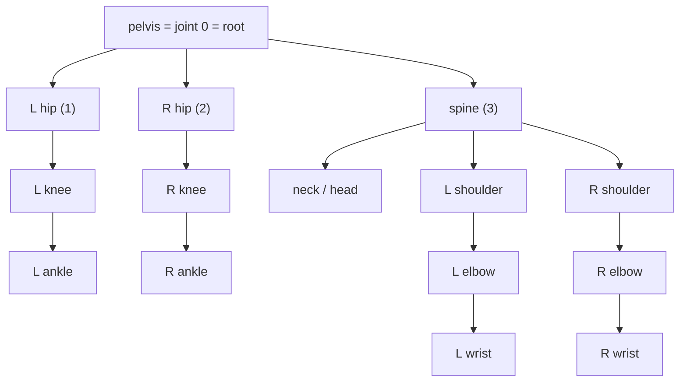
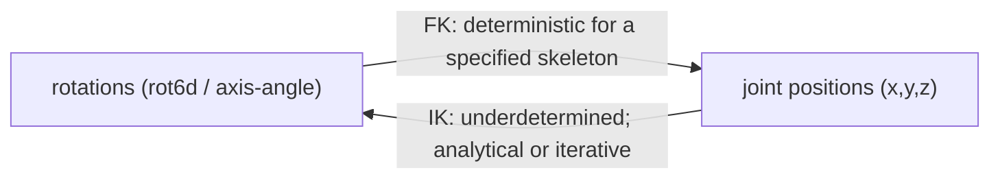

# Lesson 1 -- A single pose: joints, skeletons, and the two languages of the body

> Goal: understand a human pose at one instant, before we add time or text.
> This chapter introduces joints, coordinate frames, rotations, and the operations that connect them.

## 1.1 The body as a tree of joints

The arm contains a chain of joints: shoulder, elbow, wrist, and hand. A shoulder rotation changes the positions of the joints below it. The skeleton is a tree. Its joints have parent-child relationships.

- A joint is a point where body segments connect, such as a shoulder, elbow, or knee. A representation can associate a position and a rotation with it.
- A bone, or segment, is the link between a parent joint and a child joint. Its length is approximately fixed.
- A kinematic tree is the hierarchy of joints. Every joint has one parent, except the root.
- The root joint is the first joint in the tree. It is usually the pelvis.
- A pose is the configuration of the skeleton at one instant. Motion is a sequence of poses.

The root has a global position and orientation. A representation with local rotations describes each other joint's orientation relative to its parent.

In our data, SMPL-X joint 0 is the pelvis. Joint 1 is the left hip, and joint 2 is the right hip. We keep `joints[:22]`, so the pelvis remains joint 0. The skeleton chains start at the root.

HumanML3D-263 stores three root quantities in four scalar channels:

1. The root angular increment: one channel.
2. The root displacement in the ground plane: two channels, for x and z.
3. The root height: one channel, for y.

Thus, the root block has $1 + 2 + 1 = 4$ channels. It does not store a complete root position directly.

The position block stores joints 1-21 in a frame relative to the root's ground position and orientation. It subtracts the pelvis x and z coordinates. It keeps each joint's y coordinate relative to the floor. The pelvis height remains nonzero.

The representation removes the clip's initial absolute ground position and initial absolute orientation. It retains subsequent root displacement, rotation, and height.



A parent rotation affects every descendant. Forward kinematics calculates these effects through the tree.

## 1.2 The two languages for describing a pose

We first compare joint positions with joint rotations. Section 1.2b explains how a representation can combine them.

### Joint positions

A position representation stores `(x, y, z)` for each joint. Joint positions are also called keypoints. They are easy to inspect and plot.

For joint $j$, write its position as:

$$
\mathbf{p}_j = (x_j, y_j, z_j).
$$

Positions alone do not enforce a fixed bone length. A model can place the elbow and wrist 2 metres apart.

For a bone between parent $p$ and child $j$, the length is:

$$
L_j = \|\mathbf{p}_j - \mathbf{p}_p\|.
$$

A model that predicts positions must preserve this length through its data, architecture, or loss.

### Joint rotations

A local rotation specifies a joint frame's orientation relative to its parent frame. A fixed rest pose supplies the reference frames and bone offsets.

The root also needs a global position and rotation. These values place the skeleton in the world.

A rotation representation with fixed bone offsets preserves the bone lengths. Rotations change the bone directions without a change in their lengths. Animation and robotics commonly use this representation. Motion generators can also use it.

A bone direction does not fully specify a rotation. The bone can rotate about its own axis without a change in that direction. This rotation is called twist.

Thus, a local rotation relates two coordinate frames. A bone direction alone cannot determine that relationship.

- The rest pose is the fixed reference configuration, such as a T-pose. It defines the default joint frames.
- A local rotation specifies the orientation relative to the parent frame.
- A world orientation specifies the joint frame's orientation in the global frame.

World orientations follow the composition rule:

`world(joint) = world(parent) * local(joint)`

Here, `*` means rotation composition. This rule forms part of forward kinematics.

For example, bend the elbow 90 deg. Then raise the arm at the shoulder. The forearm changes its world orientation, although the elbow's local rotation remains 90 deg.

The number of degrees of freedom, or DoF, is the number of independent values that specify a configuration. A free rotation in 3D has 3 DoF. A skeleton with J unrestricted joint rotations has approximately `3J` rotational DoF, plus 3 for the root position.

### 1.2b The recorded quantities and the rotation representation

The quantities that a pose representation records are a separate choice from the representation of each rotation.

HumanML3D-263 combines these quantities:

- Joint positions.
- Joint rotations.
- Root and joint displacement quantities.
- Foot-contact flags.

Thus, HumanML3D-263 is a hybrid representation. Lesson 3 explains each channel block.

A single rotation also has several possible representations:

- Euler angles use 3 angles. They have coordinate discontinuities and can produce gimbal lock.
- Axis-angle uses an axis and an angle, represented by 3 numbers. SMPL and SMPL-X use this representation.
- A quaternion uses 4 numbers with unit norm. It has no gimbal lock and supports spherical linear interpolation, or SLERP. The quaternion functions are in `geometry.py`.
- A rotation matrix uses 3x3 entries, or 9 numbers. It specifies the rotation uniquely but has more entries than independent rotational DoF.
- A 6D rotation, or rot6d, stores the first two matrix columns. The decoder reconstructs the third column through a cross product.

HumanML3D-263 stores its non-root joint rotations as rot6d.

> **Paper observation -- Zhou et al., 2019, "On the Continuity of Rotation Representations in Neural
> Networks."** Euler angles and quaternions have discontinuities as rotation representations for neural networks.
> A small change in the physical rotation can require a large change in the representation.
> The paper introduces a continuous 6D representation.

The continuous representation helps a network represent nearby rotations with nearby values. It does not guarantee a valid rotation for every possible set of six output values.

The source and display paths use different operations:

1. The SMPL-X body model converts the source axis-angle pose to joints.
2. Skeleton inverse kinematics derives quaternions from those joints.
3. The representation encoder converts the quaternions to rot6d for storage in HumanML3D-263.
4. The live avatar recovers joints from the root and position channels.
5. An analytical solver derives an SMPL-X axis-angle pose from the recovered joints.
6. The SMPL-X body model converts that pose to a mesh.

The live avatar does not apply the stored rot6d values directly as an SMPL-X pose.

#### How rot6d works

A rotation matrix contains three perpendicular unit columns. Each column specifies the transformed direction of one coordinate axis.

Write the matrix as:

$$
R = [\mathbf{r}_1\ \mathbf{r}_2\ \mathbf{r}_3].
$$

For a valid rotation:

$$
\|\mathbf{r}_1\| = \|\mathbf{r}_2\| = \|\mathbf{r}_3\| = 1,
\qquad
\mathbf{r}_1 \cdot \mathbf{r}_2 = 0,
\qquad
\mathbf{r}_3 = \mathbf{r}_1 \times \mathbf{r}_2.
$$

The third column follows from the first two. Rot6d therefore stores 6 numbers instead of 9.

To encode a rotation:

1. Obtain its rotation matrix.
2. Keep columns 1 and 2.
3. Store their six entries.

A network can produce vectors that are not perpendicular or do not have unit length. The decoder must construct perpendicular unit axes.

The current decoder uses this sequence:

1. Normalize the first vector to obtain the x axis.
2. Calculate the cross product of the x axis and the second vector.
3. Normalize that result to obtain the z axis.
4. Calculate the cross product of the z axis and the x axis to obtain the y axis.

For the two input vectors $\mathbf{a}$ and $\mathbf{b}$:

$$
\mathbf{x} = \frac{\mathbf{a}}{\|\mathbf{a}\|},
\qquad
\mathbf{z} = \frac{\mathbf{x} \times \mathbf{b}}
{\|\mathbf{x} \times \mathbf{b}\|},
\qquad
\mathbf{y} = \mathbf{z} \times \mathbf{x}.
$$

The resulting matrix is:

$$
R = [\mathbf{x}\ \mathbf{y}\ \mathbf{z}].
$$

This construction is equivalent to orthogonalization through the Gram-Schmidt method for nondegenerate inputs.

If the first vector is zero, its normalization divides by zero. If the two vectors are collinear, their cross product is zero. Near these cases, small input errors can cause large rotation errors.

The current `cont6d_to_matrix` function has no protective denominator. It does not repair every possible set of six numbers into a valid rotation.

HumanML3D-263 stores rot6d for 21 joints. The block therefore contains $21 \times 6 = 126$ numbers.

#### Gimbal lock

Euler angles describe three successive rotations about specified axes, such as yaw, pitch, and roll. At some configurations, two axes coincide.

The Euler coordinates then lose one independent rotational direction. They cannot specify three independent local rotation changes at that configuration.

For example, at a camera pitch of 90 deg, yaw and roll can act about the same axis. Near this configuration, a small orientation change can require a large change in the Euler angles.

Rotation matrices, quaternions, and rot6d do not have Euler gimbal lock. Rot6d still has the separate degenerate-input problem described above. This project does not store joint rotations as Euler angles.

> **Paper observation -- SMPL (Loper et al., 2015).** The standard parametric human body model
> represents a pose with axis-angle rotations for each joint and a small shape vector.
> SMPL-X (Pavlakos et al., 2019) adds hands and a face.
> Our source AMASS data uses the SMPL-X release, so it stores the source pose as rotations.

## 1.2c The complete calculation for a 2-joint arm

Consider a planar arm with a shoulder and an elbow. The upper arm has length 30, and the forearm has length 25. The shoulder remains at the origin.

Let $\theta_s$ be the shoulder angle. Let $\theta_e$ be the elbow angle relative to the upper arm.

The elbow position is:

$$
\mathbf{p}_e =
30
\begin{pmatrix}
\cos\theta_s\\
\sin\theta_s
\end{pmatrix}.
$$

The hand position is:

$$
\mathbf{p}_h =
\mathbf{p}_e +
25
\begin{pmatrix}
\cos(\theta_s+\theta_e)\\
\sin(\theta_s+\theta_e)
\end{pmatrix}.
$$

The arm has 2 rotational DoF. The two angles specify those DoF, subject to the usual equivalence of angles separated by a complete turn.

Compare the available choices:

1. The elbow and hand positions need 4 numbers. Arbitrary values can violate the two fixed bone lengths.
2. The hand position needs 2 numbers. It can leave an elbow-up or elbow-down ambiguity.
3. The shoulder and elbow angles need 2 numbers. Together with the fixed lengths, they determine the joint positions.

The fully extended arm has length $30 + 25 = 55$. No angle can increase that length. A requested hand position of `(1000,0)` is outside this arm's reach.

A model that predicts valid rotations can preserve fixed bone lengths through forward kinematics. It does not automatically satisfy anatomical limits or produce plausible motion.

A model that predicts positions must also preserve the skeleton's geometry. Otherwise, it can produce limbs whose lengths change.

Our representation contains positions and rot6d. The live avatar uses inverse kinematics to derive a body pose from recovered positions.

Forward kinematics accumulates rotations and positions through the chain:

```
direction_so_far = 0;  position = (0,0)
direction_so_far += shoulder_angle      # bone 1: inherit nothing, add shoulder
position += 30 * (cos, sin)             #         -> elbow
direction_so_far += elbow_angle         # bone 2: inherit shoulder's turn, add elbow
position += 25 * (cos, sin)             #         -> hand
```

Each bone uses the rotations of its ancestors and its own local rotation. The skeleton functions and the SMPL-X body model calculate this relationship.

The same chain rule applies in 3D, with these differences:

- A 3D rotation has three independent rotational DoF.
- Rotation composition replaces angle addition.
- The order of the rotations matters.

For example, pitch followed by yaw generally differs from yaw followed by pitch. In matrix form:

$$
R_{\mathrm{pitch}}R_{\mathrm{yaw}}
\ne
R_{\mathrm{yaw}}R_{\mathrm{pitch}}.
$$

The hierarchy rule remains:

`rotation(joint) = rotation(parent) * local_rotation(joint)`

Here, `*` means composition. Unlike addition of planar angles, general 3D rotation composition is not commutative.

## 1.3 The conversion between positions and rotations

Forward kinematics and inverse kinematics connect the two pose descriptions.

### Forward kinematics

Forward kinematics, or FK, calculates joint positions from rotations and fixed bone offsets.

1. Start at the root position and orientation.
2. Compose each local rotation with the parent rotation.
3. Rotate the bone offset.
4. Add the offset to the parent position.
5. Repeat through the tree.

The result is deterministic for the specified skeleton, rotations, and root position. The calculation needs one traversal of the tree.

The SMPL-X body model also uses pose and shape parameters to produce joint positions and mesh vertices.

### Inverse kinematics

Inverse kinematics, or IK, calculates rotations from target joint positions.

Positions can leave some rotations undetermined. A wrist position alone does not determine the forearm twist. Different rotations can produce the same target position.

A solver must choose a solution through additional rules or constraints. Poor choices can cause abrupt changes between frames.

IK does not always require iterative optimization. The skeleton IK in this project is analytical. The live SMPL-X pose solver is also analytical.

A separate SMPL-X fit path uses iterative optimization. That path is not the solver that the live avatar calls.



The preprocessing path uses both IK and FK. The live avatar first solves rotations from recovered joints. The body model then uses those rotations to produce the mesh.

Thus, the presence of rot6d in the motion vector does not remove the need for IK in this project.

## 1.4 Coordinate frames

A joint position or rotation has meaning only with a specified coordinate frame. The same physical pose can have different coordinates in different frames.

- The world frame is a fixed global coordinate system. A world position specifies a joint's position relative to its origin and axes.
- The local frame is the parent joint's coordinate frame. A local rotation specifies the orientation relative to that frame.
- A root-relative frame uses the root as a reference. The exact position and orientation conventions depend on the representation.
- The up-axis convention specifies which coordinate axis points upward.

A floor-based world frame can place its origin on the floor. Its horizontal axes can have specified directions, such as north and east.

HumanML3D-263 uses a specific root-relative convention. It subtracts the root x and z coordinates and expresses the joints relative to the root orientation. It keeps y coordinates relative to the floor.

Thus, “root-relative” does not mean that every pelvis coordinate is zero. The pelvis height remains part of the representation.

AMASS uses Z-up coordinates. Our representation uses Y-up coordinates. The extraction stage converts the coordinates before the representation encoder uses them.

An incorrect up-axis interpretation can place the body on its back.

> **Paper observation -- HumanML3D (Guo et al., CVPR 2022).** The representation removes the initial root position in the ground plane.
> It also rotates the initial body orientation to a common direction.
> Joint positions then use the root-relative convention described above.

A change to the initial absolute ground position or yaw does not change the retained motion description under this convention. Subsequent displacement and rotation remain in the representation.

## 1.5 What to remember from Chapter 1

1. The skeleton is a tree with the pelvis as its root. Parent rotations affect descendant positions.
2. Positions specify joint locations. Valid rotations and fixed bone offsets preserve bone lengths through FK.
3. FK calculates positions from rotations. IK solves rotations from positions and can use an analytical or iterative method.
4. Each position and rotation needs a coordinate frame. HumanML3D-263 keeps joint heights relative to the floor.

### Questions to answer before Lesson 2

1. What impossible change in bone length can a position model produce? How do valid rotations with fixed offsets prevent it?
2. Which operation converts an SMPL-X rotational pose to joint positions? Which operation first derives the live avatar pose from recovered joints?
3. Explain why a Y-up or Z-up convention changes the interpretation of the coordinates.

### Lesson 2 preview

Lesson 2 adds time to a pose sequence. It explains the frame rate, the choice of 20 fps, and velocity. Lesson 3 explains the 263 channels for positions, rotations, velocities, and foot contacts.

## 1.6 Results of the implementation check

The current code confirms the representation and display paths described in this lesson. These are implementation facts, not measurements of motion quality.

- `src\text2motion\motion\amass.py` evaluates the source SMPL-X body model, selects the body joints, and converts the coordinates to Y-up.
- `src\text2motion\motion\representation.py` treats joint 0 as the root and defines its block as channels 0-3.
- `encode_joints` uses skeleton IK to obtain quaternions and converts them to rot6d. It subtracts root x and z, but preserves floor-relative y.
- `src\text2motion\motion\geometry.py` contains the quaternion functions and `cont6d_to_matrix`. The rot6d decoder divides by vector norms without a protective denominator.
- `src\text2motion\motion\kinematics.py` contains the analytical skeleton IK and the skeleton FK functions.
- `src\text2motion\studio\avatar.py` calls `solve_smplx_pose_from_joints` for the live avatar.
- `src\text2motion\studio\fitting.py` contains that analytical solver and the separate iterative function `fit_smplx_to_joints`.

The live solver derives axis-angle rotations from the recovered joints. The SMPL-X body model then produces the mesh. The stored rot6d block is not a direct SMPL-X pose input.
