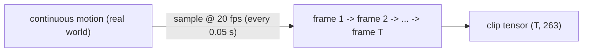
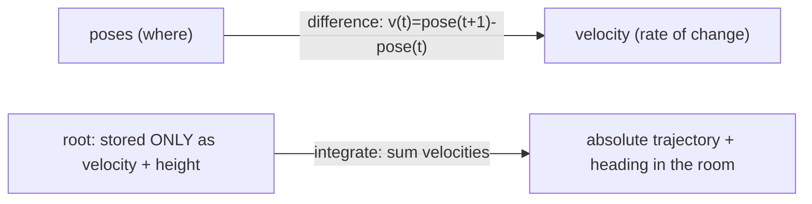

# Lesson 2 -- From a pose to *motion*: time, frame rate, and velocity

> Goal: describe motion as a sequence of poses. Explain the time axis, the frame rate, and the velocity between frames.

## 2.1 Motion is a sequence of poses sampled in time

A pose describes the body at one instant. A motion clip contains an ordered sequence of poses. Each frame describes one pose. The frames have equal time intervals.

Definitions:

- A **frame** is one pose at one instant.
- The **frame rate**, in frames per second (fps), specifies the number of frames in one second.
- **Sampling** replaces continuous time with a finite set of instants.
- A **sequence**, or **clip**, is an ordered set of frames.

At 20 fps, the interval between frames is 0.05 s:

$$
\Delta t = \frac{1}{f_s} = \frac{1}{20} = 0.05\ \mathrm{s}.
$$

Here, $f_s$ is the frame rate. Frame $k$ has the time $t_k = k\Delta t$, if the first frame has the time zero.

A motion clip has the tensor shape `(T frames, per-pose numbers)`. Our representation has the shape `(T, 263)`, where $T$ is the number of frames.

The captioned training dataset uses default limits of 40-196 frames, or approximately 2-10 s at 20 fps. These limits do not describe every stored clip. The evaluation dataset uses a separate length rule. Section 2.6 gives the implemented rules.

## 2.2 How finely must we sample? (why 20 fps is enough)

Motion capture records poses at 60-120 fps. The standard HumanML3D representation uses 20 fps. A lower frame rate reduces the number of frames that the model must process.

A signal with a frequency $f$ needs a sample rate above $2f$ for faithful recovery under the sampling assumptions:

$$
f_s > 2f.
$$

At 20 fps, this condition gives:

$$
f < 10\ \mathrm{Hz}.
$$

A component above this limit can appear as a lower-frequency component in the sampled data. This error is called **aliasing**.

Large body movements, such as steps, turns, and changes from a standing pose to a seated pose, have frequencies well below 10 Hz. The extra 60-120 fps in mocap mostly captures sensor jitter and micro-vibration
at the body-joint level, not meaningful action. So 20 fps keeps the action and drops the noise -- and
it is the **field standard**, so our numbers stay comparable.

Some fast events contain frequencies that 20 fps cannot represent. Examples include the rapid end of a boxing jab and the instant when two hands clap. The data loses this detail before the model receives it.

A higher frame rate in the display cannot recover the lost detail. Recovery needs a representation with a higher frame rate and a model trained on that representation.

> **Paper observation: HumanML3D (Guo et al., 2022).** The standard pipeline resamples all motion to 20 fps. T2M-GPT, MoMask, and Mogo train and report at 20 fps. This common rate supports comparisons between methods.

## 2.3 Velocity: the rate of change between frames

A finite difference measures the change between consecutive frames:

`velocity(t) = pose(t+1) - pose(t)`

For a joint position $p_t$, the displacement per frame is:

$$
v_t = p_{t+1} - p_t.
$$

The velocity in distance units per second is:

$$
u_t = \frac{p_{t+1} - p_t}{\Delta t}.
$$

In this lesson, **velocity** means the stored displacement per frame unless the text specifies units per second. The position describes where a joint is. The velocity describes its change between frames.

The representation includes velocity for three reasons:

1. A velocity loss penalizes incorrect changes between frames. It can penalize jitter even when each pose appears plausible.
2. The root channels store planar displacement and a turn increment instead of an absolute planar position. The decoder recovers the trajectory from these increments.
3. The velocity distinguishes motions that pass through the same pose with different directions of movement.

For example, a joint can pass through the same position during upward motion and downward motion. The position is equal in both cases. The vertical velocities have opposite signs.

**Integration** recovers a position from an initial position and the subsequent displacements:

`position(t) = position(0) + sum of velocities up to t`

For displacements in a common coordinate system:

$$
p_t = p_0 + \sum_{i=0}^{t-1} v_i.
$$

The decoder also recovers the root orientation. It converts the stored local planar displacements to world coordinates before it accumulates them.

The root representation also includes the pelvis height. Thus, the representation describes vertical position directly and planar movement through increments. It does not store the original absolute planar location.

## 2.4 Why a sequence is more than "many poses"

A motion model must describe relations between frames. A model that treats each pose independently cannot check those relations.

The main requirements are:

- **Temporal coherence:** Frame `t+1` must agree with frame `t`. A foot that remains on the floor must not jump to another position. The limbs must not change abruptly.
- **Foot sliding (foot skate):** A foot that has floor contact moves across the floor while the body moves. Individual poses can appear correct even when this error occurs.
- **Dynamics and momentum:** Changes in velocity must agree with the motion. An abrupt reversal can produce an implausible acceleration.

A finite difference also describes acceleration. For equal frame intervals:

$$
a_t = \frac{p_{t+2} - 2p_{t+1} + p_t}{\Delta t^2}.
$$

This expression needs three consecutive positions. A single pose cannot specify it.

The representation has four foot-contact channels among its 263 channels. These channels describe contact states. They help the model learn when the feet have floor contact.

The default foot loss measures the L1 error between the predicted and reference contact channels:

$$
L_{\mathrm{foot}} = \operatorname{mean}\left|c_{\mathrm{pred}} - c_{\mathrm{ref}}\right|.
$$

Here, $c$ contains the four contact channels. This loss penalizes incorrect contact predictions. It does not directly penalize foot movement across the floor.

The implementation has a separate optional `foot_skate` loss. It penalizes the planar displacement of a predicted foot during reference contact. Section 2.6 gives the default state of this loss.

> **Paper observation: foot contacts (Guo et al., 2022).** HumanML3D includes binary heel/toe contact labels in the feature vector. These four channels help models learn when a foot has floor contact and avoid foot skate.

## 2.4b Design sidebar: "can we sample per action / raise fps?" (a defense answer)

Different actions have different speeds. A separate frame rate for each action category changes the duration that one frame represents.

The current representation assumes one fixed frame rate. At 20 fps, one frame always represents an interval of 0.05 s.

The following components depend on this interval:

- The velocity channels.
- The foot-contact logic.
- The tokenizer's /4 downsample.
- The generator's prediction at each step.
- The frozen Guo evaluator.

The tokenizer maps four frames to one token step. At 20 fps, this gives:

$$
\Delta t_{\mathrm{token}} = 4\Delta t = 4 \times 0.05 = 0.2\ \mathrm{s}.
$$

Different frame rates would give different durations for the same token step. They would also change the meaning of each stored displacement.

The frozen Guo evaluator expects the standard 20-fps representation. A direct comparison with its baseline FID values requires the same time convention.

The valid options keep one frame rate within each model:

- Use one consistent frame rate for each complete representation and model.
- Train a separate model entirely at 30 fps for an ablation. Report its results separately from the 20-fps comparison.
- Use a higher frame rate for the demo display. Separate the display rate from the rate of the generated motion.
- Use the native motion capture rate as the limit for recorded detail. Additional interpolated frames contain no new recorded information.

The implemented generator produces motion at 20 fps. The studio uses interpolation to display that motion at 120 fps. These are separate rates within the same display pipeline, not separate frame rates for different actions.

A higher display rate can make the motion appear smoother. It cannot restore a fast event that the 20-fps data does not contain.

The dataset also limits the range of actions. HumanML3D captions describe actions such as:

- Locomotion.
- Changes to a seated pose.
- Jumps.
- Kicks.
- Punches.
- Waves.
- Dance.

The dataset has few or no examples of some other actions:

- Fine hand manipulation.
- Object interaction.
- Sports technique.
- Motion with multiple people.

A wider action range needs more captioned data or different captioned data. A different frame rate alone does not supply these examples.

## 2.5 What to hold onto from Lesson 2

1. Motion is a sequence of poses on a time grid. Our representation has the shape `(T, 263)` at 20 fps.
2. Frame rate caps the **fastest motion you can record** (~half the fps); 20 fps keeps body action,
   drops jitter, and matches the field.
3. Velocity describes a change per frame. It supplies a loss target, represents root movement, and distinguishes directions of movement.
4. Integration recovers the root trajectory from its increments.
5. Temporal coherence, foot skate, and acceleration depend on relations between frames. A single pose does not describe these relations.

### Questions to answer before Lesson 3

1. Explain which motion detail a reduction from 120 fps to 20 fps can lose.
2. Give one reason to store `pose(t+1) - pose(t)` explicitly.
3. Explain why a single pose cannot show whether a foot moves during floor contact.
4. Distinguish the default foot-contact loss from the optional `foot_skate` loss.
5. Explain why a 120-fps display cannot restore detail absent from 20-fps motion.

### Looking ahead (Lesson 3 preview)

Lesson 3 explains the channel groups in the 263 vector:

- Root movement and height: 4 channels.
- Joint positions / ric: 63 channels.
- Joint rotations / rot6d: 126 channels.
- Local velocities: 66 channels.
- Foot contacts: 4 channels.

The channel counts give:

$$
4 + 63 + 126 + 66 + 4 = 263.
$$

Each group connects the concepts in Lessons 1 and 2 to a specific part of the representation.

## 2.6 Implemented settings and results

The following settings come from the current code. They describe the implemented pipeline, not measured model performance.

The captioned training dataset uses these default limits:

- `MotionDataConfig.min_motion_len`: 40 frames.
- `MotionDataConfig.max_motion_len`: 196 frames.

The loader crops a selected captioned segment if it exceeds the maximum length. These limits do not restrict the lengths of every file on disk.

The evaluator applies a separate rule to each captioned piece:

$$
40 \leq T < 200.
$$

It then truncates the accepted piece to a multiple of the tokenizer's downsample factor. The rules appear in `src\text2motion\evaluation\evaluator.py` and `src\text2motion\evaluation\contracts.py`.

The representation defines `FPS = 20` in `src\text2motion\motion\representation.py`. The studio defines `StreamDisplayConfig.upsample = 6` in `src\text2motion\studio\config.py`. The resulting display rate is:

$$
f_{\mathrm{display}} = 6 \times 20 = 120\ \mathrm{fps}.
$$

The studio interpolates the fitted pose parameters in `src\text2motion\studio\avatar.py`. The display rate does not change the rate of the generated representation.

The generator defines these default loss weights in `src\text2motion\generation\contracts.py`:

- `foot = 0.1`: the contact-channel L1 loss is active.
- `foot_skate = 0.0`: the explicit foot-skate loss is inactive.

The loss implementations appear in `src\text2motion\generation\losses.py`. The default foot term therefore measures contact error, not foot-skate displacement.
