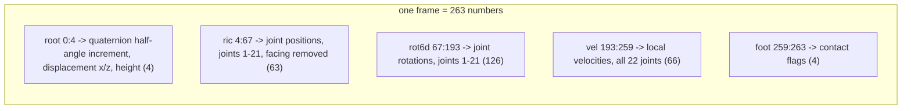
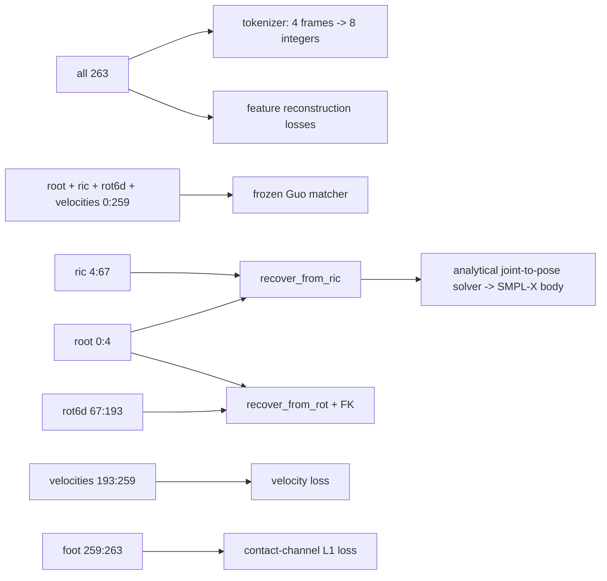

# Lesson 3 -- Opening the 263 vector, slice by slice

> Goal: connect the concepts from Lessons 1-2 to the 263 channels.
> Identify each channel, its purpose, and the concept that it represents.
> The layout follows `representation.py`, in the concatenation block of `encode_joints`.

## 3.0 The picture

Each frame contains five blocks:

1. The root block contains 4 numbers.
2. The ric block contains 63 numbers.
3. The rot6d block contains 126 numbers.
4. The local velocity block contains 66 numbers.
5. The foot-contact block contains 4 numbers.

Their total is `4 + 63 + 126 + 66 + 4 = 263`.

The root block stores motion increments and height. It does not store an absolute horizontal position. The ric and rot6d blocks exclude the pelvis, so each block describes 21 joints.

## 3.1 The exact layout (per frame, 22 joints)

| Slice | Size | Name | Language (Lesson 1) |
|------:|-----:|------|---------------------|
| `[0:1]`     | 1   | root angular velocity: quaternion half-angle increment about the vertical axis | rotation / velocity |
| `[1:3]`     | 2   | root linear velocity: displacement per frame in the ground plane x, z | velocity |
| `[3:4]`     | 1   | root height above the floor (y) | position |
| `[4:67]`    | 63  | ric: positions of joints 1-21; pelvis-relative x/z, floor-relative y, heading removed | positions (A) |
| `[67:193]`  | 126 | rot6d: rotations of joints 1-21 | rotations (B) |
| `[193:259]` | 66  | local velocities: displacement per frame for all 22 joints | velocity |
| `[259:263]` | 4   | foot-contact flags (2 left, 2 right) | contacts |

`1 + 2 + 1 + 63 + 126 + 66 + 4 = 263`.

The code uses the name “velocity” for displacement per frame. These channels do not store metres per second. Channel `[0]` does not store ordinary yaw radians per second.

## 3.1a What "ric" means (read this before the table)

ric means Rotation-Invariant Coordinates. This block stores joint positions, which are Language A in Lesson 1. The function `root_relative_positions` in `representation.py` removes the horizontal root position and the heading.

The function applies these steps:

1. Subtract the pelvis x coordinate from each joint x coordinate.
2. Subtract the pelvis z coordinate from each joint z coordinate.
3. Keep each joint y coordinate above the floor.
4. Rotate the coordinates into the frame with the heading removed.
5. Store the positions of joints 1-21.

For joint k, the coordinates before the rotation are:

$$
\tilde p_k = (x_k-x_0,\ y_k,\ z_k-z_0).
$$

Here, joint 0 is the pelvis. The function does not subtract the pelvis height. Thus, ric positions are pelvis-relative in x/z and floor-relative in y.

The heading removal lets the model use the same local position description for an action with different horizontal directions. The root angular-velocity channel stores the change in heading separately.

A yaw rotation of a clip preserves its ric positions after the heading removal. A horizontal translation also preserves them. A vertical translation has a different meaning because y describes height above the floor.

The root and ric blocks describe different quantities:

- `[0:3]` describes changes in the pelvis heading and horizontal position.
- `[3]` describes the pelvis height above the floor.
- `[4:67]` describes the other joints with pelvis-relative x/z and floor-relative y.

The vector does not store the original horizontal position or absolute heading. Recovery accumulates the root increments to obtain a trajectory in the canonical frame.

## 3.1b Which value belongs to which joint (the "which is which" map)

The skeleton has 22 joints, with indices 0-21. Joint 0 is the pelvis and the root.

The root block stores the pelvis motion and height. The ric and rot6d blocks store the other joints. The local velocity block includes the pelvis.

| Block | Index range | Which joints | Per joint |
|------|------------|--------------|-----------|
| root (pelvis) | `[0:4]`     | joint 0 only | `[0]` half-angle increment; `[1:3]` ground displacement; `[3]` height |
| ric positions | `[4:67]`    | joints 1-21 (21) | 3 numbers; pelvis-relative x/z, floor-relative y |
| rot6d rotations | `[67:193]`| joints 1-21 (21) | 6 numbers |
| local velocities | `[193:259]` | all 22 (0-21) | 3 numbers |
| foot contacts | `[259:263]` | foot joints | 4 binary flags |

The pelvis is absent from ric because the root block already supplies its position for recovery. Its horizontal ric coordinates are zero, but its height is generally nonzero.

The pelvis rotation is absent from rot6d because recovery reconstructs it from channel `[0]`. Both blocks therefore contain 21 joints.

To find joint k, where k is 1..21, use `[4 + (k-1)*3 : 4 + (k-1)*3 + 3]`. The left hip, joint 1, uses `[4:7]`.

To recover the pelvis trajectory, accumulate channel `[0]` and the displacements in `[1:3]`. Use the recovery functions to apply the correct rotation convention.

## 3.2 Reading it (each block ties back to a concept)

### Root block `[0:4]`

The root block contains:

- A quaternion half-angle increment.
- Two horizontal displacements per frame.
- The pelvis height above the floor.

Channel `[0]` comes from the arcsine of the relative quaternion y component. Recovery accumulates this value and constructs a quaternion.

For frame t, let a be the value in channel `[0]`. The recovery calculation uses:

$$
\alpha_0=0,\qquad
\alpha_t=\sum_{i=0}^{t-1}a_i,
\qquad
q_t=(\cos\alpha_t,\ 0,\ \sin\alpha_t,\ 0).
$$

A quaternion uses a half-angle in its sine and cosine components. Thus, a stored increment is not an ordinary yaw increment.

Recovery rotates the horizontal displacements with the inverse root quaternion, then accumulates them. It takes the vertical coordinate directly from `[3]`.

The initial horizontal root position is zero in the recovered frame. The vector cannot restore an arbitrary original horizontal offset or initial heading.

### ric `[4:67]`

This block stores the positions of joints 1-21 after removal of the horizontal root position and heading. The y coordinates remain floor-relative.

The block size is `21 x 3 = 63`.

The function `recover_from_ric` restores the heading and adds the horizontal root position. It then inserts the pelvis from the root block.

These positions support joint plots and geometric losses. The matcher also consumes this block, together with other feature blocks.

### rot6d `[67:193]`

This block stores the local rotations of joints 1-21 in the continuous six-number representation from Lesson 1. The block size is `21 x 6 = 126`.

Preprocessing derives these rotations from joint positions through inverse kinematics. The function `recover_from_rot` combines them with the recovered root rotation and applies forward kinematics.

The live SMPL-X avatar does not apply this block directly as its pose. It uses joints from ric recovery and an analytical solver to obtain the SMPL-X pose.

### Local velocities `[193:259]`

This block stores local displacement per frame for all 22 joints. Its size is `22 x 3 = 66`.

The encoder calculates a difference between consecutive joint positions and removes the heading. These values describe changes in the pose and supply a target for the velocity loss.

### Foot contacts `[259:263]`

This block contains four binary flags, with two flags per foot. The encoder compares the squared displacement of each selected foot joint with a threshold.

A small displacement produces a contact flag. This test supplies a contact estimate; it does not directly test the distance above the floor.

The default foot loss is L1 error on these contact channels. A separate, optional foot-skate loss penalizes horizontal foot motion during reference contact.

## 3.3 The deliberate redundancy (an important insight)

The vector stores joint positions, joint rotations, and local velocities. These quantities overlap because forward kinematics converts rotations into positions, and position differences give velocities.

Each block supports a different calculation:

- The ric block supports direct recovery of joint positions and position losses.
- The rot6d block supports recovery through forward kinematics with a skeleton.
- The local velocity block supplies targets for changes between frames.
- The contact block supplies targets for foot-contact estimates.

The frozen matcher consumes channels `[0:259]`. These channels include the root, ric, rot6d, and local velocity blocks. It excludes the four contact channels.

The 263 vector is the hybrid representation from Lesson 1.2b. The tokenizer encodes all five blocks, so the token targets contain information from each block.

## 3.3a Who reads which slice (the system view)

The selected tokenizer produces eight integers for each group of four frames. Each integer has 1024 possible values.

The matcher uses the first 259 channels. The live avatar uses recovered joints. The loss functions compare the relevant feature blocks and can also compare recovered geometry.

## 3.4 Where the 263 sits in the whole system

The modules use the vector as follows:

1. The tokenizer compresses `(T, 263)` into discrete tokens.
2. The generator predicts tokens that the tokenizer decodes into `(T, 263)`.
3. The evaluator converts the features to its Comp_v6 normalization and supplies them to the frozen matcher.
4. The studio recovers joints from the root and ric blocks, then solves the SMPL-X pose analytically.

The selected tokenizer uses eight groups, with levels `[8,8,4,4]` in each group. Each group has `8 x 8 x 4 x 4 = 1024` possible values.

The latent width is `8 x 4 = 32`. The temporal reduction factor is four, so four motion frames correspond to eight integers.

The historical configuration with six integers and 1000 possible values remains available. It is not the selected tokenizer configuration.

## 3.4b How we KNOW the 263 is correct (the misinterpretation fear)

A wrong channel order, unit, coordinate frame, or vertical axis can invalidate a result. A decrease in loss does not establish a correct representation.

The checks address separate properties:

1. Compare the constants and concatenation order in `representation.py` with the official HumanML3D implementation.
2. Check the features for non-finite values, absent channels, and unexpected ranges.
3. Encode joints with `encode_joints`, then recover them with `recover_from_ric`.
4. **Cross-path agreement** (rules out rot6d vs position inconsistency): `recover_from_ric`
   (positions) and `recover_from_rot` (rot6d + FK) must rebuild the *same* skeleton -> validates the
   **rot6d** block against the position block.
5. Check the frozen Guo matcher on reference motions and compare its outputs with reference measurements.

The round-trip target is the canonicalized, retargeted joint sequence from the encoder. It is not the untouched input sequence.

The encoder changes the skeleton proportions, removes the floor offset, and sets the initial horizontal position and heading. Recovery must reproduce that encoded geometry.

A source sequence with T frames produces T-1 feature frames. The last source frame supplies the final displacement but has no separate feature frame.

A low round-trip error checks the root and ric path. It does not independently establish correct rot6d, local velocity, or contact values.

### Published definition of the layout

The 263 specification comes from **Guo et al., CVPR 2022** (HumanML3D). Follow-up work describes the same composition, for example MotionStreamer, arXiv:2503.15451.

The published composition is `4 root + (J-1)*3 ric + (J-1)*6 rot6d + J*3 vel + 4 foot`. For J=22, this gives `4+63+126+66+4 = 263`.

These blocks correspond to the slices in `representation.py`: `[0:4] [4:67] [67:193] [193:259] [259:263]`.

The code header identifies the reference file: `.../HumanML3D/blob/main/motion_representation.ipynb`. The source comparison establishes the intended layout.

A matcher result checks compatibility with a learned feature representation. It cannot establish the meaning of every channel, especially contacts, which the matcher excludes.

### Definitions

A round-trip test encodes a sequence, decodes it, and compares the result with the correct encoded target. This test checks consistency for the recovery path under test.

An external oracle is an independent component that checks a property of the output. Here, the frozen matcher checks motion and text embeddings.

### Visual checks

Inspect a recovered clip with a known caption. Check the trajectory, joint positions, and foot motion separately.

Inspect the rotation recovery path to check bends from rot6d. The live avatar instead checks the recovered joints and the analytical SMPL-X pose solver.

The aitviewer studio supports visual checks and the demonstration. A plausible display supplements numerical checks but does not establish that every channel is correct.

## 3.4c "Why not model rot6d only, positions for loss?" (a real research axis)

A rotation-only tokenizer can encode rot6d and use positions as loss targets. This is a separate representation experiment.

The current generator predicts discrete tokens. However, the tokenizer encodes all 263 channels, so its token targets also depend on positions, velocities, and contacts.

The geometric losses add supervision after soft decode. They do not make the current tokenizer rotation-only.

The choice has these consequences:

- A rotation-only representation preserves bone lengths through forward kinematics, but errors can accumulate along a joint chain.
- A position-only representation gives direct joint targets, but it can violate bone lengths and require projection onto a skeleton.
- The 263 hybrid representation supplies positions, rotations, local velocities, and contacts.

QuaterNet, Pavllo et al., arXiv:1805.06485 discusses rotation representations and error accumulation through forward kinematics. A small rotation error near the spine can produce a larger position error at the hand.

A loss on local rotations can weight joints equally without equal effects on the final joint positions. A position loss directly measures those effects.

"Absolute Coordinates Make Motion Generation Easy" (Meng et al., arXiv:2505.19377) argues that local-relative pelvis representations cause global drift. It proposes absolute joint coordinates as an alternative.

HumanML3D also derives rotations through inverse kinematics. Its root rotation uses one scalar about the vertical axis, with the half-angle convention described in sec. 3.2.

The thesis keeps the 263 representation for compatibility with the frozen matcher. Compatibility of the feature layout alone does not establish comparability of evaluation protocols.

A rot6d-only tokenizer remains a possible ablation. We expect a higher reconstruction FID because errors through forward kinematics affect the positions that the matcher consumes.

This expectation is a hypothesis, not a measured result. A valid comparison must reconstruct the full matcher input, including rotations and velocities.

The thesis studies the tokenizer and generator. It cites alternative representations without a claim that the representation question is settled.

## 3.5 What to hold onto

1. The layout is `root(4) + ric positions(63) + rot6d rotations(126) + local velocities(66) + foot(4) = 263`.
2. The root stores a quaternion half-angle increment, horizontal displacements per frame, and height.
3. The ric block uses pelvis-relative x/z and floor-relative y, with the heading removed.
4. The tokenizer encodes all 263 channels; the matcher consumes `[0:259]`.
5. The live SMPL-X avatar uses recovered ric joints and an analytical pose solver.

### Questions before Lesson 4

1. How do the recovery functions obtain a trajectory from the root increments?
2. Which coordinates in ric are pelvis-relative, and which coordinate remains floor-relative?
3. Which function recovers positions directly, and which function uses rot6d with forward kinematics?
4. Which feature blocks does the frozen matcher consume?
5. How does the live studio obtain the SMPL-X pose from the decoded vector?

### Looking ahead (Lesson 4 preview)

Lesson 4 explains how the tokenizer converts continuous motion features into discrete integers. The generator then predicts those integers instead of direct feature values.

## 3.6 Results and limits

This section contains the reported measurements. The code establishes the implementation details; the supplied findings provide the numerical reports below.

### Feature checks

The earlier report records:

- 0 non-finite values.
- 0 absent items across the splits.
- A normalized mean of approximately 0.03.
- A normalized standard deviation of approximately 1.03.
- A minimum channel standard deviation of 0.014.

These aggregate values do not establish correct units or semantics for every channel. They also do not imply unit variance for each channel.

### Root and ric recovery

The reported round-trip L1 error is 0.0000. Its target is the canonicalized, retargeted encoded joints, with the last source frame excluded.

This result concerns the root and ric recovery path. It does not establish recovery accuracy for every feature block.

### Frozen matcher checks

The earlier report gives R@1 0.514 against a published value of 0.511. It also reports a correlation of 0.99997 between the channel means and the official evaluation statistics.

The protocol-path check from 2026-11-02 sends real test motion through our evaluation path. It reports these values against the published real-motion row:

- R@3: 0.799 against 0.797.
- Diversity: 9.505 against 9.503.
- MM-Dist: 2.964 against 2.974.

These measurements support compatibility with the matcher input. They do not independently establish the correctness of all 263 channels.

### Protocol limits

The changes for the official 4,648-sample generation population remain drafted, not applied. The Diversity and MultiModality seed fixes also remain drafted.

The current evaluation code selects base clip identifiers. It does not yet implement the complete official generation population.

Tokenizer reconstruction evaluation measures decoded versions of reference motions. Generation evaluation measures motions that the generator produces from text.

These evaluations use different populations and procedures. A tokenizer reconstruction result does not establish compliance with the official generation protocol.

The numerical reports above are supplied findings. Their cited STATUS entry is unavailable in this checkout, so the measurements are not independently verified here.
