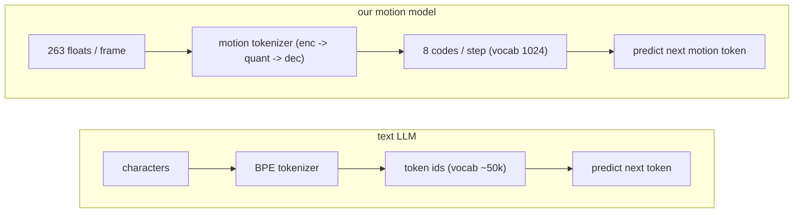

# Lesson 4 -- From motion to tokens: the tokenizer (Contribution A)

> Goal: connect the motion representation in Lessons 1-3 to a model that generates motion.
> The tokenizer converts each continuous motion sequence into a sequence of discrete integers.

## 4.1 Why not just generate the 263 floats directly?

A model can predict 263 continuous values for each frame. This project instead uses discrete motion tokens for these reasons:

1. A regression loss can favor the average of several possible motions. The average can lose motion detail.
2. An autoregressive model predicts the next token from previous tokens. A fixed vocabulary makes this task a classification problem.
3. Token sequences support cross-entropy, token selection, and classifier-free guidance (CFG). Transformers use a KV-cache; state-space models use a recurrent state.

Let $x_t \in \mathbb{R}^{263}$ denote the motion features at frame $t$. A continuous model predicts $\hat{x}_t$ directly.

The tokenizer instead produces discrete indices $z_s$ at token step $s$. The generator predicts these indices from the text condition $c$ and previous indices:

$$
p_\theta(z_s \mid z_{<s}, c).
$$

The decoder converts the predicted indices into motion features. The tokenizer therefore determines which motion features the generator can express through its tokens.

## 4.2 The token interface

A text model and a motion model both accept discrete token indices. Their tokenizers operate on different inputs and use different methods.

| Text model | Motion model |
|---|---|
| characters | 263 floats per frame |
| BPE tokenizer | motion tokenizer (Contribution A) |
| token vocabulary (~50k) | fixed vocabulary (8 x 1024 codes) |
| next text token | next motion token |

BPE divides text into subword tokens. The motion tokenizer uses a learned encoder, a quantizer, and a learned decoder.

The selected tokenizer produces eight indices at each token step:

$$
z_s = (z_{s,1}, \ldots, z_{s,8}), \qquad z_{s,g} \in \{0,\ldots,1023\}.
$$

The generator uses one output head for each group. Lesson 8 introduces its autoregressive objective.

## 4.3 What the tokenizer is: encoder -> quantizer -> decoder

The networks are in `src\text2motion\tokenization\nn_model.py`. The quantizers are in `src\text2motion\tokenization\nn_quantizers.py`.

The tokenizer has three parts:

1. The encoder converts the motion features into a continuous latent sequence.
2. The quantizer converts each latent vector into discrete indices.
3. The decoder converts the selected code vectors into reconstructed motion features.

Let $E$ denote the encoder, $Q$ the quantizer, and $D$ the decoder:

$$
h = E(x), \qquad q = Q(h), \qquad \hat{x} = D(q).
$$

The encoder uses two convolution stages with stride 2. Their combined downsample factor is 4:

$$
S = T/4.
$$

Here, $T$ is the number of frames and $S$ is the number of token steps. A 196-frame clip produces 49 token steps.

The network requires a positive frame count divisible by 4. The frozen wrapper removes excess final frames before it calls the encoder.

The decoder restores the frame rate and produces 263 features per frame. The generator also uses it for the soft-decode loss.

Use these definitions consistently:

- A code vector is a discrete vector that the quantizer selects.
- A token index identifies a code vector.
- A vocabulary is the set of possible token indices.
- A learned codebook stores code vectors that change during tokenizer training.
- An FSQ grid defines code vectors without a learned codebook.
- The downsample factor is the number of frames per token step.
- Reconstruction means an encoder, quantizer, and decoder pass on an existing motion sequence.

A larger downsample factor reduces the sequence length for the generator. It also reduces the temporal resolution of the latent sequence.

## 4.4 The quantizer options

Quantizers differ in their code vectors and their method of latent conversion:

1. Plain VQ-VAE selects the nearest vector from one learned codebook. Some code vectors can remain unused.
2. VQ with EMA and dead-code reset updates code vectors through an exponential moving average. A reset replaces unused code vectors.
3. Residual Vector Quantization (RVQ) uses several learned codebooks. Each level quantizes the residual from previous levels.
4. Grouped or Product VQ divides a latent vector into groups. Each group uses a separate learned codebook.
5. Finite Scalar Quantization (FSQ) uses a fixed scalar grid for each latent dimension. It has no learned codebook.
6. LFQ uses binary scalar values. Its implicit vocabulary can be large.

The published context and numerical comparisons appear in section 4.4c at the end.

### RVQ mechanics (the baseline)

RVQ represents a latent vector as a sum of code vectors. Let $h$ be the encoder latent and $C_r$ the codebook at level $r$:

$$
r_0 = h, \qquad
c_r = \operatorname*{argmin}_{c \in C_r}\|r_{r-1}-c\|_2^2,
\qquad
r_r = r_{r-1}-c_r.
$$

For the historical six-level configuration:

$$
q = c_1+c_2+c_3+c_4+c_5+c_6.
$$

Follow the residual sequence:

1. Select the nearest code vector from codebook 1.
2. Subtract that code vector from the latent vector.
3. Select the nearest code vector for the residual from codebook 2.
4. Repeat the process for all six levels.
5. Add the selected code vectors.
6. Pass their sum to the decoder.

The six indices form one token step. Early levels describe coarse motion; later levels describe residual detail.

The RVQ baseline also uses:

- Codebook EMA to update the learned code vectors.
- Dead-code reset to replace unused code vectors.
- A commitment loss to keep the encoder latent close to the selected code vectors.
- Quantization dropout to omit later levels during training.

### FSQ mechanics (the selected method)

FSQ bounds each latent scalar, rounds it to a grid value, and normalizes the result. A straight-through estimator supplies the gradient.

The implementation uses `round_straight_through`. The grid dimensions determine the vocabulary size:

$$
V = \prod_{i=1}^{d} L_i.
$$

Here, $d$ is the number of dimensions per group and $L_i$ is the number of levels in dimension $i$.

The selected levels are [8,8,4,4]:

$$
V = 8 \times 8 \times 4 \times 4 = 1024.
$$

The historical levels (8,5,5,5) produce 1000 codes. That configuration remains part of the earlier experiments.

**No codebook is learned**,
so none of RVQ's machinery (EMA / reset / commitment) exists -- nothing to collapse.

RVQ levels quantize successive residuals. Grouped-FSQ groups quantize separate parts of the latent vector:

$$
h = [h_1;\ldots;h_G], \qquad q = [Q(h_1);\ldots;Q(h_G)].
$$

The brackets and semicolons denote concatenation. The decoder receives the concatenated code vectors.

### The selected configuration and the historical configuration

The selected configuration is `configs\tokenizer\fsq_g8_v1024.yaml`. The default checkpoint path in `configs\default.yaml` selects this tokenizer.

Its parameters are:

- Eight groups.
- Four latent dimensions per group.
- Levels [8,8,4,4].
- A vocabulary of 1024 codes per group.
- A latent width of 32.
- A downsample factor of 4.

The latent width follows from the group count and the dimensions per group:

$$
d_{\text{latent}} = 8 \times 4 = 32.
$$

The historical six-group configuration uses levels (8,5,5,5). It has a latent width of 24 and emits six indices from 0 to 999.

That historical configuration matched the six-level RVQ token budget. Its asymmetric levels give the first dimension more resolution than the other dimensions.

The historical vocabulary permits approximately 1000^6, or 10^18, distinct token tuples. Its generator uses six embedding tables and six output heads.

With an END token, each historical head has 1001 outputs. The selected configuration instead uses eight embedding tables and eight heads:

$$
V_{\text{head}} = 1024 + 1 = 1025.
$$

This vocabulary count describes possible tuples. It does not measure the number of motion patterns that a trained model uses.

## 4.4b Read the training logs: is the tokenizer healthy? (FSQ vs RVQ)

The trainer reports a reconstruction loss and quantizer statistics. Interpret these quantities separately.

### Reconstruction losses

Let $x$ be the target features and $\hat{x}$ the reconstructed features. The reconstruction loss has two terms:

$$
L_{\text{feature}} = \operatorname{mean}|\hat{x}-x|,
$$

$$
L_{\text{difference}}
=
\operatorname{mean}
|(\hat{x}_{t+1}-\hat{x}_t)-(x_{t+1}-x_t)|,
$$

$$
L_{\text{recon}} = L_{\text{feature}} + L_{\text{difference}}.
$$

The first term compares all feature values. The second term compares their differences between adjacent frames.

The second term acts on all features. It does not compare only the stored velocity channels.

The trainer then adds the weighted commitment loss:

$$
L_{\text{total}}
=
L_{\text{recon}}
+
\texttt{commitment\_beta}\,L_{\text{commit}}.
$$

Read the loss fields as follows:

- `recon` reports feature L1 plus temporal-difference L1.
- `commit` reports the commitment loss before the coefficient.
- `total` reports `recon` plus `commitment_beta` times `commit`.

FSQ returns a zero commitment loss. Its `total` therefore equals its `recon`.

### Quantizer statistics

The trainer counts token indices separately for each group or level. It reports statistics averaged over the active groups or levels.

Let $p_k$ be the observed fraction for code $k$:

$$
H = -\sum_k p_k \log p_k, \qquad
\text{perplexity} = \exp(H).
$$

The usage fraction is:

$$
\text{usage fraction}
=
\frac{\text{number of observed codes}}{\text{vocabulary size}}.
$$

Read the health fields as follows:

- `perplexity` reports the effective number of observed codes.
- `usage_frac` reports the fraction of codes observed in the current batch.
- `commit` reports how strongly the RVQ encoder differs from its selected code vectors.

For FSQ, inspect the reconstruction loss and code statistics. A zero `commit` confirms the implementation has no commitment term.

Unused FSQ grid points have no learned parameters. A run does not need maximum usage of every grid point.

For RVQ, inspect the reconstruction loss, code statistics, and commitment loss. A sharp usage decrease or commitment increase can indicate a problem.

### The two types of EMA

Codebook EMA updates learned RVQ code vectors. FSQ has no codebook EMA.

Weight EMA maintains an average of the tokenizer parameters for evaluation. The tokenizer trainer applies weight EMA to both quantizer types.

The historical RVQ evaluation combined incompatible encoder and codebook EMA states. The historical codebook update order also had a defect.

The fixes require a new RVQ training run. The earlier scores do not establish a valid matched-quality comparison.

Contribution A therefore separates a structural fact from an experimental claim. FSQ removes learned-codebook maintenance; a corrected RVQ comparison must establish any quality advantage.

## 4.5 How we selected Grouped-FSQ

The original proposal combined FSQ with a residual structure. ScaMo supplied the motion context for FSQ; MoMask supplied the motion context for residual quantization.

The experiment sequence was:

1. Propose Residual-FSQ as Contribution A.
2. Build an RVQ baseline with EMA, dead-code reset, commitment loss, and quantization dropout.
3. Evaluate Residual-FSQ.
4. Inspect the residual latent structure.
5. Replace the residual structure with separate FSQ groups.
6. Compare vocabulary sizes and group counts.

The original diagnosis remains:

Residual FSQ keeps the latent at the tiny `fsq_dim` (codes summed in ~4-D);
later residual levels collapse onto the fixed grid, and a 4-D continuous latent cannot represent
263-D motion. The residual structure fights the fixed grid.

The original grouped-latent explanation also remains:

Instead of stacking residuals in 4-D, **partition** the latent into
6 groups (6 x 4 = 24-D), FSQ each independently. Every group is used; the latent is wide enough.

These statements describe the original decision path. The selected configuration now uses eight groups and a latent width of 32.

Section 4.4c contains the negative result and the historical comparisons. The defective RVQ evaluation prevents those comparisons from proving a quantizer advantage.

## 4.6 Train it first, then freeze it

Train the tokenizer to reconstruct motion. Then freeze it before the generator training stage.

The generator predicts indices from the frozen tokenizer. It does not change the tokenizer parameters.

This sequence has two purposes:

1. The token targets remain stable.
2. The experiment can assess Contribution A and Contribution B separately.

A tokenizer change can change which index represents a motion pattern. A frozen tokenizer avoids that change during generator training.

Reconstruction FID compares original motions with their reconstructed distribution. Generation FID compares original motions with a generated distribution.

These are different distributions. Reconstruction FID is a reference for tokenizer quality, not a mathematical bound on generation FID.

The decoder constrains the motion features available through tokens. That constraint does not establish an ordering between the two FID scores.

## 4.7 What to retain

1. The tokenizer converts a continuous motion sequence into discrete indices.
2. The encoder reduces the frame count by a factor of 4.
3. The selected Grouped-FSQ tokenizer emits eight indices per token step, each from 0 to 1023.
4. Its levels are [8,8,4,4], and its latent width is 32.
5. RVQ adds code vectors from residual levels; Grouped-FSQ concatenates code vectors from separate groups.
6. FSQ has no learned codebook, codebook EMA, dead-code reset, or commitment term.
7. The reconstruction loss includes feature L1 and temporal-difference L1.
8. The generator uses a frozen tokenizer.
9. Reconstruction FID is a reference, not a bound on generation FID.
10. The historical RVQ scores require corrected retraining before a matched comparison.

### Questions before Lesson 5

1. Why does a fixed token vocabulary make the autoregressive objective a classification problem?
2. How do eight groups and levels [8,8,4,4] produce eight indices from 0 to 1023?
3. How do RVQ residual levels differ from Grouped-FSQ groups?
4. Why must the tokenizer remain frozen during generator training?
5. Why does reconstruction FID not bound generation FID?

### The next lessons

Lesson 5 explains the RVQ tokenizer. Lesson 6 explains FSQ and discrete capacity, and Lesson 7 presents tokenizer results.

Lesson 8 introduces the generator objective. Later lessons explain the text condition and the Transformer and Mamba models.

## 4.4c Results to report (interpretation deferred to the paper)

### Historical evaluation description

Full HumanML3D test split (2,189 clips), recon-FID via the frozen Guo evaluator. Same conv
encoder/decoder, width, downsample, and 500-epoch budget for every row -- only the quantizer differs.

The table retains the historical measurements. The RVQ row has an invalidated evaluation and does not provide a valid baseline.

| Tokenizer | codes/step x vocab | recon-FID (down) (seeded) |
|---|---|---|
| Grouped-FSQ | 6 x 1000 | **0.0274** |
| Grouped-FSQ (iso-vocab) | 6 x 512 | 0.0305 |
| Historical RVQ (invalidated evaluation) | 6 x 512 | 0.0342 |
| Grouped-FSQ (selected configuration) | 8 x 1024 | **0.0170** |
| *context (cited, more compute):* T2M-GPT VQ | -- | 0.071 |
| *context (cited, more compute):* MoMask RVQ | 6 x 512 | 0.019 |

The earlier FSQ scores are numerically below the recorded RVQ score. The EMA mismatch and update defect prevent a valid conclusion about relative quality.

The earlier iso-vocabulary experiment used levels (8,8,8), which produce 512 codes. Its score was 0.0305, compared with the invalidated RVQ score of 0.0342.

That comparison does not confirm that the quantizer alone caused the difference. The RVQ baseline requires corrected retraining.

The full 3x5 matrix appears in Lesson 7. The run manifests contain per-cell MPJPE and perplexity records.

The reviewer retains this original published-comparison claim:

> the best cell
> (8x1024 = 0.0170) **beats** MoMask's tuned 0.019 on our controlled budget.

### Replication of the selected tokenizer

The ledger records a replication on 2026-11-02 with seed 2026 and CUDA. It scored 2,189 clips and excluded three clips that were too short.

| Measurement | Replicated value |
|---|---|
| Reconstruction FID | 0.016963 |
| MPJPE, global positions without alignment | 106.9 mm |
| Feature L2 | 0.587 |

The replicated FID agrees with the rounded record of 0.0170. However, the MPJPE shows substantial error in joint positions.

A low reconstruction FID therefore does not imply exact geometry. FID assesses the distribution of evaluator features; MPJPE assesses joint positions.

### Historical negative result

Residual-FSQ produced a reconstruction FID of 0.22. The original report described this as about five times worse than RVQ.

Grouped-FSQ with six groups and 1000 codes produced 0.0274. The iso-vocabulary configuration produced 0.0305.

These results explain the historical choice of a grouped structure. The invalidated RVQ score does not prove that Grouped-FSQ has better quality than corrected RVQ.

### Published quantizer context

This table retains the original numerical context and citations. These published values are separate from the local replication.

| Quantizer | How | Catch | Cite |
|---|---|---|---|
| Plain VQ-VAE | selects the nearest vector from one learned codebook | unused codes and codebook collapse; T2M-GPT naive VQ recon-FID 0.492 | van den Oord 2017 (1711.00937) |
| VQ + EMA + dead-code reset | updates codes through an average and replaces unused codes | requires codebook maintenance; T2M-GPT: 0.070 (7x better than naive) | Jukebox, SoundStream |
| RVQ (Residual VQ) | each codebook quantizes the residual from previous levels | MoMask 0.019; requires learned codebooks, EMA/reset, commitment loss, and quantization dropout | SoundStream (2107.03312), EnCodec (2210.13438), MoMask (2312.00063) |
| Grouped / Product VQ | divides the latent into groups and quantizes each group separately | combines small vocabularies; still uses learned codebooks | -- |
| FSQ (Finite Scalar Quantization) | rounds each latent dimension onto a fixed grid | implicit vocab = product of levels; ~100% usage, **no collapse, no EMA/reset/commitment** | Mentzer 2023 (2309.15505); motion: ScaMo (2412.14559) |
| LFQ / MAGVIT-v2 | uses binary values per dimension | image/video; vocabulary too large for the HumanML3D data scale | 2310.05737 |

The original survey describes a trend from audio to images to motion toward fixed quantizer structures. FSQ removes the learned codebook from that structure.
