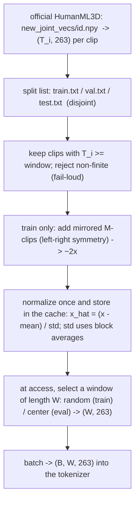

# Lesson 4a -- The data pipeline: from regenerated clips to a training batch

This lesson sits between the representation in Lesson 3 and the tokenization in Lesson 4. It explains how the tokenizer receives fixed-length batches from HumanML3D-263 clips.

The loader is `MotionWindowDataset` in `src\text2motion\motion\datasets.py`. The logged runs use the complete `data\HumanML3D_official` source. The title retains the historical reference to regenerated clips.

An examiner can ask these questions:
- Does the loader use every eligible clip?
- Do the splits keep the test clips separate from the train clips?
- Can the same seed reproduce the crop choices?
- What does a test reconstruction score establish?

## 4a.0 The picture (with shapes)

The diagram shows the execution order. The loader normalizes each retained clip before it stores the clip in the cache. At access, the loader selects a window from that normalized cache.

## 4a.1 What the pipeline must guarantee

The pipeline has four requirements:

1. Each sample has the same length $W$, which is a multiple of `downsample`. The convolutional encoder reduces the frame count by this fixed factor.
2. The train, validation, and test splits have separate clip identities. Mirror augmentation applies only to the train split.
3. The loader raises an error for a non-finite eligible clip. NaN and Inf values can corrupt the gradients.
4. The root seed and the epoch determine the random crop choices. The same inputs reproduce those choices.

These requirements support the generalization audit in Lesson 7. A test clip and its mirror must stay outside the train set.

## 4a.2 Source and layout

Each source clip is a HumanML3D-263 array at `new_joint_vecs/<id>.npy`, with shape $(T_i, 263)$. Lesson 3 explains this vector. The logged runs use the complete official source, not the incomplete local regeneration.

The tokenizer and the captioned dataset share the statistics $\mu,\sigma\in\mathbb{R}^{263}$ from `Mean.npy` and `Std.npy`. Both datasets load these statistics through `MotionScaler`. The split lists are `train.txt`, `val.txt`, and `test.txt`.

The current training statistics use a refit on the train split with block-averaged standard deviations. The evaluator has separate statistics. A checkpoint depends on the statistics that its training run used.

## 4a.3 Normalization

The scaler subtracts the channel mean and divides by the stored channel scale:
$$
\hat{x}_{t,c} = \frac{x_{t,c} - \mu_c}{\sigma_c},\qquad c = 1,\dots,263,
$$
The exact inverse is `denormalize`: $x = \hat{x}\,\sigma + \mu$.

The scale is not necessarily the standard deviation of that individual channel. The statistics procedure first calculates each channel standard deviation. It then replaces the standard deviations within each feature block with their average.

The blocks are:
- The root angular displacement.
- The root planar displacement.
- The root height.
- The relative joint positions.
- The joint rotations.
- The joint displacements.
- The foot-contact flags.

An individual normalized channel therefore need not have unit variance. Its mean is zero on the data that supplied its channel mean. A crop or a held-out split can have a different mean.

The blocks have different units and scales. The root height uses metres, the rot6d components represent rotations, and the foot flags use $\{0,1\}$. A single global scale can give the large-variance channels too much weight in the L1 loss.

The loader normalizes each retained clip once and stores the normalized array in memory. At access, it selects only the crop. The tokenizer therefore requires no disk read or repeated normalization for each sample.

The evaluator first restores the motion features with the training statistics. It then normalizes those features with the evaluator statistics. The shared training scaler does not replace the evaluator scaler.

## 4a.4 Windows

The tokenizer uses fixed-length crops, as in the T2M-GPT/MoMask recipe. For a window $W$ and a clip length $T_i$, the overflow is $T_i - W$.

The loader selects the start as follows:
- On the train split, it selects a random valid start.
- On the validation and test splits, it selects the center start.

$$
\text{start} = \begin{cases} \mathrm{Uniform}\{0,\dots,T_i-W\} & \text{train} \\ \lfloor (T_i-W)/2 \rfloor & \text{val/test} \end{cases},
\qquad \text{window} = \hat{x}[\text{start}:\text{start}+W].
$$

The dataset requires an explicit root seed. It stores the epoch in shared memory so that persistent workers receive the current epoch. It draws the starts for all clips together from the seed and the epoch.

Call `set_epoch` before each epoch. Keep the seed, the epoch, and the clip order unchanged to reproduce the starts.

A new epoch causes a new draw, but a draw can repeat a previous start. A clip with no overflow always has the same start. Random crops increase possible frame coverage; they do not guarantee coverage of every frame.

Even across 500 epochs, the loader can repeat windows. “All data” means that every eligible clip enters the dataset. It does not mean that the model receives every possible window.

## 4a.5 Mirror augmentation (the symmetry map)

Human motion has approximate left-right symmetry. A reflection across the body’s sagittal plane can provide another valid motion sample.

The mirror map $\mathcal{M}$ has these operations:
- Swap the left and right joint channels.
- Negate the lateral components of the positions, rotations, and velocities.
- Swap the left and right foot-contact flags.

The source stores precomputed mirrors as clips with an `M` prefix. The loader includes both `id` and `Mid` when mirror augmentation is active on the train split. The condition is `self._mirror = mirror_augment and split == "train"`.

This procedure approximately doubles the train set without a new mirror calculation at access. The validation and test datasets use only the base clips. A mirror shares the identity of its base clip for split membership.

## 4a.6 Splits and hygiene

The official split files contain base identifiers and mirror identifiers. The helper `base_clip_ids` removes the `M` prefix and removes duplicate identities. This operation treats a base clip and its mirror as one identity within a split.

The window loader applies these checks:
- It raises an error if a required feature file is absent.
- It excludes a clip shorter than $W$ and reports the excluded identifiers.
- It raises an error with the identifiers of non-finite clips that pass the length filter.
- It checks the statistics for finite means and positive, finite scales.

The length filter precedes the feature finiteness check. Thus, the window loader does not check every short clip for non-finite values.

Each retained clip enters the normalized cache once. Each access selects a crop from that cache. The shared epoch and the required seed control the train crop choices.

The prefix rule keeps each mirror with its base identity. Separate split membership remains necessary; prefix removal alone does not prove that the splits are disjoint.

## 4a.7 Why this underwrites the claims

Separate splits and train-only mirrors support the generalization audit in Lesson 7. A test reconstruction score measures tokenizer behavior on motion clips outside the train set. This interpretation requires the test clips and their mirrors to stay outside training.

The complete official source addresses the earlier project’s limited data use. The window dataset retains all clips that satisfy its window requirement. Random crops provide more possible windows over successive epochs.

Block-based normalization controls the relative scales of the features. Explicit errors prevent non-finite eligible clips from silently entering the cache. These properties support loss interpretation, but a lower loss alone does not prove better motion quality.

Tokenizer reconstruction and text-to-motion generation require separate evaluation procedures. A reconstruction score compares source motion with decoded source motion. A generation score evaluates motion that the generator produces from text.

Clean data splits are necessary for both procedures. They do not establish that either procedure matches a published protocol.

## 4a.8 Results and limits

The official split counts are:

| Split | Base identities | Listed identifiers, including mirrors |
|---|---:|---:|
| Train | 11,692 | 23,384 |
| Validation | 730 | 1,460 |
| Test | 2,192 | 4,384 |

These are source counts before the window length filter. The validation and test window datasets exclude mirrors. The train window dataset includes mirrors only when mirror augmentation is active.

Lesson 3 reports a normalized mean $\approx 0.03$ and a standard deviation $\approx 1.03$. These aggregate values do not establish unit variance for every channel. This rewrite retains them as a reported audit result, not as a new measurement.

The intended official generation population contains 4,648 samples. The population correction and the Diversity and MultiModality seed corrections remain drafted, not applied. The current evaluator uses base clip identities and retains the unresolved metric seed behavior.

A tokenizer reconstruction result therefore does not establish compliance with the official generation protocol. Claims of direct agreement with published generation scores require the protocol corrections and a new evaluation.
