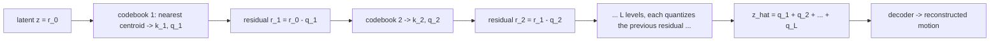

# Lesson 5 -- RVQ: turning motion into tokens with a learned codebook (the baseline)

> This lesson explains the RVQ baseline tokenizer, with mathematics at each step.
> VQ assigns each vector to a centroid. An exponential moving average (EMA) updates the centroids.
> Code: `src\text2motion\tokenization\nn_model.py`, `src\text2motion\tokenization\nn_quantizers.py`, and `src\text2motion\tokenization\trainer.py`.
> Results appear in section 5.8 and Lesson 7.
> Use a markdown preview with KaTeX or MathJax support for the LaTeX formulas.

## 5.1 The problem

Each motion frame contains 263 continuous feature values. A next-token generator needs discrete tokens. A tokenizer converts motion $\to$ a sequence of integers. Its decoder reconstructs motion from those integers.

RVQ performs the discrete conversion.

## 5.2 Vector Quantization = nearest-centroid (the digital-signal idea, for vectors)

Vector Quantization (VQ) replaces a continuous vector with the nearest vector from a finite set. This set is the codebook. Its representative vectors are the centroids.

The encoder produces a latent vector $z \in \mathbb{R}^{d}$. The codebook is $C = \{e_1,\dots,e_K\}$, with $e_k \in \mathbb{R}^{d}$. It contains $K$ centroids.

The quantizer selects the nearest centroid:

$$
k^\star = \arg\min_{k}\,\lVert z - e_k\rVert_2,
\qquad q(z) = e_{k^\star},
\qquad \text{token} = k^\star .
$$

The decoder reconstructs $\hat{x} = \text{Decoder}\!\big(q(z)\big)$ from the selected centroid. The input $x$ supplies the target. The feature reconstruction term is $\mathcal{L}_{\text{recon}} = \lVert x - \hat{x}\rVert_1$.

Both project tokenizers also use an L1 term for differences between consecutive frames. Define these differences as:

$$
\Delta x_t = x_t - x_{t-1},
\qquad
\Delta \hat{x}_t = \hat{x}_t - \hat{x}_{t-1}.
$$

The full reconstruction objective is:

$$
\mathcal{L}_{\text{reconstruction}}
=
\mathcal{L}_{\text{recon}}
+
\lVert \Delta x - \Delta \hat{x}\rVert_1.
$$

The code computes the mean absolute error for each term, then adds the two means. The temporal term compares changes in all features. It is not limited to joint positions.

Lesson A explains the use of L1 instead of L2 for reconstruction.

Definitions:

- A codebook contains the $K$ learned centroids $e_k$.
- Quantization assigns $z$ to its nearest centroid. This defines a Voronoi partition of $\mathbb{R}^d$.
- A token is the index $k^\star$ of the selected centroid.

## 5.3 Training VQ -- three problems, each with its math

### Problem 1: the discrete assignment has no useful gradient

The assignment $k^\star$ is piecewise constant. Therefore, $\partial q/\partial z = 0$ almost everywhere. The encoder cannot learn through this derivative.

The Straight-Through Estimator (STE) supplies a substitute derivative:

$$
z_q = z + \operatorname{sg}\!\big(e_{k^\star} - z\big),
$$

Here, $\operatorname{sg}(\cdot)$ means stop-gradient. In the forward pass, $z_q = e_{k^\star}$. In the backward pass, the stop-gradient term contributes zero.

Thus, $\partial z_q/\partial z = 1$. The STE passes the reconstruction gradient to the encoder.

### Problem 2: the centroids must match the encoder outputs

The VQ-VAE objective contains a reconstruction term, a codebook term, and a commitment term:

$$
\mathcal{L} = \mathcal{L}_{\text{recon}}
\;+\; \underbrace{\lVert \operatorname{sg}(z) - e_{k^\star}\rVert_2^{2}}_{\text{codebook loss}}
\;+\; \beta\,\underbrace{\lVert z - \operatorname{sg}(e_{k^\star})\rVert_2^{2}}_{\text{commitment}} .
$$

The codebook term moves each centroid towards its assigned encoder outputs. The commitment term moves the encoder outputs towards their selected centroids. The stop-gradient operator separates these two effects.

The project replaces the codebook loss with an EMA update. This update performs online k-means through averages of assignment counts and vector sums.

The decay is $\gamma$, with a project value of $0.99$. The count $n_k$ is the number of latent vectors assigned to centroid $k$ in the current batch.

$$
N_k \leftarrow \gamma N_k + (1-\gamma)\,n_k, \qquad
m_k \leftarrow \gamma m_k + (1-\gamma)\!\!\sum_{i:\,k_i = k}\!\! z_i, \qquad
e_k \leftarrow \frac{m_k}{N_k}.
$$

Here, $N_k$ is the averaged count. The vector $m_k$ is the averaged sum of assigned vectors. Their ratio gives the centroid.

The implementation also applies count smoothing before division. The equations above describe the basic EMA update.

Only the commitment term $\beta\,\lVert z - \operatorname{sg}(e_{k^\star})\rVert_2^2$ remains from the two VQ-specific loss terms. The project uses $\beta = 0.02$. The codebook changes through EMA updates, not optimizer gradients.

### Problem 3: some centroids receive no assignments

Codebook collapse occurs when many centroids have $N_k \approx 0$. These centroids contribute little or nothing to the representation.

A dead-code reset replaces a centroid when its averaged count falls below a threshold $\tau$. The replacement is a random encoder output from the batch:

$$
\text{if } N_k < \tau:\quad e_k \leftarrow z_j,\quad j \sim \text{Uniform(batch)} .
$$

The implementation also resets the associated vector sum and count. These values must agree with the replacement centroid.

The baseline uses these mechanisms:

- The STE supplies a gradient to the encoder.
- The commitment loss keeps encoder outputs close to selected centroids.
- The EMA update changes the centroids.
- The dead-code reset replaces centroids with low assignment counts.

## 5.4 RVQ = quantize the residual, recursively (coarse-to-fine)

Each level quantizes the residual from the previous level. Early levels represent the main structure. Later levels can add detail. The tokens are the selected indices from the $L$ levels.

One codebook with a moderate $K$ can produce a coarse approximation. Residual VQ applies $L$ quantizers to improve this approximation.

The initial residual is $r_0 = z$. For $l = 1,\dots,L$:

$$
k_l = \arg\min_{k}\,\big\lVert r_{l-1} - e_k^{(l)}\big\rVert_2,
\qquad q_l = e_{k_l}^{(l)},
\qquad r_l = r_{l-1} - q_l,
$$

The quantizer selects a centroid for the current residual. It subtracts that centroid to obtain the next residual.

The sum of the selected centroids gives the reconstructed latent vector:

$$
\hat{z} = \sum_{l=1}^{L} q_l = z - r_L,
\qquad \text{tokens} = (k_1,\dots,k_L).
$$

The strict decrease $\lVert r_l\rVert < \lVert r_{l-1}\rVert$ is not guaranteed. The nearest centroid minimizes the distance among the available centroids. The code does not require that distance to be smaller than the previous residual norm.

The $L$ codebooks permit $K^{L}$ index combinations. This count describes possible token combinations.

Quantization dropout sometimes retains only the first $L' < L$ levels in a training step. This trains the decoder to reconstruct motion with fewer active levels.

## 5.5 How we do it (applied -- `nn_model.py` and `nn_quantizers.py`)

The baseline uses a recipe from T2M-GPT, MoMask, and EnCodec:

- It has $L = 6$ levels $\times\, K = 512$ centroids, with a code dimension of $512$.
- It uses an EMA decay of $\gamma = 0.99$ and a dead-code reset.
- It uses a commitment weight of $\beta = 0.02$ and a quantization dropout probability of $0.2$.
- It shares the convolutional encoder and decoder architecture with FSQ: width 512, downsample factor 4, and 3 residual blocks.

The encoder and decoder architecture stays the same in the comparison. Each tokenizer also has learned projections before and after its quantizer. The projection dimensions depend on the quantizer.

The networks are in `src\text2motion\tokenization\nn_model.py`. The quantizers are in `src\text2motion\tokenization\nn_quantizers.py`. The trainer is in `src\text2motion\tokenization\trainer.py`.

The training step follows this sequence:

1. Encode a normalized 64-frame window.
2. Quantize the latent vectors with the six RVQ levels.
3. Decode the sum of the selected centroids.
4. Compute the feature L1 loss and the temporal-difference L1 loss.
5. Add the weighted commitment loss.
6. Compute the gradients through the STE.
7. Update the trainable parameters with AdamW.
8. Update the evaluation EMA.

The RVQ objective is:

$$
\mathcal{L}_{\text{RVQ}}
=
\mathcal{L}_{\text{reconstruction}}
+
\beta\cdot\text{commitment}.
$$

The code sums the commitment losses from the active levels. Each level uses the mean squared distance between its residual input and its selected centroid.

Two EMA mechanisms have different functions. The quantizer EMA updates the codebook from assigned latent vectors. The evaluation EMA averages the trainable parameters and floating-point buffers.

The floating-point buffers include the RVQ codebooks. Evaluation must use the averaged parameters and averaged codebooks together. An average of weights alone does not provide this consistency.

## 5.6 Health, with math (preview; values in Lesson 7)

For each codebook, the usage probability is $p_k = n_k / \sum_j n_j$:

$$
\text{perplexity} = \exp\!\Big(\!-\!\sum_k p_k \log p_k\Big)\ \ (\text{effective centroids in use}),
\qquad
\text{usage\_frac} = \frac{\lvert\{k : n_k > 0\}\rvert}{K}.
$$

Perplexity measures the effective number of centroids in use. The usage fraction measures the proportion of centroids with at least one assignment.

Check these quantities during training:

- The reconstruction loss $\mathcal{L}_{\text{recon}}$ should decrease.
- The perplexity and usage fraction should remain high.
- The commitment loss should remain small and stable.

The dead-code reset helps maintain centroid use. A sharp decrease in usage can indicate collapse. An increase in commitment loss can indicate a mismatch between the encoder outputs and the centroids.

## 5.7 Research lineage

VQ-VAE (van den Oord et al., 1711.00937) -- learned-codebook quantization + STE + commitment;
SoundStream (2107.03312) / EnCodec (2210.13438) -- RVQ as the audio-codec standard; T2M-GPT
(2301.06052), MoMask (2312.00063) -- VQ/RVQ for motion. Our baseline follows them exactly.

### Check before Lesson 6

1. Write the STE identity for $z_q$. Explain why its backward derivative is the identity.
2. State what codebook $l$ quantizes. Explain why $\lVert r_l\rVert$ does not necessarily decrease at each level.
3. Identify the VQ loss term that remains with codebook EMA updates. Explain its function.

## 5.8 Results and reference values

The reported comparison runs use $\sim 500$ epochs. The selected checkpoint has the best reconstruction FID. Lesson 7 contains the measured values.

(T2M-GPT measured the stakes:
naive VQ recon-FID $0.49$ vs EMA+reset $0.07$ -- a $7\times$ gap.)
