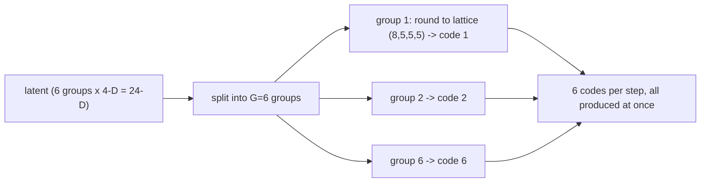
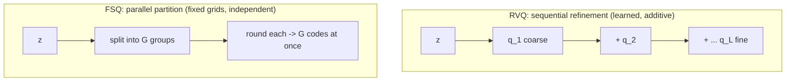
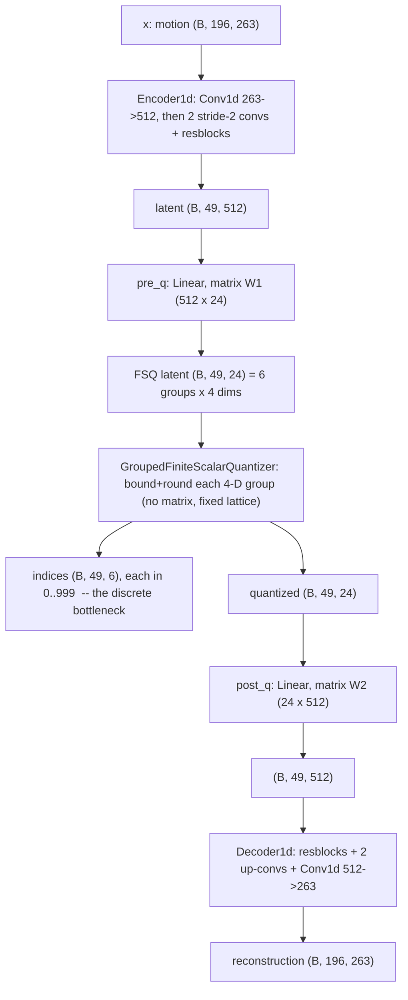

# Lesson 6 -- FSQ: turning motion into tokens with a fixed grid (our tokenizer)

> This lesson explains the Grouped-FSQ tokenizer (Contribution A).
> It follows Lesson 5: the theory, the training method, and the project implementation.
> Section 6.7 contains the results. Lesson 7 contains the full comparison.
> Code: `src\text2motion\tokenization\nn_quantizers.py`, `nn_model.py`, and `trainer.py`.
> Research: FSQ (Mentzer), ScaMo.

## 6.1 The same problem, a different answer

The tokenizer converts continuous motion $\to$ discrete tokens. VQ learns centroids and selects the nearest centroid. FSQ rounds each latent coordinate onto a fixed integer lattice.

The FSQ quantizer has no learned centroids. It needs no nearest-neighbour search. The encoder, the decoder, and their projection layers still have learned parameters.

## 6.2 Finite Scalar Quantization: the fixed lattice

Take a small latent $z \in \mathbb{R}^{d}$, with $d = 4$ per group in these examples. Each dimension $i$ has a fixed number of levels $L_i$. For example, the levels $(8,5,5,5)$ define a vocabulary of 1000 codes.

The quantizer processes each coordinate independently:

1. Bound the coordinate.
2. Round the bounded value to an integer.
3. Normalize the integer.
4. Convert the normalized value to a token digit.

The code defines the bound as follows. The boundary margin is $\epsilon=10^{-3}$ by default.

$$
\text{scale}_i = \frac{L_i-1}{2}(1-\epsilon),
\qquad
\text{offset}_i =
\begin{cases}
0.5, & L_i \text{ is even},\\
0, & L_i \text{ is odd},
\end{cases}
\qquad
\text{shift}_i =
\operatorname{atanh}\!\left(\frac{\text{offset}_i}{\text{scale}_i}\right).
$$

The shift and the offset give the correct integer range for even levels.

$$
b_i = \tanh(z_i+\text{shift}_i)\,\text{scale}_i-\text{offset}_i,
\qquad
h_i = \left\lfloor\frac{L_i}{2}\right\rfloor,
\qquad
r_i = \operatorname{round}(b_i),
\qquad
\hat{z}_i = \frac{r_i}{h_i}.
$$

The normalized coordinate is the code value. The token digit comes from this value:

$$
\text{idx}_i =
\operatorname{round}(\hat{z}_i h_i+h_i)
\in \{0,\dots,L_i-1\}.
$$

The implementation rounds this expression before the conversion to an integer. For an even level count of 8, the integers range from -4 to 3. The corresponding digits range from 0 to 7.

The single token index is the mixed-radix combination of the digits:

$$
\text{index} = \sum_i \text{idx}_i \prod_{j<i} L_j
\ \in\ \Big\{0,\dots,\textstyle\prod_i L_i - 1\Big\},
\qquad \prod_i L_i = 8\cdot5\cdot5\cdot5 = 1000.
$$

The mixed-radix basis gives each dimension its position in the token index. The inverse operation recovers the digits and then the normalized coordinates.

The quantizer does not store a table of code vectors. It stores the levels, the basis, and the bound constants. These values define the implicit codebook.

`FiniteScalarQuantizer.bound` in `nn_quantizers.py` implements the bound. The code requires each level count to be at least 3. It also checks that the boundary margin leaves the end digits reachable.

Definitions:

- The levels $L_i$ specify the allowed values for each latent dimension.
- The implicit codebook contains $\prod_i L_i$ ($=1000$) possible coordinate combinations.
- A token digit identifies one coordinate value within its dimension.
- A token index identifies one complete coordinate combination.

## 6.3 Training FSQ: the straight-through estimator

The autoencoder has this path: encoder $\to z \to$ quantizer $\to$ decoder. The round operation has no useful ordinary derivative for this task.

The straight-through estimator, or STE, replaces the derivative of the round operation with 1. It acts on the bounded coordinate, before normalization.

$$
r = b + \operatorname{sg}\!\big(\operatorname{round}(b)-b\big),
\qquad
z_q = \frac{r}{h},
\qquad
\mathcal{L} = \mathcal{L}_{\text{recon}}.
$$

Here, the stop-gradient operator $\operatorname{sg}$ blocks the derivative through its argument. The forward pass uses the rounded value. The backward pass treats the round operation as the identity.

The full quantizer does not have an identity derivative. The gradient still passes through the tanh bound and the normalization:

$$
\frac{\partial z_{q,i}}{\partial z_i}
=
\frac{\text{scale}_i}{h_i}
\left(1-\tanh^2(z_i+\text{shift}_i)\right)
\quad\text{under the STE}.
$$

Both tokenizers use the same reconstruction objective. It adds feature L1 to temporal-difference L1.

$$
\mathcal{L}_{\text{recon}}
=
\lVert \hat{x}-x\rVert_1
+
\lVert \Delta\hat{x}-\Delta x\rVert_1,
\qquad
\Delta x_t=x_{t+1}-x_t.
$$

The temporal difference measures the change in each feature between adjacent frames. The code names this term the velocity reconstruction loss.

FSQ does not need these VQ-specific operations:

- A commitment loss $\beta\lVert z - \operatorname{sg}(e)\rVert^2$: FSQ has no learned centroid $e$.
- A codebook loss or a codebook EMA: FSQ has no centroids to update.
- A dead-code reset: an unused lattice point has zero learned parameters to reset.

Thus, FSQ training $=$ reconstruction with an STE for the round operation. The absence of centroid updates simplifies the quantizer. It does not guarantee that the encoder uses every lattice point.

## 6.4 Grouped-FSQ: partition the latent into groups

This diagram shows the six-group example. Each group has four latent coordinates and produces one token index. The six groups produce six codes per step in parallel.

A single small FSQ latent restricts the information that the decoder receives. Grouped-FSQ increases the latent width through separate groups. Section 6.7 gives the result from the residual-FSQ experiment.

For **G = 6 groups**, each group has four dimensions. The complete latent has 6x4 = 24 dimensions. Each group uses the same fixed levels, but receives different coordinates from the encoder projection.

Six FSQ groups and six RVQ levels use the same number of codes per step. Their operations differ:

- RVQ selects learned centroids through sequential residual stages.
- RVQ adds the selected code vectors.
- FSQ quantizes separate coordinate groups independently.
- FSQ concatenates the group vectors.

The six-group configuration remains a useful example. The current frozen tokenizer uses eight groups, as section 6.5 explains.

## 6.4a RVQ vs FSQ, side by side

RVQ processes a residual at each level. FSQ partitions the latent and quantizes all groups in parallel.

At equal vocabulary sizes and code counts, both methods have the same nominal token rate. Lesson 7 compares these mechanisms with a shared convolutional encoder and decoder.

## 6.5 The project implementation

The project separates the implementation into three modules:

- `nn_model.py` defines the tokenizer networks and the reconstruction loss.
- `nn_quantizers.py` defines the quantizers.
- `trainer.py` defines the optimizer, the evaluation EMA, and the training loop.

The six-group example uses `(8,5,5,5)`, with 1000 codes per group. It shares the convolutional encoder and decoder with RVQ. The shared settings include the width, the downsample factor, and the residual block count.

Each tokenizer also has learned projections before and after its quantizer. Their dimensions depend on the quantizer latent width.

The frozen winner uses eight groups and levels `(8,8,4,4)`. Each group has 1024 possible codes. The complete FSQ latent has 32 dimensions.

The active pilot uses this configuration in `configs\generator\gen_pilot_fsq8x1024_kernel.yaml`. Its encoder width is 512, and its downsample factor is 4.

The training loop has this sequence:

1. Encode the motion.
2. Project the encoder output into the FSQ latent.
3. Bound, round, and normalize each coordinate.
4. Project the quantized latent into the decoder input.
5. Decode the motion.
6. Compute the feature L1 and temporal-difference L1 losses.
7. Update the learned parameters with AdamW.
8. Update the evaluation EMA.

The FSQ commitment loss is structurally zero. The evaluation EMA averages the learned parameters and the floating-point buffers. It is separate from the RVQ codebook EMA.

The logs retain the same two tiers as the RVQ logs. They report `recon`, `perplexity`, `usage_frac`, and `commit`.

A lower `recon` means a lower reconstruction loss. The perplexity and the usage fraction describe code use. `commit 0.0000` confirms the zero commitment term; it does not prove full lattice use.

## 6.6a Discrete capacity: how much can the tokens hold, and how we choose G

### Data path and dimensions

This diagram describes the `tok_g6_v1000` example, not the current frozen winner. Its labels `Encoder1d` and `Decoder1d` refer to the convolutional encoder and decoder. The current classes are `MotionFeatureEncoder` and `MotionFeatureDecoder`.

The example uses $\text{width}=512$, $\text{downsample}=4$, and $G=6$ groups. The levels $(8,5,5,5)\Rightarrow$ FSQ dim $4$, with latent width $6\times4=24$.

The quantizer path has two learned matrices:

- $W_1\in\mathbb{R}^{512\times24}$ belongs to `pre_q`.
- $W_2\in\mathbb{R}^{24\times512}$ belongs to `post_q`.

FSQ itself has no learned parameters. The tensor `indices` $(B,49,6)$ fully specifies the quantized latent. A decode operation can recover the same coordinate values from these indices.

During training, the decoder receives the normalized quantized coordinates through `post_q`. The integer conversion does not carry the reconstruction gradient.

For the frozen eight-group configuration, the latent and quantized tensors have shape `(B, 49, 32)`. The index tensor has shape `(B, 49, 8)`. Each index ranges from 0 to 1023.

### The capacity formula

A token step is one downsampled position. It covers $\text{downsample}=4$ frames.

$$
\text{codes/step}=G,\quad \text{vocab/code}=V=\prod_i L_i,\quad
\boxed{\ \text{distinct tuples/step}=V^{G},\qquad \text{bits/step}=G\log_2 V\ }.
$$

For $G=6$, $V=1000$, the nominal rate is $\text{bits/step}=6\log_2 1000 \approx 59.8$. The number of possible tuples is $V^G = 1000^{6}=10^{18}$ per step.

A 196-frame clip has 49 steps and $49\times6=294$ token indices. Its nominal capacity is $49\times59.8\approx
2930$ bits.

The value $\sim 2^{2930}$ is an upper bound on possible token sequences. It does not count demonstrated distinct motions. The encoder may use only some sequences, and different sequences may produce the same decoded motion.

Nominal capacity alone cannot show whether the tokenizer preserves enough motion detail.

### Capacity and distortion

The required capacity depends on the allowed distortion. The input per step has $4\times263=1052$ floats. The comparison uses rates from $36$-$80$ bits per step.

For 32-bit input floats, this gives approximately $\sim\!400\text{-}900\times$ lossy compression. This estimate compares fixed-width input storage with the nominal token rate. It excludes file metadata.

The reconstruction FID measures one aspect of the distortion. A graph of reconstruction FID against bits per step describes the measured rate-distortion relation.

Lesson 7 varies the codes per step over $\{4,6,8\}$. Section 6.7 summarizes the recorded results.

Choose the code count from the measured change in distortion. Also compare the downstream generator results. A small reconstruction gain may not justify a larger generator.

### Effective and nominal capacity

$V^G$ gives the nominal tuple count. The observed distribution shows how the model uses its codes.

The per-group perplexity is $\exp(-\sum_k p_k\log p_k)$, as in Lesson 5.6. It measures the effective number of codes under that distribution. It does not directly measure the effective number of joint tuples across groups.

The usage fraction measures the fraction of codes that appear at least once in the measured sample. Full usage does not imply uniform use.

FSQ does not guarantee $\sim\!100\%$ lattice usage. The encoder can concentrate its output on part of the lattice. The effective capacity therefore need not equal the nominal capacity.

RVQ uses a dead-code reset to replace unused centroids. FSQ has no centroids to reset. Both methods still require measurements of code use.

### The cost of more groups

The generator predicts $G$ codes per step through $G$ parallel heads (Lesson 8). A larger $G$ increases the nominal joint space and the output size.

More groups can improve reconstruction, but they also increase the generator task. Select the frozen tokenizer with both reconstruction FID and downstream generation FID. Compare whether the extra codes improve the complete system.

## 6.6 Research lineage

FSQ (Mentzer et al., 2309.15505) studies fixed-grid quantization as an alternative to learned VQ. ScaMo (2412.14559) applies FSQ to motion.

Our contribution is the Grouped-FSQ formulation on HumanML3D-263 and the controlled comparison with the strong RVQ baseline. Section 6.7 separates the reported research results from our recorded measurements.

### Check before Lesson 7

1. Explain why FSQ needs no commitment loss, codebook EMA, or dead-code reset.
2. Identify the operation that uses an STE.
3. Explain why the full FSQ derivative differs from an identity derivative.
4. Explain the difference between six parallel groups, one small latent, and a residual stack.
5. Distinguish the six-group example from the frozen eight-group tokenizer.

## 6.7 Results and reference values

### The residual-FSQ experiment

The earlier residual-FSQ variant reached reconstruction FID 0.22. Its small latent did not provide a useful reconstruction in that experiment. The grouped formulation gives the decoder a wider quantized latent.

### The recorded rate-distortion results

The Lesson 7 matrix contains 500-epoch runs with seed 2026. The original lesson describes approximately 500 epochs and checkpoint selection by reconstruction FID. This metric evaluates reconstructed motions; it is distinct from downstream generation FID.

Across the matrix, the recorded reconstruction FID ranges are:

$$
\text{4 codes} \approx 0.0514\text{-}0.063 \;\to\; \text{6 codes} \approx 0.028\text{-}0.034
\;\to\; \text{8 codes} \approx 0.0170\text{-}0.028.
$$

The four-code lower endpoint includes FSQ-1000 at 0.0514. The six-code range is approximate; the FSQ-1000 cell is 0.0274. The eight-code lower endpoint includes FSQ-1024 at 0.0170.

The recorded FID decreases as the code count increases in each matrix column. The improvement becomes smaller between six and eight codes.

MoMask's $\approx0.019$ is a published reference result. It is not a lower bound on reconstruction FID. Our recorded best cell is 0.0170, against the reference value 0.019.

This numerical comparison alone does not establish equal evaluation protocols or a statistically supported published-method win. The earlier lesson reports visible residual error at four codes. It does not supply a separate visual measurement.

### The frozen tokenizer and code use

The frozen winner is FSQ 8x1024, with levels `(8,8,4,4)` and latent width 32. The active pilot uses the same tokenizer configuration.

The recorded FSQ-1024 cells have:

- A vocabulary of 1024 codes per group.
- Usage fractions of 73–74%.
- Perplexities of 577–589.

These values show substantial code use, but not full lattice use. They do not support an effective capacity equal to the nominal capacity.

### The research results

FSQ reports performance comparable to learned VQ, with approximately 100% code usage in its reported experiments. It removes the commitment loss, centroid updates, and dead-code resets.

ScaMo reports FSQ > VQ on motion. These research results provide context. They do not guarantee the same occupancy or performance for our tokenizer.
