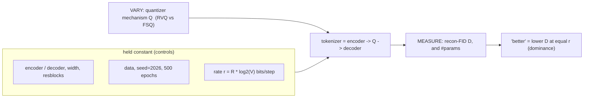

# Lesson 7 -- Results: confirming the two tokenizer designs by their values

Lessons 5 and 6 describe the tokenizer designs. This lesson explains the comparison method, then presents the recorded results.

The historical RVQ runs precede correctness fixes. Their scores remain measurements of the earlier implementation. They do not establish superiority over the corrected RVQ baseline.

## 7.0a The comparison, formally (a controlled rate-distortion experiment)

A controlled experiment separates the quantizer mechanism from the factors that affect its reconstruction error.

The experiment has three roles:

- The treatment is the quantizer mechanism $Q$.
- The controls include the shared encoder and decoder, width, data, seed, epochs, and rate $r = R\log_2 V$ bits/step.
- The outcomes are recon-FID $D$ and the parameter count.

RVQ selects learned centroids and subtracts each selected code from a residual. FSQ rounds bounded values onto a fixed lattice.

The rate $r$ is the nominal number of bits per token step. A larger rate permits more token combinations. It does not guarantee that the tokenizer uses all combinations.

A comparison of RVQ at $R{=}4$ with FSQ at $R{=}6$ changes both the mechanism and the token budget. Equal rates remove this difference.

The learned projections before and after the quantizer can differ. A shared convolutional encoder and decoder do not make the complete networks identical.

Each mechanism has a distortion curve $D_Q(r)$. Section 7.2 samples $D_{\text{RVQ}}(r)$ and $D_{\text{FSQ}}(r)$ at $r\in\{36,54,72,\dots\}$ bits.

The definition of rate-distortion dominance is:
$$
Q \text{ is better than } Q' \iff D_Q(r) \le D_{Q'}(r)\ \ \text{for every matched } r,
$$
with a strict inequality at some matched rate.

A finite table establishes this order only at its measured rates. It does not establish the order at every possible rate.

Pareto dominance on $(\text{distortion}, \text{params})$ also requires a valid count of trainable parameters. RVQ codebooks are buffers, not optimizer parameters.

FSQ has no learned codebook parameters. Both tokenizers have learned encoder, decoder, and projection parameters. A complete parameter comparison must include these projections.

The same protocol can compare LFQ, product-VQ, or another quantizer. Each comparison requires matched rates, shared controls, correct implementations, and complete parameter counts.

## 7.1 How the numbers are produced (the protocol)

The reconstruction protocol has these steps:

1. Encode each test motion.
2. Decode its tokens.
3. Use the frozen Guo evaluator to compare the real and reconstructed motions.
4. Report recon-FID, MPJPE, perplexity, and usage.

Recon-FID measures the difference between distributions of motion features from the evaluator. Lower recon-FID indicates a smaller difference.

MPJPE measures the mean error between joint positions in millimetres. Perplexity and usage describe how the tokenizer uses its codes.

The historical matrix uses the same convolutional encoder and decoder, width, downsample factor, and 500-epoch budget. The quantizers and their projections differ.

The reconstruction evaluation removes mirrors and selects 2,192 base clip IDs. It excludes three clips that are too short, then scores 2,189 nonmirror clips.

This population is not the full official test population. The change to evaluation on the official list remains unapplied.

The historical RVQ evaluation also has an EMA mismatch. It pairs an averaged encoder with the live codebook because the earlier EMA averages parameters only.

Commit `84f2ebe` makes the tokenizer EMA also average floating-point buffers, which include RVQ codebooks. FSQ does not have this codebook mismatch.

The earlier RVQ implementation also has inconsistent assignment and update order. Commit `1d7584e` returns codes from the codebook used for assignment and uses coherent initial counts.

These fixes change future RVQ runs. They do not correct the old checkpoints or their recorded scores. Corrected RVQ retraining remains pending.

## 7.1b Comparison protocol: matched interface, varied mechanism (the fairness contract)

FSQ uses parallel groups on a fixed lattice. RVQ uses sequential levels with learned codebooks. The experiment compares these mechanisms without a requirement for identical internal steps.

The matched controls are:

1. The convolutional encoder and decoder, width, downsample factor, and residual blocks.
2. The number of codes per step, which sets the generator token budget.
3. The nominal bits per step $=$ (codes/step) $\times \log_2(\text{vocab})$.
4. The data, seed 2026, and epoch budget.

The treatment is the quantizer mechanism. Its implementation includes its learned projections and its rules for code updates.

These pairs have equal bits per step:
$$
\text{FSQ } 6{\times}512:\ 6\log_2 512 = 54\text{ bits} = \text{RVQ } 6{\times}512, \qquad
\text{FSQ } 6{\times}1024:\ 60\text{ bits} = \text{RVQ } 6{\times}1024.
$$

FSQ-1000 has $6\log_2 1000 = 59.8$ bits, within 0.3% of 60. The exact $(8,8,4,4)=1024$ configuration removes this vocabulary difference.

The FSQ paper also compares FSQ and VQ at a matched vocabulary. Equal token rates provide a useful comparison despite different internal mechanisms.

The earlier estimate $L\cdot K\cdot d_{\text{code}}\approx 3$M concerns stored RVQ codebook values. These values are buffers, so the estimate is not a trainable parameter count.

FSQ has zero learned codebook parameters. This fact alone does not establish fewer total trainable parameters or Pareto dominance.

A future quantizer can use the same encoder and decoder at matched bits per step. The comparison must account for its projections and implementation differences.

## 7.2 Results: the full matrix (seed 2026, shared enc/dec, HumanML3D-263 test recon-FID)

This section contains the measured results and their limits. All RVQ comparisons below concern the historical implementation.

The matrix contains three code budgets and five mechanism-vocabulary combinations. Each configuration uses seed 2026 and a 500-epoch budget.

Lower recon-FID is better. Each cell traces to `artifacts/outputs/runs/tokenizer/*/metrics.jsonl`.

| codes/step | RVQ-512 | RVQ-1024 | FSQ-512 | FSQ-1024 | FSQ-1000 |
|---|---|---|---|---|---|
| **4** | 0.0626 | 0.0558 | 0.0612 | 0.0527 | 0.0514 |
| **6** | 0.0342 | 0.0310 | 0.0305 | 0.0283 | 0.0274 |
| **8** | 0.0277 | 0.0221 | 0.0196 | **0.0170** | 0.0199 |

*Cited context (more compute): T2M-GPT VQ 0.071; MoMask RVQ 0.019.*

The historical table gives $D_{\text{FSQ}}(r) < D_{\text{RVQ}}(r)$ at all six matched rates:

- At 512 codes, the rates are 36/54/72 bits: 0.0612<0.0626, 0.0305<0.0342, and 0.0196<0.0277.
- At 1024 codes, the rates are 40/60/80 bits: 0.0527<0.0558, 0.0283<0.0310, and 0.0170<0.0221.

This order does not establish dominance over corrected RVQ. It also does not establish Pareto dominance in total trainable parameters.

The table supports these additional observations:

- Recon-FID decreases as the number of codes per step increases in every column.
- The 1024-vocabulary result has lower recon-FID than the corresponding 512-vocabulary result for each mechanism.
- FSQ-1000, with $(8,5,5,5)$, has lower recon-FID than both other FSQ vocabularies at four and six codes per step.
- At eight codes per step, FSQ-1000 lies between FSQ-512 and FSQ-1024.

The earlier published-method interpretation remains:

> the best cell **FSQ 8x1024 =
> 0.0170 beats MoMask's tuned 0.019** on our controlled small budget, and FSQ 8x512 = 0.0196 ties it.

This statement concerns the historical comparison. It does not describe a new evaluation of the published method.

The equal-N audit is in `artifacts\outputs\generalization.md`. It uses 1,000 clips per split and seed 2026.

The audit gives `gap = test - train` <= 0 for 13/15 cells. The gap ranges from -0.010 to +0.003.

The two positive gaps are RVQ configurations:

- `rvq_l4_512`: +0.0030.
- `rvq_l8_512`: +0.0018.

Every FSQ configuration has a nonpositive gap. This observation does not prove that FSQ cannot overfit.

The FSQ encoder, decoder, and projections are learned. They can memorize data even though the lattice is fixed.

FSQ also has lower test recon-FID than historical RVQ at every matched rate in this equal-N audit. Examples are:

- 8x512: 0.0208 versus 0.0309.
- 8x1024: 0.0207 versus 0.0236.
- 6x1024: 0.0313 versus 0.0315.

The earlier interpretation of uncertainty and checkpoint selection remains:

> both are
> within the 1000-clip sampling noise
>
> Honest note: test sits ~0.01-0.02 below val for every cell -- the
> historical test-based checkpoint selection mildly (and uniformly) flattered the headline, so the
> FSQ-vs-RVQ comparison is unaffected; the trainer now selects on val (sec. 7.4). (Absolute values exceed
> the sec. 7.2 headline because FID is N-biased: 1000 clips vs the full test split.)

The reference to the full test split in this historical statement means the larger reconstruction population described in section 7.1.

### 7.2a Codebook health: a second, independent axis

A low reconstruction error does not guarantee broad code use. A tokenizer can reconstruct motions while it uses only a small code subset.

Perplexity is $\exp(H(p_{\text{code}}))$. Uniform use of $V$ codes gives perplexity $V$. Use of only one code gives perplexity 1.

The usage fraction is the number of codes used at least once, divided by $V$. The historical runs record both measures each epoch.

The table gives the final-epoch values for all 15 configurations as `perplexity (usage%)`.

| codes/step | RVQ-512 | RVQ-1024 | FSQ-512 | FSQ-1024 | FSQ-1000 |
|---|---|---|---|---|---|
| **4** | 313 (81%) | 496 (63%) | 341 (89%) | 589 (74%) | 597 (76%) |
| **6** | 321 (81%) | 547 (68%) | 345 (89%) | 586 (74%) | 561 (73%) |
| **8** | 343 (85%) | 543 (67%) | 340 (88%) | 577 (73%) | 542 (72%) |

There are six matched FSQ-RVQ comparisons. FSQ has higher usage in all six and higher perplexity in five.

The exception is 8x512. FSQ has perplexity 340, compared with RVQ at 343. Its usage is still higher: 88% versus 85%.

FSQ has no learned centroids that require a reset. Its fixed lattice does not guarantee full occupancy.

For FSQ-1024, perplexity is 577-589 and usage is 73-74%. These values show that a substantial part of the lattice remains unused.

Tokenizer evaluation has three separate axes:

- Reconstruction quality.
- Code usage and perplexity.
- Performance of the downstream generator.

Section 7.4 describes the limits of the earlier downstream comparison.

### 7.3 What the design predicts and what the values show

The FSQ design removes learned centroids and their update rules. The historical runs report `commit 0.0000` throughout.

This result agrees with the absence of an FSQ commitment loss. It does not establish full lattice use or the absence of overfitting.

The matched-512 results show lower historical recon-FID for FSQ at each code budget. Examples include 6x512 at 0.0305 < 0.0342 and 8x512 at 0.0196 < 0.0277.

These comparisons use the same vocabulary size. A larger vocabulary therefore does not explain these particular differences.

The historical RVQ runs use dead-code reset and report small, stable commitment values. The best recorded RVQ recon-FID is 0.0221 at 8x1024.

At this configuration, RVQ perplexity is 543 and usage is 67%. FSQ reports 577 and 73% at the same vocabulary.

These measurements describe the earlier RVQ implementation. They do not validate the corrected baseline.

The historical reconstruction advantage is about 2% at 4x512. At 8x1024, FSQ gives 0.0170 versus RVQ at 0.0221, a reduction of about 23%.

The fixed FSQ lattice removes RVQ codebook updates and resets. The measured reconstruction order remains historical until corrected RVQ runs are available.

### 7.4 Honest caveats (state these in the paper)

The best historical RVQ result is 0.0221 at 8x1024. Its matched 6x512 result is 0.0342.

Both exceed MoMask's tuned RVQ reference of 0.019, which uses more compute. The shared encoder, decoder, and budget do not remove the historical RVQ correctness problems.

The earlier FSQ-versus-MoMask qualification remains:

> the FSQ-beats-MoMask
> cell (8x1024 = 0.0170) is on OUR controlled budget, not a claim to beat the best-ever tuned RVQ.

Recon-FID measures reconstruction, not generation. It describes the decoder output from encoded real motions. A generator must also predict suitable tokens from text.

The earlier downstream comparison is recorded in `doc\notes\FEEDBACK.md`, in the 2026-09-20/21 updates.

At 18 epochs, the recorded test FID is 0.832 for RVQ and 3.30 for FSQ. RVQ has the lower value.

The earlier report describes both 60-epoch runs as converged. Their recorded FID values reverse the order: FSQ has 0.132 and RVQ has 0.294.

The report describes R@1 as statistically tied, at 0.395 for FSQ and 0.392 for RVQ. Both epoch budgets use a single seed.

These are earlier-protocol measurements. They do not establish the final downstream order or prove that undertraining alone explains the reversal.

The evaluation protocol later changes in these ways:

- Commit `a3d4cc6` changes the caption and motion sample pairs.
- Commit `d84903c` generates motions independently for each evaluation repetition.
- The earlier repeated evaluations reuse one generation and resample captions and batches.

The earlier downstream comparison uses a transformer backbone and its earlier test population. Evaluator follow-up and corrected-baseline reruns remain outstanding.

The earlier results appear in section 4.4a of the dissertation draft. They require the same historical-protocol qualification there.

The tokenizer matrix also uses one seed, 2026, per configuration. It has no variance bars.

The equal-N generalization audit already exists. Its nonpositive gaps do not prove the absence of overfitting. The trainer now selects checkpoints on validation data.

### 7.5 Pending (extends this section)

The completed historical work includes:

- The full seeded tokenizer matrix in section 7.2.
- The perplexity and usage measurements in section 7.2a.
- The downstream measurements at 18 and 60 epochs in section 7.4.
- The equal-N audit in `artifacts\outputs\generalization.md`.

The manifest-logged matrix supersedes the earlier pre-manifest values 0.0266 / 0.0382.

The downstream measurements are complete as historical records. The corrected comparison remains pending.

The remaining work is:

1. Train and evaluate the corrected RVQ baseline.
2. Resolve the reconstruction population protocol.
3. Repeat the downstream comparison with the corrected evaluator and independent generation repetitions.
4. Repeat both tokenizer and downstream comparisons with multiple seeds.
5. Report uncertainty before a general superiority claim.

The existing audit uses `scripts/evaluation/eval_generalization.py`. It already provides the train, validation, and test columns; the audit is not pending.

### 7.6 Where each number lives (reproducibility)

The section 7.2 records are in `artifacts/outputs/runs/tokenizer/<stem>/metrics.jsonl`.

The FSQ example is fsq_g8_v1024 = 0.0170 at `*tokenizer_fsq_g8_v1024/`. The RVQ example is rvq_l8_1024 = 0.0221 at `*tokenizer_rvq_l8_1024/`.

The run records include manifests and metric logs. They do not establish complete provenance for every configuration.

The best FSQ manifest has `git_commit: "unknown"`. Its last metric record contains recon-FID but has no explicit `split` or `final` marker.

The replication record provides additional evidence for the frozen FSQ 8x1024 tokenizer. The 2026-11-02 entry in `doc\notes\module_ledger.csv` reports:

- Seed 2026 and CUDA.
- 2,189 scored clips, after three exclusions for short clips.
- Recon-FID 0.016963, compared with the recorded 0.0170.
- MPJPE 106.9 mm.
- Feature L2 0.587.

The MPJPE uses global joint positions without alignment. The replicated recon-FID is within 1e-4 of the recorded value.

Precision is part of the reproduction protocol. The 2026-10-30 audit compares TF32 with `highest` on 730 validation clips.

TF32 changes 347 of 204,104 token indices, or 0.17%, across 268 clips. Two evaluations at `highest` produce no index changes.

Use `precision: highest` to reproduce the historical numbers. Record the precision with each new measurement and token pack.

The pre-manifest 0.0266 / 0.0382 values in the old STATUS.md are superseded by the seeded matrix.

Contribution A has measured support for the fixed-lattice FSQ design and its historical reconstruction results. Superiority over corrected RVQ remains unverified.
