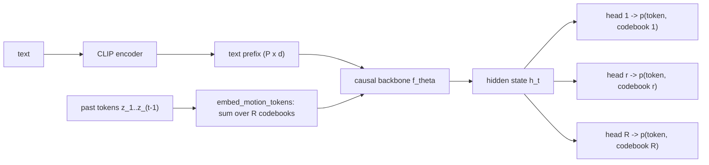

# Lesson 8 -- The autoregressive generator: text into a distribution over tokens

> This lesson starts Contribution B. Lessons 5-7 define the tokenizer, which maps motion to a grid of discrete codes and back.
> This lesson defines the conditional distribution that both twins learn.
> Lessons 11 and 12 describe two implementations of $f_\theta$: the transformer and Mamba.
> Lesson 13 describes their state and memory costs.
> The equations correspond to `src\text2motion\generation\nn_model.py`, with the loss in `src\text2motion\generation\losses.py`.

## 8.0 The picture

The model is causal across time. The state $h_t$ depends on the text and past tokens. Each of the $R$ heads predicts one codebook from this state.

Lessons 11 and 12 replace the box "f_theta". The token embeddings, output heads, loss, and sampler remain shared.

## 8.1 What the generator describes

The frozen tokenizer maps a motion to a grid of integers:
$$
z \in \{0,\dots,K-1\}^{T\times R},
$$
where:

- $T$ is the number of token steps after the tokenizer reduces the frame count by a factor of four.
- $R$ is the number of codebooks per step, specified by `num_codebooks`. It equals the codes per step from Lesson 7.
- $K$ is the vocabulary size of each codebook, specified by `codebook_size`.

A caption supplies the condition $c$. The generator defines the conditional distribution:
$$
p_\theta(z \mid c).
$$
The sampler draws tokens from this distribution. The frozen decoder converts these tokens to motion. The trainer adjusts $\theta$.

## 8.2 The factorisation: causal in time, parallel across codebooks

The grid has $T\cdot R$ entries. A direct representation of their joint distribution is intractable. The chain rule separates the distribution across time.

The implementation also assumes conditional independence between the codebooks at each step:
$$
p_\theta(z \mid c) \;=\; \prod_{t=1}^{T}\;\prod_{r=1}^{R} p_\theta\!\big(z_t^{\,r}\;\big|\;z_{<t},\,c\big),
\qquad z_{<t} := (z_1,\dots,z_{t-1}).
$$

Across time, $z_t$ depends only on the past tokens and the text. Within a step, the model has no codebook order $z_t^{<r}$. All codebooks share the state $h_t$ and use separate heads, as section 8.4 describes.

`MotionTokenGenerator.predict_token_logits` stacks the outputs of $R$ independent heads. The model therefore predicts all codebooks in one parallel operation. This reduces the work per step and supports incremental generation.

The model does not explicitly represent the residual order within a step. A masked bidirectional model, such as MoMask, uses a different dependence structure. This choice limits the distributions that the parallel heads can represent.

## 8.3 The text condition: a prefix

The CLIP text encoder supplies $P$ vectors. A projection maps them to the model width:
$$
c \in \mathbb{R}^{P\times d_{\text{text}}}
\;\xrightarrow{\;W_{\text{text}}\;}\;
\tilde c = W_{\text{text}}\,c \in \mathbb{R}^{P\times d_{\text{model}}},
\qquad P=\texttt{text\_prefix\_len}
$$

`project_text_prefix` checks that the encoder output has the configured prefix length. It raises an error if the lengths differ.

Without a restart, each backbone consumes the prefix once before the motion tokens. The transformer retains the prefix in its KV cache. Mamba incorporates the prefix into its fixed-size recurrent state.

The deployed service restarts both twins after every eight generated tokens. Each restart supplies the text prefix and at most the latest sixteen motion tokens. `configs\service.yml` specifies these limits.

This policy bounds the deployed state of both twins. With fixed restart limits, the total generation cost grows linearly with the output length. Without restarts, the transformer cache grows with the token history. Its learned positions also impose a length limit.

The optional `per_step_text` setting adds the projected text vector to every motion token embedding. It requires `text_prefix_len` to equal one. For a null condition, this additional vector is zero.

`per_step_text` defaults to false in `generation\contracts.py`. Its presence in the code does not establish its adoption. The equations below describe the default prefix-only case; the option adds the text vector before the backbone receives each motion embedding.

## 8.4 Embeddings, the shared state, and the heads

Each codebook $r$ has a separate embedding table $E_r$. `embed_motion_tokens` adds the $R$ embeddings at one step:
$$
e(z_t) \;=\; \sum_{r=1}^{R} E_r\big(z_t^{\,r}\big) \;\in\; \mathbb{R}^{d_{\text{model}}}.
$$

The causal backbone $f_\theta$ converts the prefix and embedded history to a hidden state. Each linear head converts this state to logits for one codebook:
$$
h_t \;=\; f_\theta\big(\tilde c,\; e(z_1),\dots,e(z_{t-1})\big)\in\mathbb{R}^{d_{\text{model}}},
\qquad
\ell_t^{\,r} \;=\; W_r\,h_t \;\in\;\mathbb{R}^{V},\quad
p_\theta(z_t^{\,r}\mid z_{<t},c)=\mathrm{softmax}(\ell_t^{\,r}).
$$

The vocabulary has size $V = K + 1$ when the model uses an END token, as section 8.8 describes. The backbone-specific operations reside inside $f_\theta$, implemented in `generation\nn_backbones.py`.

Both twins use the same interface, embeddings, and heads. This structure supports a controlled architecture comparison. A valid comparison also requires matched initialization, training, checkpoint updates, and evaluation.

## 8.5 Teacher forcing and the cross-entropy loss

Teacher forcing supplies reference tokens as the history. The model predicts the next token step at each valid position.

For a clean reference sequence, `MotionTokenGenerator.forward` receives the prefix and token embeddings with a one-step shift:
$$
\text{seq\_in} = \big[\,\tilde c_1,\dots,\tilde c_P,\; e(z_1),\dots,e(z_{L-1})\,\big],
$$
The hidden states from position $P\!-\!1$ onward predict $z_1,\dots,z_L$.

The actual trainer also corrupts the input tokens. The default `pkeep` is 0.8, so approximately 20% of the input entries receive random motion code IDs. The target tokens remain clean.

`generation\trainer.py` applies this corruption before the forward pass. The sequence equation shows the clean teacher-forcing case. For the actual default procedure, the input embeddings use the corrupted history.

`token_ce_loss` computes the mean cross-entropy across codebooks. It masks positions outside each valid length $L_b$:
$$
\mathcal{L}_{\text{CE}}
= -\,\frac{1}{R}\,\frac{\sum_{b}\sum_{t\le L_b}\sum_{r}\log p_\theta\!\big(z_{b,t}^{\,r}\mid z_{b,<t},c_b\big)}
{\sum_b L_b}.
$$

For the corrupted-input procedure, the model receives the corrupted history in this expression, while the target remains the clean token. The loss therefore penalises incorrect predictions of the reference tokens.

$\mathcal{L}_{\text{CE}}$ is the principal next-token loss. The full recipe also includes a soft-decode reconstruction term through the frozen decoder. Geometry, velocity, and foot errors contribute according to the configured loss terms. Lesson A and the chapter on the training protocol describe that recipe.

## 8.6 Token generation: temperature and nucleus sampling

At inference, the future tokens are unknown. The model generates one step at a time.

Greedy selection uses $\arg\max$ at each step. The documented T2M-GPT failure mode includes a concentration on a few repeated motions. This project uses temperature and nucleus sampling through `sample_logits`.

The temperature $\tau$ changes the probability distribution:
$$
\tilde p^{\,r}_v = \frac{\exp(\ell^{\,r}_v/\tau)}{\sum_{u}\exp(\ell^{\,r}_u/\tau)},
$$

Nucleus sampling then applies these operations:

1. Order the codes by probability, from highest to lowest.
2. Retain the smallest set $\mathcal{S}$ whose total probability reaches or exceeds $p$.
3. Renormalise the probabilities within that set.
4. Draw a token from the retained distribution.

The set and draw are:
$$
\mathcal{S} = \Big\{\text{top codes until }\textstyle\sum \tilde p \ge p\Big\},\qquad
z_t^{\,r} \sim \frac{\tilde p^{\,r}_v\,\mathbb{1}[v\in\mathcal{S}]}{\sum_{u\in\mathcal{S}}\tilde p^{\,r}_u}.
$$

## 8.7 Classifier-free guidance (CFG)

The trainer fits conditional and unconditional predictions within one network. With probability $p_{\text{drop}}$, it replaces the text condition with zeros.

At inference, `stream_token_indices` constructs the null condition with `torch.zeros_like(text_emb)`. For `cfg_scale > 1`, it combines the conditional and unconditional logits:
$$
\ell^{\text{cfg}} \;=\; \ell_{\varnothing} \;+\; s\,\big(\ell_{c} - \ell_{\varnothing}\big),\qquad s\ge 1.
$$

$s=1$ uses the conditional logits directly. $s>1$ increases each logit difference between the conditional and unconditional predictions. This can increase the probability of text-consistent codes.

The conditional rows $c$ and null rows $\varnothing$ share one batch of size $2B$. CFG therefore doubles the batch size for the backbone state. It adds a constant factor to the state cost.

CFG does not bound a transformer cache without restarts. The restart policy in section 8.3 bounds the deployed cache. Mamba has a fixed-size recurrent state even without that policy.

## 8.8 The END token and length

With `use_end_token`, the vocabulary is $V=K+1$. The additional code ID is END. The two length protocols have different rules:

- Fixed-length evaluation masks END with $\ell_{\text{END}}\!=\!-\infty$. It generates tokens up to the ground-truth length for comparison with the literature.
- Self-terminating generation permits END after the first step. END is always masked at step zero.

For a token row, END in any codebook marks the end of that motion. The batch pipeline uses the first such position as the row length.

`generation\pipeline.py` excludes that position and all later positions from the decoder input. If a row contains no END, its length equals the number of emitted token steps. The tokenizer never receives an END ID.

The token stream stops early when every row emits END in the same step. The batch pipeline still determines each row length from its first END. A fixed token budget can also stop the stream.

## 8.10 How the later lessons use this model

Sections 8.1-8.7 define the shared generator framework:

- Lesson 11 describes the transformer implementation of $f_\theta$ in section 8.4.
- Lesson 12 describes the Mamba implementation of the same function.
- Lesson 13 examines the recurrence and its state cost.
- Lesson 14 scores the motions that the procedures in sections 8.6-8.7 produce.

The twins share the objective, heads, loss, and sampler. These shared parts define the intended architecture comparison. They do not establish that a historical experiment achieved matched convergence.

Lesson 13 expresses the incremental computation as $h_t = g_\theta(h_{t-1}, e(z_{t-1}))$. Here, the recurrence must retain the backbone state required for the next prediction.

Without restarts, Mamba retains a constant-size recurrent state, while the transformer retains an expanding KV cache. With the deployed restart policy, both twins have bounded state.

The generator represents one conditional distribution $p_\theta(z\mid c)$. It separates predictions across time and across the codebooks at each step. The trainer uses masked next-token cross-entropy and additional reconstruction losses. The sampler uses temperature, nucleus sampling, and CFG.

Contribution B compares the implementations of $f_\theta$, their motion quality, and their generation costs.

## 8.9 What the measured values show

The historical pilot had 31.6M parameters. Its CFG sweep used the validation split and 300 clips. The archived record is `artifacts\logs\train\_archive\cfg_sweep.log`.

At $s=5$, the reported change from the conditional baseline was $\mathrm{FID}\ 6.14\!\to\!3.55$ ($-42\%$). R@1 changed from $0.105\!\to\!0.22$ ($\times 2.1$).

The temperature/top-$p$ pair was $(\tau,p)=(1.0,0.9)$. The archived log confirms temperature 1.0. This sweep supports the effect of CFG on that pilot under the stated settings. It does not isolate the effect of non-greedy sampling.

Lesson 19 contains the historical comparison of the 34M transformer and Mamba twins. These values remain provisional. They do not establish a matched, converged comparison.

The checkpoint history invalidates the earlier convergence claims:

- The Mamba epoch-60 evaluation used the frozen epoch-30 EMA.
- The transformer epoch-100 evaluation used the EMA from its resume point.
- The additional 40 epochs therefore do not establish that the Mamba result remained stable or that the transformer result worsened.

The earlier evaluation also used incomplete protocol rules:

- It used the old caption and sample rules.
- It excluded mirrored samples.
- Its old 20-repetition intervals omitted variation from motion generation.

The complete correction for the 4,648-sample protocol remains unapplied, according to the accepted audit. The historical table therefore cannot support a claim of complete test coverage or publication-ready results.

The source lesson also records the 100M scale-up as unmeasured and not planned in Lesson 17.3. It supplies no quality result at that scale.
