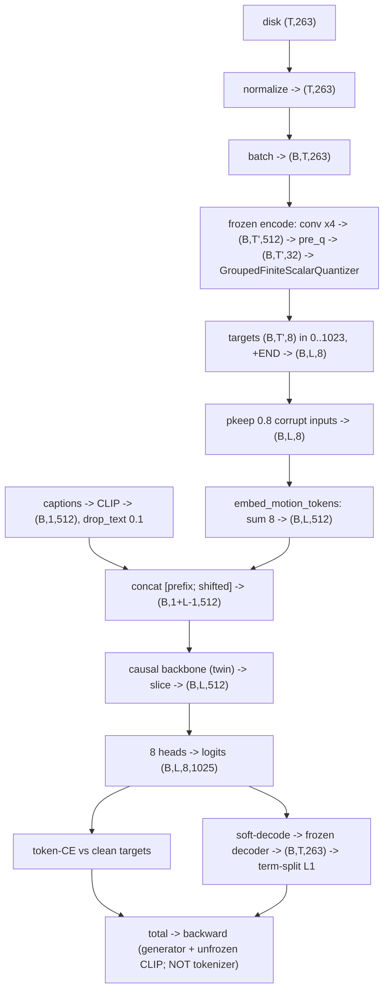

# Lesson 9 -- The training trace: every transformation a value suffers

> Follow one motion clip from the disk to the loss.
> Each stage gives the operation and the tensor shape.
> This trace uses the default demo configuration: eight FSQ groups, 1024 codes per group, and one text prefix vector.

The symbols have these meanings:

- B is the batch size, for example 64.
- T is the batch frame count after the trainer trims the batch.
- T' is T/4, the number of motion token steps.
- L is T'+1, the target sequence length with END.
- Each motion frame has 263 features.
- The tokenizer width and the generator width are 512.
- The FSQ latent has 32 coordinates: eight groups of four.
- Each group has 1024 motion codes.
- Each output head has 1025 classes, which include END.

The default demo uses `configs\generator\gen_pilot_fsq8x1024.yaml`.
The six-group configuration is an alternative: six groups of four coordinates give 24 latent coordinates.
Its levels (8,5,5,5) give 1000 codes per group.
A sixteen-vector text prefix is also an alternative.

The source files are:

- `src\text2motion\motion\datasets.py`
- `src\text2motion\motion\representation.py`
- `src\text2motion\tokenization\nn_model.py`
- `src\text2motion\tokenization\nn_quantizers.py`
- `src\text2motion\generation\contracts.py`
- `src\text2motion\generation\nn_model.py`
- `src\text2motion\generation\nn_backbones.py`
- `src\text2motion\generation\trainer.py`
- `src\text2motion\generation\losses.py`
- `src\text2motion\evaluation\evaluator.py`

## The picture (shapes end to end)

The diagram uses T after the trainer trims the batch to a multiple of four.
The text prefix has shape (B,1,512) after the generator projects the CLIP output.

## Stage 0 -- on disk

A file at `new_joint_vecs\<id>.npy` contains a float32 array with shape (frames,263).
Lesson 3 defines the feature layout.

The channel types are:

- The root angular velocity uses radians per frame.
- The root linear velocity uses metres per frame.
- The relative joint coordinates, or ric features, use metres.
- The rot6d features have no physical unit.
- The joint velocity features use metres per frame.
- The foot contact features use values 0 or 1.

## Stage 1 -- load + normalize (motion\datasets.py)

1. Select a caption and its motion segment.
   HumanML3D stores each annotation as `caption#tokens#start#end`.
   For nonzero time tags, crop the motion to $[\text{start}\cdot\text{fps} : \text{end}\cdot\text{fps}]$.
   Zero start and end tags select the whole clip.
   The caption and the selected frames must describe the same motion.

2. Limit the selected segment to 196 frames.
   The captioned dataset selects a random window for the train split.
   For other splits, this dataset selects the first window.
   It retains long clips and selects at most 196 frames per visit.
   At 20 fps, 196 frames cover 9.8 seconds and give at most 49 motion token steps.

3. Normalize each channel with `(x - Mean) / Std`.
   The array keeps its shape (frames,263).
   The subtraction removes the channel mean.
   The division scales the channel by its standard deviation.
   This operation reduces scale differences between channels with different units.

The generator evaluator uses a separate sample selection procedure in `evaluation\evaluator.py`.
It separates the whole-clip annotations from the annotations with time tags.
Each annotation with time tags produces a separate segment.

The evaluator applies these rules:

- Retain only samples with at least 40 frames and fewer than 200 frames.
- Retain only samples with a usable tokenized caption.
- Trim each retained sample to a multiple of the tokenizer downsample factor.

Thus, the generator evaluator does not select the first 196 frames of every long clip.
The dataset window rule and the evaluator sample rule are different.

## Stage 2 -- batch (collate_pad)

Stack the motion arrays and add zero padding to the longest array.
The motion tensor has shape (B,batch frames,263).
The frame lengths have shape (B,).
The batch also contains a list of captions.

Before the tokenizer call, the trainer computes the usable frame count:

$$
T = 4\left\lfloor\frac{\text{batch frames}}{4}\right\rfloor.
$$

The trainer removes the final excess frames and limits each frame length to T.
The motion tensor then has shape (B,T,263).

The tokenizer requires a positive frame count that is a multiple of four.
A direct tokenizer call with a nonaligned frame count raises an error.

## Stage 3 -- FROZEN tokenizer ENCODE: motion -> tokens (tokenization\nn_model.py)

The tokenizer parameters remain fixed throughout generator training.
The trainer calls the encoder without an autograd graph.

1. Apply `MotionFeatureEncoder`.
   The convolution input has shape (B,263,T).
   Two stride-2 convolutions reduce the time dimension by four.
   The residual blocks process the resulting features.
   The encoder output has shape (B,T',512), where T' = T/4.

2. Apply the `pre_q` linear layer.
   The shape changes from (B,T',512) to (B,T',32).
   The 32 coordinates form eight groups of four.

3. Apply `GroupedFiniteScalarQuantizer`.
   Each group uses the levels (8,8,4,4).
   Their product gives 8 × 8 × 4 × 4 = 1024 codes.
   The `bound` operation limits each coordinate to the grid range.
   The `round_straight_through` operation selects a grid coordinate.
   The `codes_to_indices` operation converts the grid coordinates to an integer code.

The output `target_tokens` has shape (B,T',8).
Each integer lies between 0 and 1023.
Each motion token step contains eight integers.

The round operation makes each coordinate discrete.
The index operation expresses the four discrete coordinates as one integer per group.
The generator receives these integer codes, not the continuous encoder output.

## Stage 4 -- build targets + corrupt inputs (generation\trainer.py)

1. Append a time position for END.
   The target tensor has shape (B,T'+1,8).
   END has index 1024 in each group.

2. Place END at each clip's valid token length.
   For clip b, the trainer computes:

   $$
   n_b = \operatorname{clamp}\left(\left\lfloor\frac{\ell_b}{4}\right\rfloor,1,T'\right).
   $$

   Here, \(\ell_b\) is the frame length after the trainer limits it to T.
   END occupies position \(n_b\).
   The token loss includes \(n_b+1\) positions for this clip.
   It excludes later padding positions.

3. Construct the teacher-forcing inputs with `pkeep = 0.8`.
   Keep each target entry with probability 0.8.
   Replace the other entries with random motion codes from 0 to 1023.
   The input tensor has shape (B,L,8).

Approximately 20% of the input entries receive random replacement codes.
A replacement can equal the original code.
The targets remain clean.

This corruption exposes the generator to imperfect previous tokens.
The clean targets still specify the correct next token.

## Stage 5 -- text branch (generation\nn_model.py + generation\trainer.py)

CLIP converts each caption to a pooled vector with 512 coordinates.
With a prefix length of one, CLIP returns shape (B,512).
The generator later adds the prefix dimension to obtain (B,1,512).

The default text configuration permits updates to these CLIP parameters:

- The last text encoder layer.
- The final layer normalization.
- The text projection.

The other CLIP parameters remain fixed.

The trainer applies `drop_text` with probability 0.1 per batch row.
It replaces the complete text vector with zeros for a selected row.
The shape remains (B,512).
These rows provide the text-free branch required by classifier-free guidance, or CFG.

## Stage 6 -- generator FORWARD (generation\nn_model.py), teacher forced

1. Apply `embed_motion_tokens`.
   Each of the eight input integers selects a 512-coordinate embedding from its group's table.
   Sum the eight embeddings at each time position.
   The result has shape (B,L,512).

2. Apply `project_text_prefix`.
   Add the prefix dimension to the CLIP output.
   Apply the text projection.
   The result has shape (B,1,512).

3. Concatenate the prefix and the previous-token embeddings.
   Use `emb[:, :-1]` to exclude the final input position.
   The sequence has shape (B,1+L-1,512), which equals (B,L,512).
   The prefix position predicts the first target.
   Each later position predicts a target from the prefix and earlier input tokens.

4. Apply the causal backbone.
   The Transformer permits attention to the current position and earlier positions.
   Its incremental decode path stores keys and values in a KV cache.
   Mamba updates a fixed-size recurrent state.
   Both backbones preserve the sequence shape.

5. Select the hidden positions that correspond to the targets.
   The code starts this slice at `prefix.size(1) - 1`.
   With one prefix vector, the slice starts at position zero.
   The result has shape (B,L,512).

6. Apply the eight output heads.
   Each head maps 512 coordinates to 1025 logits.
   The complete output has shape (B,L,8,1025).
   A softmax converts each set of logits to probabilities over the motion codes and END.

The optional `per_step_text` setting adds the projected text vector to every motion embedding.
It requires a text prefix length of one.
Its default value is false.
This trace uses the default prefix-only path.

## Stage 7 -- loss (generation\losses.py)

### 1. Token cross-entropy

The token cross-entropy, or token-CE, compares the logits with the clean target codes.
It includes END.
A length mask excludes positions after each clip's END target.

The loss divides the sum by the number of valid time positions and by eight codebooks.
Thus, it gives the mean classification loss across valid targets.

### 2. Soft decode

The geometric loss requires motion features instead of integer decisions.
The soft decode provides a differentiable path from the logits to these features.

Apply these operations:

1. Remove the final appended-END time position from the logits.
2. Select only the 1024 motion-code logits in each head.
3. Apply a softmax over these motion codes.
4. Compute the expected FSQ code vector from the code probabilities.
5. Combine the eight expected group vectors.
6. Apply `post_q` and the fixed decoder.

For group g at time t, the expected code vector is:

$$
\bar c_{t,g} = \sum_{k=0}^{1023} p_{t,g,k}\,c_{g,k}.
$$

The END class does not contribute to this expectation.
The remaining logits have T' time positions.
The decoder expands each token step to four frames.
The reconstruction therefore has shape (B,4T',263), which equals (B,T,263).

For a shorter clip, the frame mask excludes the padded part of the reconstruction.
The soft decode uses no argmax.
Gradients pass through the decoder to the logits, although the decoder parameters remain fixed.

### 3. Geometric L1 terms

The loss compares the reconstruction with the normalized reference motion.
It computes a separate length-masked L1 term for each channel group:

- The root features.
- The ric features.
- The rot6d features.
- The joint velocity features.
- The foot contact features.

Each term divides its absolute-error sum by the valid frame count and the channel count for that group.

The optional FK-consistency terms first restore the physical feature scale.
They use `recover_from_ric` and `recover_from_rot` to obtain joint positions.
The `fk_self` term compares the reconstructed rotation-based positions with the reconstructed ric positions.
The `fk_gt` term compares the reconstructed rotation-based positions with the reference ric positions.

With a frame-length mask, the current FK normalization divides by valid frames × 3.
It does not divide by valid frames × 22 × 3.
Thus, each masked FK term is 22 times the mean absolute error across all joint coordinates.
Both FK weights default to zero.
This scale requires care when you select an ablation weight.

### 4. Optional dynamics terms

The loss also supports two dynamics terms:

- `foot_skate` measures reconstructed horizontal foot displacement when the reference features indicate foot contact.
- `accel` compares reconstructed and reference joint accelerations from second frame differences.

Both terms require the normalization mean and standard deviation.
The terms recover joint positions from the denormalized ric features.
Their default weights are zero.

The configuration `configs\generator\gen_pilot_fsq8x1024_dynamics.yaml` sets the foot-skate weight to 10.0 and the acceleration weight to 18.0.

### 5. Total loss and gradients

With fixed weights, the total loss is:

$$
\mathcal L_{\mathrm{total}}
=
\mathcal L_{\mathrm{CE}}
+
\sum_j w_j\mathcal L_j.
$$

The sum includes the geometric terms and any enabled FK or dynamics terms.
The default geometric weights are:

- Root: 0.3.
- Ric: 0.5.
- Rot6d: 0.5.
- Joint velocity: 0.3.
- Foot contact: 0.1.

The code also supports a learned uncertainty weight for the non-CE terms.
The default uses fixed weights.

Backpropagate the total loss.
Gradients update the generator and the permitted CLIP parameters.
The tokenizer parameters remain fixed.

## The one-line journey

263 features → normalization → convolution encoder with fourfold time reduction → FSQ grid → eight integer codes → summed embeddings and text prefix → causal backbone → eight heads → token-CE and geometric loss.

### Check

1. Identify the operation that makes a continuous coordinate discrete.
2. Explain why the trainer corrupts the inputs but preserves clean targets.
3. Explain what token-CE measures and what the geometric loss measures.
4. Calculate the reconstructed frame count from T' motion token steps.
5. Explain why soft decode excludes the END class and the final time position.
6. Identify the missing divisor in the masked FK normalization.

## Data coverage and historical results

The caption crop selects the motion span that a caption describes.
It can use less than the complete clip during one dataset visit.

The train dataset retains long clips and selects random windows.
Different epochs can select different windows and captions.
This procedure increases access to long clips but does not prove that every frame appears during training.

The historical HumanML3D count is approximately 22,418 retained entries against 23,384 entries, or about 96%.
The quoted total already includes mirrored variants.
An additional factor of two would count those variants twice.
The dataset removes clips shorter than 40 frames and requires usable captions.

The historical inventory lists these AMASS quantities:

- 151 GB of data.
- 16,407 sequences.
- A pretraining corpus with 13,249 sequences.
- A 5.8 MB token pack identified as E7b.

AMASS has no captions for this captioned generator task.
The supervised captioned stage therefore uses HumanML3D pairs.
Inter-X, ARCTIC, and PAHOI remain unused in this lesson's data account.

Both historical generator twins started from AMASS-pretrained weights.
Thus, AMASS contributed through pretraining, although it did not provide supervised caption-motion pairs.
The legacy token packs now fail the provenance checks and require replacement.

The prior project attributed part of its plateau to use of less than 10% of its 290 GB inventory.
That statement is a historical explanation, not a measured coverage result for the current pipeline.

The historical extension results do not establish a matched, converged twin comparison.
The Mamba epoch-60 evaluation used frozen epoch-30 EMA weights.
The Transformer epoch-100 evaluation used the EMA weights from its resume point.
These EMA faults invalidate the historical no-gain conclusions for the loss ablations.
