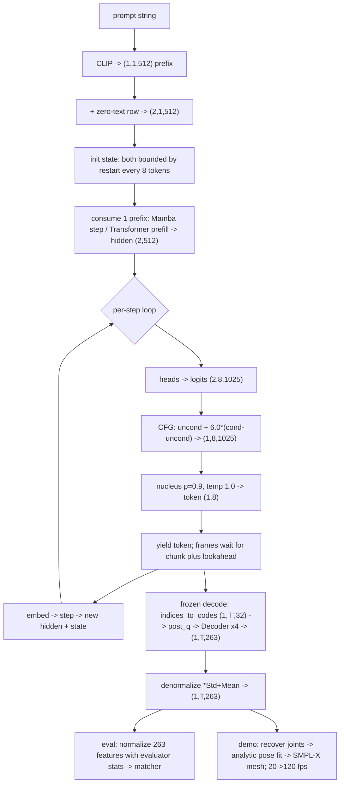

# Lesson 10 -- The inference trace: a prompt becomes motion, value by value

> This lesson follows the deployed path from text to motion. It uses the symbols from Lesson 9.
> The generator uses its own output tokens as inputs. It does not use teacher forcing during inference.

The generator predicts discrete motion tokens. The frozen tokenizer converts these tokens into motion features. The evaluator and the studio use these features for different purposes.

The current demo uses eight FSQ groups. Each group has 1024 codes and four scalar coordinates. The combined code vector has 32 coordinates.

The symbols describe these quantities:

- $B$: the number of prompts.
- $T'$: the number of motion token steps, without END.
- $T$: the number of motion frames.
- $h$: a hidden vector with 512 coordinates.
- $z_t$: the eight code indices at token step $t$.

This trace uses $B=1$ and $T=4T'$. CFG adds an unconditional row, so the backbone processes two rows.

The source files are:

- `src\text2motion\generation\nn_model.py`: the CLIP encoder and the generator.
- `src\text2motion\generation\nn_backbones.py`: the two backbones.
- `src\text2motion\generation\contracts.py`: the configuration types.
- `src\text2motion\generation\pipeline.py`: batch generation and END removal.
- `src\text2motion\generation\decoder.py`: the decoder for frame chunks.
- `src\text2motion\tokenization\nn_model.py`: the tokenizer decoder.
- `src\text2motion\motion\representation.py`: the motion representation and joint recovery.

## The picture (shapes end to end)

The diagram shows the default demo shapes and studio parameters. Stage 5 also describes the restarts that bound the state.

## Stage 0 -- the prompt

The input is one string: `"a person walks forward and sits down"`.

Let $s$ denote this string. The CLIP tokenizer converts $s$ into text token IDs. These IDs represent words or word parts, not motion codes.

## Stage 1 -- encode the text (`generation\nn_model.py`)

`CLIPTextEncoder` converts the text IDs into a projected text vector. The default prefix contains one vector.

$$
e=\operatorname{CLIP}(s)\in\mathbb{R}^{1\times512},
\qquad
p=W_{\text{text}}e+b_{\text{text}}
\in\mathbb{R}^{1\times1\times512}.
$$

CLIP returns the shape **(1, 512)** for this configuration. `project_text_prefix` adds the prefix dimension and applies the learned projection.

The alternative 16-vector configuration uses one pooled vector and 15 token states. Its prefix has shape **(1, 16, 512)**. It is not the default demo configuration.

## Stage 2 -- set up classifier-free guidance (`generation\nn_model.py`)

CFG uses a conditional row and an unconditional row. The unconditional row contains a zero text vector. The generator does not encode an empty string for this row.

$$
e_{\mathrm{CFG}}
=
\begin{bmatrix}
e\\
0
\end{bmatrix}
\in\mathbb{R}^{2\times512},
\qquad
p_{\mathrm{CFG}}\in\mathbb{R}^{2\times1\times512}.
$$

The text projection applies to both rows. The generator processes the conditional row first and the unconditional row second.

CFG combines their logits at each step. It doubles the batch size when the CFG scale differs from 1.0.

## Stage 3 -- initialise the bounded state

The two backbones store different state types:

- Mamba stores an SSM state and a convolution state. Their shapes stay fixed.
- The Transformer stores keys and values in a KV cache. The cache gains an entry at each step between restarts.

The deployed service restarts both backbones after every eight output tokens. Each restart uses the text prefix and at most the latest sixteen motion tokens.

Let $c$ denote the number of context tokens at a restart. Then $0\leq c\leq16$.

$$
\text{prefix length}+\text{context length}+\text{restart interval}
\leq1+16+8=25.
$$

This bound also limits the Transformer cache. Both deployed backbones use bounded state and computation that grows linearly with the output length.

Without restarts, the Transformer cache grows with the sequence. Its learned positions also impose a length limit. Mamba has fixed state shapes without restarts, but fixed shapes do not guarantee useful motion for unlimited time.

## Stage 4 -- consume the prefix

The default prefix contains one vector. Each backbone consumes it through its own interface:

1. Mamba creates a zero state with `backbone.init_state`.
2. Mamba consumes the prefix with `backbone.step`.
3. The Transformer consumes the prefix with `backbone.prefill`.

For an empty motion context, both paths return a hidden vector with shape **(2, 512)**.

$$
(h_0,S_0)=
\begin{cases}
\operatorname{step}(p_{\mathrm{CFG}}[:,0],S_{\mathrm{zero}})
& \text{for Mamba},\\
\operatorname{prefill}(p_{\mathrm{CFG}})
& \text{for the Transformer}.
\end{cases}
$$

At a restart, the Transformer uses one batched `prefill` call for the prefix and the retained motion context. Mamba consumes the prefix and the context through recurrent steps.

## Stage 5 -- the generation loop (per token step)

Each step predicts eight code indices from the current hidden vector.

1. Apply the eight output heads to the hidden vector.

   $$
   \ell_t=\operatorname{heads}(h_t)
   \in\mathbb{R}^{2\times8\times1025}.
   $$

   Each head has 1024 motion codes and one END entry. The END ID is 1024.

2. Combine the conditional and unconditional logits.

   $$
   \ell_t^{\mathrm{CFG}}
   =
   \ell_t^{\mathrm{uncond}}
   +6.0\left(
   \ell_t^{\mathrm{cond}}-\ell_t^{\mathrm{uncond}}
   \right)
   \in\mathbb{R}^{1\times8\times1025}.
   $$

   The studio default CFG scale is 6.0. The user can change this value.

3. Mask END at step zero.

   If `stop_at_end` is false, mask END at every step. If it is true, permit END after step zero.

   $$
   \ell_{t,r,\mathrm{END}}=-\infty
   \quad\text{when }t=0\text{ or self-termination is disabled}.
   $$

4. Sample one index from each head.

   The studio defaults use temperature 1.0 and nucleus top-p 0.9.

   $$
   q_{t,r}=\operatorname{softmax}
   \left(\ell_{t,r}^{\mathrm{CFG}}/1.0\right),
   \qquad
   z_t\in\{0,\ldots,1023\}^{1\times8}
   $$

   The sampler sorts the probabilities and retains entries through the top-p threshold. It normalizes the retained probabilities before the random choice.

   END is an additional possible index when it is permitted. Non-greedy selection permits different outputs; it does not guarantee motion quality.

5. Yield the token vector.

   A token yield does not mean that a frame chunk is ready. The decoder first needs the chunk tokens and the measured right lookahead.

6. Embed the generated token vector and duplicate it for CFG.

   $$
   u_t=\sum_{r=1}^{8}E_r(z_{t,r})
   \in\mathbb{R}^{1\times512},
   \qquad
   u_t^{\mathrm{CFG}}\in\mathbb{R}^{2\times512}.
   $$

   Use this vector as the next backbone input. The generated token becomes the next input for both CFG rows.

7. Restart after eight tokens if more output is required.

   Retain at most sixteen recent tokens. Recreate the state from the text prefix and those tokens.

The loop continues until the requested token count or END termination. Without END, the assembled token sequence has shape **(1, T', 8)**.

For a batch, each row ends at its first END in any codebook. `generation\pipeline.py` excludes that position and all later positions from tokenizer decoding.

The stream stops immediately when every row has END in at least one codebook at the current step. Batch generation also records separate row lengths.

## Stage 6 -- FROZEN tokenizer DECODE: tokens -> motion (`tokenization\nn_model.py`)

The frozen tokenizer uses three transformations:

1. Convert the indices into FSQ code vectors with `indices_to_codes`.
2. Apply the `post_q` linear layer.
3. Apply the convolutional decoder.

For the default eight-group tokenizer:

$$
(1,T',8)
\longrightarrow
(1,T',32)
\longrightarrow
(1,T',512)
\longrightarrow
(1,4T',263).
$$

Each group index identifies a point with four scalar coordinates. `indices_to_codes` recovers that point. This operation reverses the index representation of the rounded FSQ code.

The decoder uses residual blocks and two convolution stages that increase the frame count. One token step produces four motion frames.

The alternative six-group example from Lesson 9 uses a 24-coordinate code vector. Its shapes are **(1, T', 6)** and **(1, T', 24)**. With 1000 codes and END, its generator vocabulary has 1001 entries per head.

For incremental output, `StreamingMotionDecoder` retains left context and waits for right lookahead. It decodes the local token window and emits only the required frames.

$$
N_{\mathrm{buffer}}
=
N_{\mathrm{left}}
+
N_{\mathrm{chunk}}
+
N_{\mathrm{right}}.
$$

The decoder measures the context requirement from the tokenizer. This buffer has a fixed bound independent of the total output length.

## Stage 7 -- denormalize

The decoder produces normalized HumanML3D features. Denormalization applies the tokenizer statistics to each feature coordinate.

$$
x=\hat{x}\odot\mathrm{Std}+\mathrm{Mean}
\in\mathbb{R}^{1\times T\times263}.
$$

This is the operation `feat * Std + Mean`. It reverses the normalization described in Lesson 9.

The output retains the native 263-feature layout. Positions and velocities return to their representation units; rotation coordinates and contact features retain their own meanings.

## Stage 8 -- features -> a body

The evaluator and the studio use separate paths, as described in Lesson 3.

The evaluator normalizes the physical features with the Guo evaluator statistics:

$$
x_{\mathrm{eval}}
=
\frac{x-\mathrm{Mean}_{\mathrm{Guo}}}
{\mathrm{Std}_{\mathrm{Guo}}}
\in\mathbb{R}^{1\times T\times263}.
$$

The Guo motion encoder consumes these 263 features. It does not consume recovered joints. Its embeddings support FID and R-precision.

The studio follows this sequence:

1. Recover the joint positions with `recover_from_ric`.
2. Fit the SMPL-X pose analytically from the recovered joints.
3. Interpolate the pose parameters to the display rate.
4. Evaluate the SMPL-X body model to produce the mesh.

The recovered joint tensor has shape **(1, T, 22, 3)**. The recovery operation integrates the root motion and places the joints on the world trajectory.

$$
x\in\mathbb{R}^{1\times T\times263}
\longrightarrow
J\in\mathbb{R}^{1\times T\times22\times3}
\longrightarrow
(\theta_{\mathrm{root}},\theta_{\mathrm{body}},\mathrm{transl})
\longrightarrow
\text{mesh vertices}.
$$

The analytic fit derives pose rotations from joint directions. The studio does not directly convert the feature rotation slice into SMPL-X pose inputs.

The source motion rate is 20 fps. The default display rate is 120 fps, with sixfold interpolation. The pose interpolation uses spherical interpolation for rotations.

$$
f_{\mathrm{display}}=6\times20=120\ \mathrm{fps}.
$$

## The one-line journey (mirror of Lesson 9)

Text -> CLIP -> one prefix vector -> CFG -> causal token steps with periodic restarts -> eight indices per step -> FSQ code vectors -> decoder -> denormalization -> evaluator features or SMPL-X mesh.

### Check

1. What input tokens does the generator use during inference?
2. Why can an incorrect token affect later predictions?
3. Which operation recovers the continuous FSQ code from its index?
4. Why does a token yield occur before a frame chunk yield?
5. How do the restarts bound the Transformer cache?
6. Which tensor does the Guo motion encoder consume?

## Results

This lesson specifies the inference path and its tensor shapes. It reports no measured quality score or latency.

The state bound follows from the restart policy. A quality comparison requires measured results under a matched evaluation protocol.
