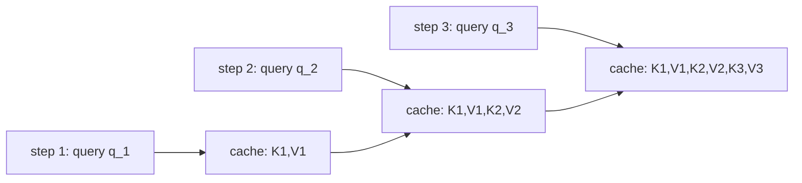

# Lesson 11 -- The transformer twin: the controlled baseline (and why its memory grows)

> This lesson explains the first backbone that implements $f_\theta$ from Lesson 8.
> The Transformer twin follows the T2M-GPT design (arXiv:2301.06052).
> Both twins use the same objective, heads, loss, and sampler.
> Only the backbone and its position mechanism differ.
> `TransformerBlock` and `TransformerBackbone` are in `src\text2motion\generation\nn_backbones.py`.
> The shared generator is in `src\text2motion\generation\nn_model.py`.

## 11.0 The picture

The diagram shows a Transformer without a restart. Each query uses all keys and values in the cache. The cache grows with each step.

The deployed service restarts both twins every eight motion tokens. Each restart uses the text prefix and up to sixteen recent motion tokens. Thus, both twins have bounded deployed state.

## 11.1 The job, restated

From Lesson 8, the backbone computes:
$$
h_t \;=\; f_\theta\big(\tilde c,\; e(z_1),\dots,e(z_{t-1})\big)\in\mathbb{R}^{d_{\text{model}}}.
$$
Here, the text prefix supplies the condition. The motion embeddings supply the token history. The Transformer computes every $h_t$ through attention over the available history.

Without a restart, attention gives direct access to every earlier token. This access requires the model to retain the keys and values for those tokens. After a restart, the available history contains only the text prefix and the retained motion context.

## 11.2 Self-attention

The block normalises the input and projects it to queries, keys, and values. It divides these vectors into $H$ heads of width $d_h = d_{\text{model}}/H$:
$$
Q = X W_Q,\quad K = X W_K,\quad V = X W_V \in \mathbb{R}^{L\times d_{\text{model}}},
\qquad d_h = d_{\text{model}}/H .
$$
Each query assigns a weight to each visible key. The head output is the weighted sum of the corresponding values. A causal mask $M$ excludes future positions:
$$
\mathrm{Attn}(Q,K,V) = \mathrm{softmax}\!\Big(\frac{QK^\top}{\sqrt{d_h}} + M\Big)V,
\qquad
M_{ij} = \begin{cases} 0 & j \le i \\ -\infty & j > i \end{cases}.
$$

The parallel path uses `F.scaled_dot_product_attention(q, k, v, is_causal=True)`. This mask implements the autoregressive factorisation from Lesson 8. Output row $i$ depends only on tokens $\le i$.

## 11.3 The block

Each block uses RMSNorm before attention and before the MLP. A residual connection adds each operation's output to its input:
$$
\begin{aligned}
x &\leftarrow x + W_O\,\mathrm{Attn}(\mathrm{RMSNorm}(x)),\\
x &\leftarrow x + \mathrm{MLP}(\mathrm{RMSNorm}(x)),\qquad
\mathrm{MLP}(u) = W_2\,\mathrm{GELU}(W_1 u),\ \ W_1\!:\,d\!\to\!4d.
\end{aligned}
$$
The MLP acts separately at each position. It expands the feature width by a factor of four, applies GELU, and projects back.

Neither backbone contains dropout. Only the shared generator applies embedding dropout before the backbone. Evaluation disables this dropout.

The parallel and incremental paths implement the same mathematical function for the same history. Numerical agreement uses a tolerance, not bitwise equality. The parity test uses `torch.allclose(..., atol=1e-4)`.

## 11.4 Where order comes from: positional embeddings

Attention without a causal mask or position information is permutation-equivariant. A permutation of the input rows produces the same permutation of the output rows. The causal mask restricts access to earlier positions.

The twin also adds a learned positional embedding $\mathrm{P}\in\mathbb{R}^{(L_{\max}+1)\times d_{\text{model}}}$:
$$
\text{input}_t = e(z_t) + \mathrm{P}[\,t\,].
$$
`TransformerBackbone.forward` adds $\mathrm{P}[\arange(L)]$. The incremental `step` adds $\mathrm{P}[\text{cache length}]$. The `prefill` method assigns positions to the complete supplied prefix and context.

The position table has a fixed length. Without a restart, the Transformer cannot exceed that limit. The generator rejects an unbounded request without a restart and rejects a finite request that exceeds the available positions.

Mamba has no positional embedding. Its recurrence carries the sequence order. This difference comes from the backbone structure.

## 11.5 Streaming, and the growing state

The incremental Transformer computes one output step at a time. Each query uses all past keys and values in its current cache. `TransformerBlock.step` appends the new key and value:
$$
K_{1:t} = [\,K_{1:t-1};\,k_t\,],\qquad V_{1:t} = [\,V_{1:t-1};\,v_t\,],\qquad
h_t \;\propto\; \mathrm{softmax}\!\Big(\frac{q_t K_{1:t}^\top}{\sqrt{d_h}}\Big)V_{1:t}.
$$
The incremental call uses `is_causal=False`. Its cache contains no future positions, so every cached position is visible.

Without a restart, the cache has this size:
$$
\underbrace{\text{KV-cache size at step } t}_{\text{per layer, per head}} = O(t\,d_h)
\;\;\Longrightarrow\;\;
\underbrace{\text{state over } n_{\text{layers}} \text{ layers}}_{\text{grows linearly in } t}
= O(n_{\text{layers}}\,t\,d_{\text{model}}).
$$

Each step computes scores against all cached keys. The attention cost per layer is $O(t\,d_{\text{model}})$. For a fixed layer count, a horizon of $L$ steps has this attention cost:
$$
\sum_{t=1}^{L} O(t\,d_{\text{model}}) = O\!\big(L^2 d_{\text{model}}\big),
$$
These $O(L)$ memory and $O(L^2)$ compute bounds describe the architecture without a restart, within its position limit.

The service uses a different policy. `configs\service.yml` sets a restart interval of eight tokens and a retained context of sixteen tokens. The generator performs this sequence for both twins:

1. Emit eight motion tokens.
2. Retain up to sixteen recent motion tokens.
3. Create a new backbone state.
4. Supply the text prefix and the retained context.
5. Continue from the new state.

The Transformer uses batched `prefill` for the prefix and retained context. Mamba supplies them through recurrent steps. The text prefix therefore enters the backbone again at each restart.

The fixed restart interval and context bound the deployed state of both twins. Their total compute grows linearly with the requested horizon. The Transformer uses positions local to each restart.

A restart removes older motion context. Thus, the deployed Transformer does not compute the same function as a Transformer with the complete history. Parallel and incremental parity applies when both paths receive the same history without a restart.

## 11.6 Making it a fair twin

Contribution B requires a memory comparison at matched quality. The comparison must separate the backbone architecture from the deployed restart policy. A restart already gives both deployed twins bounded state.

The intended controls are:

- The same tokenizer.
- The same data.
- The same root seed, 2026.
- The same optimiser and schedule.
- The same objective, heads, loss, and sampler.
- Approximately equal parameter counts.

The depth controls the parameter match: $\#\theta_{\text{transformer}} \approx \#\theta_{\text{Mamba}}$. The backbone and its positional mechanism remain the intended differences.

The current code also defines a reference initialisation. Both twins use small initial token embeddings and residual projections scaled by depth. The Transformer uses small initial positional embeddings. Mamba uses a log-uniform initial distribution for its step size.

These initialisation rules affect new models. They do not replace the parameters in a loaded checkpoint. New runs must start from zero to test the current initialisation and the backbones without dropout.

Quality evaluation generates tokens through `stream_token_indices`. It does not use the teacher-forced `forward` path as a substitute for generation. A controlled comparison must also use the same restart policy and evaluation protocol.

## 11.7 Big-picture fit

- The Transformer implements $f_\theta$ from Lesson 8 through attention over the available context.
- Its cache without a restart supplies the growing-state architecture comparison in Lesson 13.
- Mamba replaces attention and the position table with a recurrence, as Lesson 12 explains.
- Both twins retain the shared generator components.
- The deployed restart policy bounds both twins and limits their retained motion history.

The architectural difference remains relevant: Mamba has a fixed-size recurrent state without a restart. The Transformer retains a cache that grows until a restart or its position limit. This distinction alone does not establish matched motion quality.

## 11.8 Results and limits of the evidence

The historical 31M architecture gate for ADR 0002 reports a Transformer FID within $\sim\!1.19\times$ of the Mamba FID. This is a historical result. It does not establish matched convergence under the current implementation.

The historical 34M comparison in Lesson 19 reports a Mamba lead on every measured metric, including FID. However, the Mamba run labelled epoch 60 evaluated the frozen epoch-30 EMA. The Transformer run labelled epoch 100 evaluated the EMA from its resume point.

These checkpoints do not establish convergence at 60 epochs. They also do not establish that a further 40 epochs leave the result unchanged. Both historical twins used initial weights from AMASS pretraining, which a comparison must disclose.

The earlier evaluation results remain provisional. The old protocol has these limits:

- It uses old caption and sample rules.
- It excludes mirrored samples.
- Its old 20-repetition intervals omit variability from token generation.
- The complete 4,648-sample protocol correction remains unapplied.

Thus, these results are not a citable result for the complete corrected test split.

The historical Mamba also retained approximately one token of effective memory. Its fixed state size therefore does not demonstrate useful long memory. The current reference initialisation requires new runs before the comparison supports that claim.

The 100M-scale quality result remains unmeasured. It is not currently planned, as Lesson 17.3 states.
