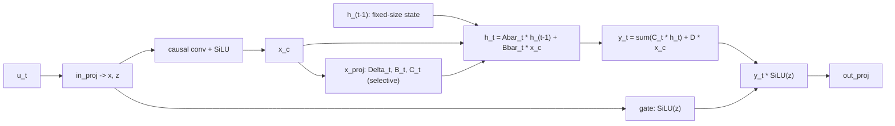

# Lesson 12 -- The S6/Mamba generator: a fixed-size state that streams

> This lesson describes Contribution B. The objective, heads, loss, and sampler match Lessons 8 and 11. Only $f_\theta$ changes.
> The transformer uses attention over stored past tokens. Without a restart, its cache needs $O(L)$ state.
> Mamba uses a recurrence over a fixed-size state. Its state memory is $O(1)$ in the horizon.
> To our literature survey, no published motion
> generator is a **token-autoregressive selective SSM** (Mamba motion work is diffusion- or
> masked-bidirectional) -- that unoccupied cell is the novelty.
> The implementation is `MambaMixer` in `src\text2motion\generation\nn_backbones.py`.
> The theory follows the selective SSM of Gu & Dao (arXiv:2312.00752).

## 12.0 The picture

The eager recurrence allocates a new tensor for the state $h_t$ and returns it. The tensor has the same shape at each step. A fixed shape does not imply an update in place.

Without a restart, the transformer cache stores more tokens at each step. The service uses a restart policy for both backbones. Section 12.5 separates these two cases.

## 12.1 The continuous state-space model

A linear state-space model (SSM) maps an input signal $x(t)$ to an output $y(t)$ through a hidden state $h(t)$:
$$
h'(t) = A\,h(t) + B\,x(t), \qquad y(t) = C\,h(t) + D\,x(t).
$$
The first equation defines the change in the state. The second equation defines the output from the state and the input.

We use a diagonal $A$. Each state channel has an independent scalar recurrence, so the state operations below are elementwise. This structure reduces the cost of each state update.

The code defines $A$ as a negative, static parameter:
$$
A = -\exp(a_{\log}) \in \mathbb{R}^{d_{\text{inner}}\times N},\qquad N=\texttt{d\_state},
$$
The expression is `a = -torch.exp(self.a_log)`. Negativity gives $|\bar A|<1$ below. Thus, the previous state decays when the input term is zero.

This decay does not bound the state magnitude under a nonzero input. Each step also adds an input term. Section 12.9 gives the supplied measurements of state magnitude.

## 12.2 Discretisation (continuous -> recurrence)

Each token defines a discrete step. We discretise the ordinary differential equation with a positive step size $\Delta_t>0$.

Zero-order hold gives the state transition for a diagonal $A$. Mamba uses a simplified input map:
$$
\bar A_t = \exp(\Delta_t\, A), \qquad \bar B_t = \Delta_t\, B_t,
$$
The model then uses this linear recurrence:
$$
\boxed{\,h_t = \bar A_t \odot h_{t-1} + \bar B_t \odot x_t,\qquad y_t = \langle C_t, h_t\rangle + D\odot x_t\,}
$$
Here, $\odot$ means elementwise multiplication over the diagonal. The state update combines the previous state with the current input. The output combines a state readout with a direct input term.

The code implements these operations:

- `da = exp(dt * a)` computes $\bar A_t$.
- `dbx = dt * b * x` computes $\bar B_t \odot x_t$, with the required tensor dimensions.
- `new_ssm = da * ssm_state + dbx` describes the state update. The current code separates this expression into an allocation and an addition.
- `y = (new_ssm * c).sum(-1) + d_skip * x` computes the readout.

## 12.3 Selectivity (the "S6"): why $\Delta, B, C$ depend on the input

A classic SSM (S4) is time-invariant. Its parameters $\Delta, B, C$ are fixed. The complete map is a convolution, so these parameters cannot change with the input content.

Mamba computes them from the current input through `x_proj` and `dt_proj`:
$$
[\,\Delta_t', B_t, C_t\,] = W_x\,x_t,\qquad \Delta_t = \mathrm{softplus}(W_\Delta\,\Delta_t').
$$
The state transition $\bar A_t = \exp(\Delta_t A)$ therefore depends on $x_t$. A large $\Delta_t$ increases the input scale and causes more decay of the previous state. A small $\Delta_t$ causes less decay, so the previous state persists longer.

This dependence on the input removes linear time invariance. The matrix $A$ stays static. The input controls its effect through the step size.

## 12.4 The full mixer block

The `MambaMixer` block uses the following operations:

1. An input projection splits the input into a content stream $x$ and a gate $z$.
2. A causal depthwise convolution combines the current content with a short window of past content.
3. A SiLU function transforms the convolution output before the SSM.
4. The SSM computes an output from its state.
5. A second SiLU function controls the output gate.
6. An output projection maps the gated output to the model dimension.

The equations are:
$$
[x, z] = W_{\text{in}} u,\quad
x_c = \mathrm{SiLU}(\mathrm{Conv1d}_{\text{causal}}(x)),\quad
\text{(SSM on } x_c \to y),\quad
\text{out} = W_{\text{out}}\big(y \odot \mathrm{SiLU}(z)\big).
$$
`MambaBlock` applies RMSNorm before the mixer and adds a residual connection. `MambaBackbone` contains a sequence of these blocks and a final RMSNorm.

Mamba has no positional embedding. The recurrence defines the token order. This property follows from the structure of the backbone.

The current initialization uses small token embeddings and residual projections with a scale that depends on the backbone depth. Both twins use these reference initialization rules. Mamba also uses a log-uniform initial step size through `init_reference_dt`.

These rules affect the initial function of the model. A controlled comparison must use the intended initialization for each backbone. The current initialization does not validate the historical checkpoints.

## 12.5 The bounded state: the precise contribution

The complete recurrent state contains the SSM state and a convolution buffer. The method `init_state` creates both:
$$
h_t \in \mathbb{R}^{d_{\text{inner}}\times N},\qquad
\text{conv buffer} \in \mathbb{R}^{d_{\text{inner}}\times(d_{\text{conv}}-1)},
$$
Both shapes are independent of the horizon $t$. For fixed model dimensions, the costs per step and over a horizon $L$ are:
$$
\text{memory} = O(d_{\text{inner}} N) = O(1)\ \text{in } L,\qquad
\text{compute} = \sum_{t=1}^{L} O(d_{\text{inner}} N) = O(L).
$$
These costs describe the recurrent backbone state and its updates. They do not include decoder or display buffers.

Without a restart, the transformer stores a longer cache after each token. Its state cost is $O(L)$ and its total attention cost is $O(L^2)$. The architectural comparison is:
$$
\text{transformer (KV-cache): } O(L)\ \text{state},\ O(L^2)\ \text{compute} \quad\longrightarrow\quad
\text{Mamba (SSM state): } O(1)\ \text{state},\ O(L)\ \text{compute}.
$$
The transformer also has a limit from its learned positional embeddings. Thus, this expression describes cache growth within its supported horizon.

The deployed service uses a different policy. In `configs\service.yml`, both backbones restart every eight tokens. Each restart uses the text prefix and the latest sixteen motion tokens.

The transformer uses `prefill` for this context. Mamba processes the prefix and context through recurrent steps. With fixed restart and context lengths, both deployed backbones have bounded state and linear total cost in the horizon.

A fixed-size Mamba state alone does not prove useful motion over an indefinite horizon. The quality of long motion requires a separate measurement.

## 12.6 Train in parallel, stream by recurrence (the duality)

A sequential recurrence limits the parallel work during model optimization. A first-order linear recurrence $s_t = a_t\,s_{t-1} + x_t$ supports an associative scan.

The eager implementation uses $\log_2 L$ parallel passes (Heinsen 2023, arXiv:2311.06281). The function is `parallel_scan` in `src\text2motion\generation\nn_backbones.py`. Its total work is $O(L\log L)$, compared with the transformer's $O(L^2)$ attention work.

The `forward` path computes the projections and convolution for the complete sequence, then applies the scan. The `step` path applies the same recurrence to one token at a time.

These paths compute the same mathematical function for the same inputs and initial state. Floating-point operations can produce small numerical differences. The test `test_parity_mamba` uses `torch.allclose` with an absolute tolerance of `1e-4`; it does not require bitwise equality.

This parity check compares logits for supplied token inputs. Quality evaluation generates tokens through `stream_token_indices`, not through teacher-forced `forward`. The parity check does not prove equal quality under a restart policy.

The optional fused CUDA kernel, `selective_scan_fn`, accelerates the scan. The eager scan remains a fallback for a 4GB GPU. A request for an absent kernel produces an explicit import error; the code does not silently select the eager path.

## 12.7 What is evidenced, and what is pending

The architecture establishes that the Mamba state shape is independent of the horizon. The test `test_parity_mamba` checks numerical agreement between the parallel and recurrent paths within a tolerance.

The $O(1)$/$O(L)$ asymptotics describe the recurrent architecture. They do not establish a quality advantage. The service restart policy also bounds the transformer state.

A valid empirical comparison requires the following conditions:

- The twins use the intended initialization.
- The checkpoints contain the intended updated weights.
- The evaluation protocol covers the required samples and generation variability.
- The quality and resource measurements identify the restart policy.

Section 12.9 separates the historical results from the supplied long-motion measurements. The 100M scale-up remains unmeasured and is not currently planned (Lesson 17.3).

## 12.8 Big-picture fit

This lesson supplies the second $f_\theta$. Lesson 8 defines the shared objective. Lesson 11 defines the transformer twin. This lesson defines the Mamba backbone.

The intended twin comparison changes the backbone while it keeps the shared generator components fixed. That design does not establish that the historical experiments met every required control.

Lesson 13 examines latency and memory as the horizon increases. Lesson 14 defines the quality metrics for the comparison. Lessons 13-14 and Lesson 19 provide the related measurement context.

Mamba computes $h_t$ through a selective linear recurrence over a fixed-size diagonal state. It needs no positional embedding. Its eager associative scan uses $O(L\log L)$ work, and its recurrent path uses $O(1)$ memory / $O(L)$ compute.

At matched quality, these architectural properties support Contribution B. A claim about the deployed service must also account for the restart policy that both backbones use.

## 12.9 Results and their limits

### Historical twin comparison

The historical twins used AMASS-pretrained weights. They did not use the current reference initialization from the start. The historical Mamba retained information for roughly one token, so those weights do not demonstrate useful long memory.

The nominal 60-epoch Mamba evaluation used EMA weights frozen at epoch 30. The nominal 100-epoch transformer evaluation used EMA weights frozen at its resume point. These evaluations do not establish matched convergence.

The earlier report placed Mamba ahead of the transformer on every measured metric, including FID. That ranking remains a provisional historical observation. It does not establish a controlled architecture advantage or a reversal of the earlier 18-epoch comparison.

The 40-epoch extension to 100 epochs does not prove that more optimization changed nothing. The Mamba best-by-validation checkpoint stayed at epoch 30. The reported transformer result at 100 epochs was worse than at 60, but the frozen EMA invalidates the interpretation of that extension.

The earlier evaluation also used incomplete protocol rules:

- The caption and sample rules differed from the required protocol.
- The sample set excluded mirrored variants.
- The earlier “20-rep” intervals omitted variability from motion generation.

The complete 4,648-sample protocol correction remains unapplied. Thus, the earlier results do not represent a citable result on the complete test split. New runs and corrected evaluation are required for a matched-quality conclusion.

### Supplied long-motion measurements

The supplied November 3 measurements used 32 prompts, a duration of 300 seconds per prompt, and seed 2026. These results come from the audit brief, not a repository artifact verified here.

Without a restart, Mamba R@3 fell from 0.72 to 0.09 by 60 seconds. Per-step text alone reached 0.13. Thus, a bounded state did not preserve text agreement over this horizon.

Without a restart, the measured state RMS increased by 3 to 5 times and reached a peak of 13 times. This result concerns the state magnitude, not its shape. It is consistent with the distinction between homogeneous decay and the driven recurrence in section 12.1.

The retained restart B policy gave the following results:

- Mamba R@3 ranged from 0.47 to 0.69, with a flat state RMS.
- Transformer R@3 ranged from 0.63 to 0.66.

These results support the restart policy for long motion. They do not establish indefinite useful generation from the unrestarted Mamba recurrence.
