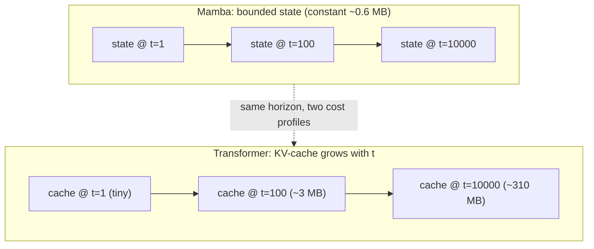

# Lesson 13 -- Streaming and complexity: the bounded-memory payoff, in bytes

> The payoff chapter of Contribution B. Lesson 12 proved the SSM state is horizon-independent
> *asymptotically*; here we turn that into concrete byte counts and the measured latency/memory-vs-
> horizon curve -- the thesis's signature figure. The claim is not "Mamba is more accurate"; it is
> **equal accuracy (Lesson 14) at bounded streaming cost** (this lesson). Grounded in `stream`,
> `MambaMixer.init_state`/`step`, and `TransformerBlock.step` (`generator.py`); numbers use the
> `GeneratorCfg` shapes ($d_{\text{model}}=512$, $n_{\text{layers}}=8$, $d_{\text{state}}=16$,
> $d_{\text{conv}}=4$, $\text{expand}=2 \Rightarrow d_{\text{inner}}=1024$).

## 13.0 The picture

*Same horizon, two state profiles: Mamba's box stays the same size for any t; the transformer's cache
grows linearly. This is the signature plot in cartoon form -- Lesson 13.5 measures the real curve.*

## 13.1 The streaming contract (the novelty restated)

Real-time text-to-motion means emitting motion **incrementally** -- one token step, decode, show,
repeat -- without re-reading the whole past. Formally the generator must admit a recurrence
$$
(y_t, h_t) = g_\theta(h_{t-1}, x_t),\qquad \dim(h_t)\ \text{bounded in } t,
$$
so that producing step $t$ costs the same whether $t=10$ or $t=10^4$.
`MotionTokenGenerator.stream_token_indices` implements this loop: initialise a state, consume the
text prefix once, then yield one $(B,R)$ token step per iteration. The entire question is the size
of $h_t$.

## 13.2 The two state shapes, in bytes

**Mamba (`init_state`)** -- per layer, the SSM state plus a tiny causal-conv buffer:
$$
\underbrace{d_{\text{inner}}\times d_{\text{state}}}_{\text{SSM}} + \underbrace{d_{\text{inner}}\times(d_{\text{conv}}-1)}_{\text{conv}}
= 1024\cdot16 + 1024\cdot3 = 19\,456 \ \text{floats/layer},
$$
$$
\times\, n_{\text{layers}}=8 \;\Rightarrow\; 155\,648\ \text{floats} \approx \mathbf{0.6\ MB\ (fp32)},\ \textbf{constant in } t.
$$

**Transformer (`TransformerBlock.step`)** -- the KV-cache stores every past key and value; at step $t$,
per layer:
$$
2\,(k,v)\times n_{\text{heads}}\times t\times d_{\text{head}} = 2\,t\,d_{\text{model}} = 1024\,t\ \text{floats/layer},
$$
$$
\times\, n_{\text{layers}}=8 \;\Rightarrow\; 8192\,t\ \text{floats} \approx \mathbf{0.03\,t\ MB},\ \textbf{linear in } t.
$$
So at horizon $t=1000$ the transformer already holds $\approx 31$ MB of cache and keeps growing; Mamba
holds $0.6$ MB at $t=1000$, at $t=10^4$, at $t=10^6$. The 100M preset scales the *constants*
($d_{\text{model}}, n_{\text{layers}}$) but not the *shape* of the curves -- that is the whole point.

## 13.3 Complexity, side by side

| | streaming **state** (memory) | **compute** per step | **compute** over horizon $L$ |
|---|---|---|---|
| Transformer twin | $O(n_{\text{layers}}\,t\,d_{\text{model}})$ -- **grows** | $O(t\,d_{\text{model}})$ | $\sum_t O(t d) = O(L^2 d)$ |
| **Mamba** | $O(n_{\text{layers}}\,d_{\text{inner}}\,d_{\text{state}})$ -- **constant** | $O(d_{\text{inner}}\,d_{\text{state}})$ | $O(L)$ |

Training (teacher-forced, parallel) is $O(L^2 d)$ for attention vs $O(L\log L)$ for the associative
scan (Lesson 12.6) -- so Mamba is asymptotically cheaper to *train* too, though our headline claim is
about *inference/streaming*.

## 13.4 Why "stream == batch" makes the figure trustworthy

Both backbones implement `forward` (parallel) and `step` (recurrent) that compute the **same**
function (`test_parity_mamba`; dropout is eval-identity). Therefore the model whose *quality* we
measure with `forward` (Lesson 14) is bit-for-bit the model whose *cost* we measure with `step` (this
lesson). There is no "fast approximate inference mode" caveat to defend -- efficiency and accuracy are
read off one model.

## 13.5 The measured figure (run on 100M twins, to horizon 8192)

`eval/streaming_bench.py` steps both backbones' `step()` to long horizons on **random-weight 100M
twins** (latency/state are architecture properties -- no checkpoint needed). Measured
(`scripts/figures/plot_streaming_bench.py`, transformer 95.4M/12 layers, Mamba 96.4M/23):

| horizon | Transformer state | Mamba state | Transf. ms/step | Mamba ms/step |
|---|---|---|---|---|
| 64   | 5.9 MB  | **2.68 MB** | ~12 | ~26 |
| 1024 | 76.7 MB | **2.68 MB** | ~12 | ~26 |
| 4096 | 303 MB  | **2.68 MB** | 16.5 | ~26 |
| 6144 | ~454 MB | **2.68 MB** | 23.6 | ~26 |
| 8192 | 605 MB  | **2.68 MB** | **~230** | ~26 |

**Memory -- decisive at every horizon:** Mamba's recurrent state is **2.68 MB flat**; the transformer's
KV-cache grows linearly to **605 MB at 8192** (~225x) and is unbounded. **Latency -- crossover near
~6500:** below that, the shallower transformer is faster per step; then quadratic attention takes over
and by **8192 the transformer is ~230 ms/step against Mamba's flat ~26 ms**. So at long horizons
**both** memory and latency favor the SSM; at short horizons the win is purely memory. Two caveats
stated plainly: Mamba here runs eager-mode (no fused CUDA kernel on the Windows test machine, a
roughly constant 2x per-step penalty), and the transformer's latency jump past L~6000 is amplified by
the 4 GB test GPU nearing its memory limit -- the **memory** result carries no such caveat, so the
efficiency argument leads with memory and reports latency as a corroborating trend (dissertation
sec. 5.5).

## 13.6 Why this matters for the use case

A bounded state means the viewer can stream **indefinitely** -- a continuous performance, a never-
ending prompt sequence -- at fixed per-step cost and memory. The transformer twin must either grow its
cache without bound (eventual OOM / rising latency) or drop history (a sliding window, which changes
the model). Bounded recurrent state is therefore not a micro-optimisation; it is what makes
open-ended real-time generation *possible* on fixed hardware (e.g. the 4GB laptop GPU).

## 13.7 Big-picture fit

This lesson supplies the **efficiency half** of Contribution B's two-part claim:
- Lesson 12 built the fixed-size-state model; **Lesson 13** quantifies its streaming cost (constant
  memory, linear compute) against the transformer's growing cache -- the signature plot.
- Lesson 14 supplies the **quality half**: the twins must at least *tie* on FID/R-precision, or
  "cheaper" would be meaningless -- at a converged 60-epoch budget the Mamba does better than tie, it
  **leads** on every metric measured (Lesson 19, dissertation sec. 5.6). "Leads on quality **and** wins
  on streaming cost" is the contribution.

## 13.8 Training cost is not inference cost

The Mamba twin trains **~9x slower per epoch** than the transformer (7.4 vs 66.5 min/epoch, measured
from the 60- and 100-epoch runs' wall-clock) but is only **~2x slower at inference** (9.4 vs 20.0
ms/step, measured in-process on the trained 60-epoch checkpoints, 30-step/120-frame generations) -- a
much smaller gap, and one that matches sec. 13.5's independently-measured "~2x per-step penalty" from
the architecture benchmark almost exactly. The reason the gaps differ: gradient checkpointing
(Lesson B / dissertation sec. 5.9, needed to fit the eager scan's activations in 4 GB) recomputes each
block's forward pass during backprop -- a training-only cost that inference, which never runs backward,
does not pay at all. The eager scan's multi-round, full-sequence tensor materialization (sec. 12) is
also far more expensive when run once per training sequence than once per inference `step()` call.
Practically: whatever this project's 4 GB card cost in training wall-clock, it does not carry over to a
deployed model -- both twins generate far faster than 20 fps real-time (19.5x transformer, 9.6x Mamba).

> **Bottom line:** measured on the 100M twins, Mamba streams in a **fixed 2.68 MB** of state at every
> horizon; the transformer's KV-cache grows to **605 MB at horizon 8192** (O(L), ~225x). Latency
> crosses over near ~6500 steps -- by 8192 the transformer is **~230 ms/step vs Mamba's flat ~26 ms**.
> Because `step` and `forward` are the same function, this efficiency is a property of the very model we
> score for accuracy -- so memory is decisive everywhere, and latency too past ~4k steps. Separately, at
> the trained 34M scale, training is ~9x slower for the Mamba twin but inference only ~2x -- the
> checkpointing cost that explains the training gap is training-only (sec. 13.8).
