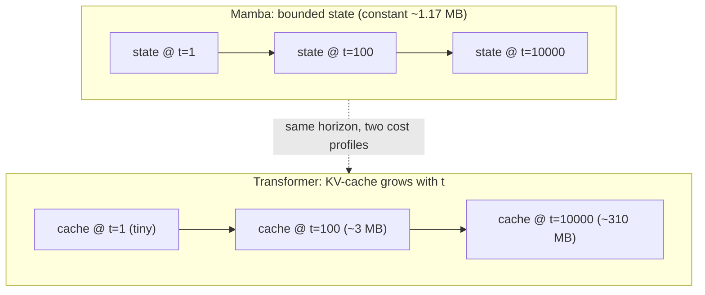

# Lesson 13 -- Streaming and complexity: the bounded-memory payoff, in bytes

> Lesson 12 explains why the SSM state has a fixed size. This lesson calculates that size and explains the cost of each token step.
>
> The deployed service restarts both backbones at fixed intervals. Both therefore have bounded state and linear total cost over the motion horizon.
>
> Equal accuracy remains a requirement for Contribution B. The historical checkpoint comparison does not prove equal accuracy or a Mamba quality advantage.
>
> The relevant code is in `src\text2motion\generation\nn_model.py`, `nn_backbones.py`, `contracts.py`, and `decoder.py`. The current benchmark code is in `src\text2motion\evaluation\benchmark.py`.

## 13.0 The picture

The diagram compares states without a restart. The Mamba label uses the current fifteen-layer twin. The Transformer labels use the eight-layer calculation in sec. 13.2.

The Transformer cache grows with the number of past positions. Its learned positions also impose a limit on the supported sequence length. The diagram describes cache growth; it does not prove that the current Transformer supports all shown horizons.

The service uses a different policy. It restarts both backbones every eight tokens with the latest sixteen tokens and the text prefix. This policy bounds both states.

## 13.1 The streaming contract (the novelty restated)

A real-time system must produce motion before the complete sequence exists. The generator produces tokens. The decoder converts these tokens into frames. The viewer displays the frames.

The generator has a recurrent interface:
$$
(y_t, h_t) = g_\theta(h_{t-1}, x_t),\qquad \dim(h_t)\ \text{bounded in } t,
$$

Here, the input contains the current token information. The state contains information from previous steps. The output supplies the next prediction.

For a fixed model and a bounded context, the cost does not grow with the horizon. Thus, step $t$ has a bounded cost at $t=10$ and $t=10^4$. A restart adds work at fixed intervals.

`MotionTokenGenerator.stream_token_indices` produces one $(B,R)$ token step at a time. It first processes the text prefix. Without a restart, it processes that prefix only once.

At each service restart, the generator processes the text prefix and the retained motion tokens again. The Transformer uses a batched `prefill`. Mamba uses recurrent prefix steps and then recurrent motion steps.

A token output does not mean that a frame chunk is ready. `StreamingMotionDecoder` retains:

- A left context for the convolutional decoder.
- The tokens for the next chunk.
- A measured right lookahead.

The decoder emits a chunk when it has the required tokens and lookahead. It emits the final pending frames when the token sequence ends.

## 13.2 The two state shapes, in bytes

The state calculation counts persistent tensors. It excludes model weights, temporary tensors, decoder buffers, transport buffers, and display buffers.

The current twin configuration uses $d_{\text{model}}=512$, $d_{\text{state}}=16$, $d_{\text{conv}}=4$, and $\text{expand}=2 \Rightarrow d_{\text{inner}}=1024$. The Transformer has $n_{\text{layers}}=8$. The resolved Mamba twin has fifteen layers.

For Mamba, `MambaMixer.init_state` creates an SSM state and a causal convolution buffer per layer:
$$
\underbrace{d_{\text{inner}}\times d_{\text{state}}}_{\text{SSM}} + \underbrace{d_{\text{inner}}\times(d_{\text{conv}}-1)}_{\text{conv}}
= 1024\cdot16 + 1024\cdot3 = 19\,456 \ \text{floats/layer},
$$
$$
\times\, n_{\text{layers}}=15 \;\Rightarrow\; 291\,840\ \text{floats}
= 1\,167\,360\ \text{bytes\ (fp32)},\ \textbf{constant in } t.
$$

Each float occupies four bytes in fp32. The state therefore occupies approximately 1.17 MB per batch row. Batch-one classifier-free guidance creates two rows, so the state occupies 2,334,720 bytes.

These sizes stay fixed at $t=1000$, $t=10^4$, and $t=10^6$. Fixed tensor sizes do not prove useful motion at these horizons. They also do not require an in-place state update.

For the Transformer, `TransformerBlock.step` retains each past key and value. At step $t$, each layer holds:
$$
2\,(k,v)\times n_{\text{heads}}\times t\times d_{\text{head}} = 2\,t\,d_{\text{model}} = 1024\,t\ \text{floats/layer},
$$
$$
\times\, n_{\text{layers}}=8 \;\Rightarrow\; 8192\,t\ \text{floats} \approx \mathbf{0.03\,t\ MB},\ \textbf{linear in } t.
$$

Here, the position count includes the prefix and the retained motion context. At horizon $t=1000$, this calculation gives $\approx 31$ MB. That is a cache-size calculation, not a supported horizon for every configuration.

The 100M preset changes the constants, including $d_{\text{model}}, n_{\text{layers}}$. It does not change the growth law without a restart.

A service restart limits the Transformer position count. It also replaces the Mamba state with a state derived from the text prefix and recent tokens. Both deployed states therefore have a fixed upper bound.

## 13.3 Complexity, side by side

First, consider token steps without a restart. The table shows the cost terms that depend on the horizon. It treats the model dimensions as fixed.

| | streaming **state** (memory) | **compute** per step | **compute** over horizon $L$ |
|---|---|---|---|
| Transformer twin | $O(n_{\text{layers}}\,t\,d_{\text{model}})$ -- **grows** | $O(t\,d_{\text{model}})$ | $\sum_t O(t d) = O(L^2 d)$ |
| **Mamba** | $O(n_{\text{layers}}\,d_{\text{inner}}\,d_{\text{state}})$ -- **constant** | $O(d_{\text{inner}}\,d_{\text{state}})$ | $O(L)$ |

The Transformer attends to a longer cache at each step. The sum of these costs gives the quadratic horizon term. Mamba updates a fixed-size state at each step.

Now apply the service policy. A restart occurs every eight tokens and retains at most sixteen motion tokens. The prefix length and these two limits do not grow with the horizon.

The Transformer therefore attends to a bounded context. Mamba also has bounded recurrent work. Each restart has bounded work, and the total deployed cost is $O(L)$ for both backbones.

For parallel teacher-forced computation, the attention term is $O(L^2 d)$. The associative scan in Lesson 12.6 has a cost of $O(L\log L)$. This scan comparison does not describe every fused kernel or establish a wall-clock advantage.

## 13.4 Why "stream == batch" makes the figure trustworthy

Both backbones provide `forward` for parallel computation and `step` for recurrent computation. Their parity tests compare outputs for the same text and token inputs.

The tests use `torch.allclose` with `atol=1e-4`. They establish agreement within a numerical tolerance. They do not establish bitwise identity.

The current backbones have no residual dropout. Shared embedding dropout remains, and evaluation mode disables it.

Quality generation uses `stream_token_indices` through `generation\pipeline.py`. It does not use teacher-forced `forward` to generate the motions for a quality score.

Parity supports a comparison between the parallel and recurrent implementations. It does not prove equal motion quality between backbones. It also does not prove equivalence between a full-history sequence and a sequence with restarts.

A valid quality-and-cost comparison must identify:

- The model configuration.
- The checkpoint and its provenance.
- The sample policy.
- The restart policy.
- The implementation and hardware.

## 13.5 The measured figure (run on 100M twins, to horizon 8192)

The historical figure measures architecture cost. It uses random or untrained weights, not the trained 34M twins. Its recorded configuration is `configs\final100m_fsq8x1024.yaml`.

The benchmark advances both backbones through long horizons without a restart. Its state calculation counts the retained recurrent tensors. It does not measure the complete service or the viewer.

The current implementation is `src\text2motion\evaluation\benchmark.py`. The historical plot uses `scripts/figures/plot_streaming_bench.py`. The results are in `artifacts\outputs\figures\streaming_bench_long.json`.

The 100M preset and the 34M twins have different state constants. Their byte counts must remain separate. Section 13.9 contains all measured results.

## 13.6 Why this matters for the use case

Fixed hardware requires bounded resource use for an open-ended session. A bounded generator state supplies one part of that requirement. The decoder and viewer also need bounded buffers.

Without a restart, the Transformer cache grows until the sequence stops or reaches a configured limit. Its learned positions prevent an unlimited sequence in the current implementation.

The service restarts both backbones with the text prefix and recent tokens. This policy changes the retained history for both models. It permits a bounded generator state for either backbone.

A fixed-size Mamba state does not guarantee a fixed state magnitude. It also does not guarantee that the motion remains relevant to the text.

An open-ended session therefore requires two separate checks:

- The resource use remains bounded.
- The motion remains useful over time.

A long-horizon state benchmark answers the first question only within its stated scope. A long-horizon motion evaluation must answer the second question.

## 13.7 Big-picture fit

Contribution B needs an efficiency result and a quality result.

Lesson 12 explains the fixed-size SSM state. This lesson calculates the state size and separates architecture cost from service cost.

Lesson 14 explains the quality evaluation. A valid comparison must test quality under the same deployed policy and a valid evaluation protocol.

The historical Mamba epoch-60 evaluation used the frozen epoch-30 EMA. The Transformer epoch-100 evaluation used the EMA from its resume point. These evaluations do not establish matched convergence.

The old results therefore do not prove that Mamba leads on every metric. They also do not prove that a longer run leaves the comparison unchanged.

The historical evaluation results remain provisional for additional reasons:

- They use the old caption and sample rules.
- They exclude mirrored samples.
- Their old 20-repetition intervals omit variation from motion generation.
- The complete 4,648-sample protocol correction remains unapplied.

The defensible architectural claim is that Mamba has a fixed recurrent state without a restart. The deployed restart policy gives both backbones bounded state and linear horizon cost.

## 13.8 Training cost is not inference cost

A training step computes a forward pass and a backward pass. An inference step computes no backward pass. Their costs therefore have different causes.

Gradient checkpointing repeats a block's forward computation during the backward pass. This extra work affects training. It does not affect inference.

The eager associative scan also creates tensors across several rounds of full-sequence computation. A recurrent `step()` processes one position. Its cost does not equal the cost of a complete parallel scan.

The current Windows environment has an available kernel. Kernel configurations use it. `MambaBackbone` enables block checkpointing when `use_kernel` is false.

The fused training path therefore changes the checkpointing cost. The historical eager timings do not predict the current kernel timings.

The service also supports CUDA-graph decode for Mamba only. A present-day latency comparison must state whether this option is active.

## 13.9 Results and limits of the evidence

### Historical 100M architecture benchmark

The Transformer has 95.4M parameters and twelve layers. Mamba has 96.4M parameters and twenty-three layers. The benchmark uses no restart and no trained quality checkpoint.

| horizon | Transformer state | Mamba state | Transf. ms/step | Mamba ms/step |
|---|---|---|---|---|
| 64   | 5.9 MB  | **2.68 MB** | ~12 | ~26 |
| 1024 | 76.7 MB | **2.68 MB** | ~12 | ~26 |
| 4096 | 303 MB  | **2.68 MB** | 16.5 | 27.7 |
| 6144 | ~454 MB | **2.68 MB** | 23.6 | ~26 |
| 8192 | 605 MB  | **2.68 MB** | **~230** | ~26 |

The table retains the historical rounded summaries except for the corrected Mamba value at 4096. The artifact contains the detailed values.

The Mamba state occupies exactly 2,684,928 bytes in this preset. It stays fixed at all recorded horizons. The Transformer cache reaches approximately 605 MB at 8192 tokens, about 225 times the Mamba state.

This 2.68 MB state belongs to the 100M preset. The fifteen-layer 34M twin instead uses 1,167,360 bytes per row. Batch-one CFG increases that state to 2,334,720 bytes.

At 4096 tokens, the Transformer remains faster: 16.5 ms against 27.7 ms. At 6144, the detailed values are 23.6 ms against 24.7 ms. At 7168, they are 205.2 ms against 25.9 ms.

The recorded latency crossover therefore lies between 6144 and 7168 tokens. The earlier estimate near 6500 falls within this interval. A claimed latency advantage past about 4000 tokens is incorrect.

At 8192, the Transformer takes approximately 230 ms per step. Mamba remains near the historical summary of 26 ms; the detailed endpoint is 28.18 ms.

These results describe the historical eager implementation. The current kernel is available, and kernel configurations use it. The historical approximate twofold per-step gap does not measure the current fused or CUDA-graph path.

The historical account includes this explanation:

> the transformer's latency jump past L~6000 is amplified by
> the 4 GB test GPU nearing its memory limit

This explanation remains unverified. The artifact records approximately 1.07 GB of peak allocation at 8192. It does not record other GPU occupancy.

The state result directly supports the different growth laws without a restart. The latency result describes this preset, implementation, hardware, and benchmark policy. It does not establish a deployed service crossover.

### Historical trained 34M timings

The old runs record 7.4 minutes per Transformer epoch and 66.5 minutes per Mamba epoch. Mamba therefore takes approximately nine times as long per epoch.

The old inference measurement uses 30-token, 120-frame generations from checkpoints labelled epoch 60. It records 9.4 ms per Transformer step and 20.0 ms per Mamba step.

The inference gap is approximately twofold. It resembles the historical short-horizon architecture gap. The recorded generation rates are 19.5 times real time for the Transformer and 9.6 times real time for Mamba at 20 fps.

These are historical timings, not current fused-path measurements. The training-only checkpointing work explains part of the difference between training and inference costs. The timings do not repair the invalid checkpoint quality comparison.

### Long-horizon motion evaluation

The supplied November 3 report uses 32 prompts, a 300-second horizon, and seed 2026. These values come from the supplied findings, not a verified repository artifact.

Without a restart, Mamba R@3 falls from 0.72 to 0.09 by 60 seconds. Per-step text alone reaches 0.13. A fixed state size therefore does not prevent a loss of text relevance.

The reported Mamba state RMS grows by three to five times and reaches a peak of thirteen times. State size and state magnitude are different quantities.

With restart policy B, Mamba R@3 stays within 0.47 to 0.69 and its state magnitude stays flat. The Transformer result stays within 0.63 to 0.66.

These results support the need to test long-horizon motion quality separately from state size. They do not establish a general quality advantage for Mamba.

Under the deployed restart policy, both backbones have bounded state and linear horizon cost. A final contribution claim needs valid quality measurements and current service measurements under that same policy.
