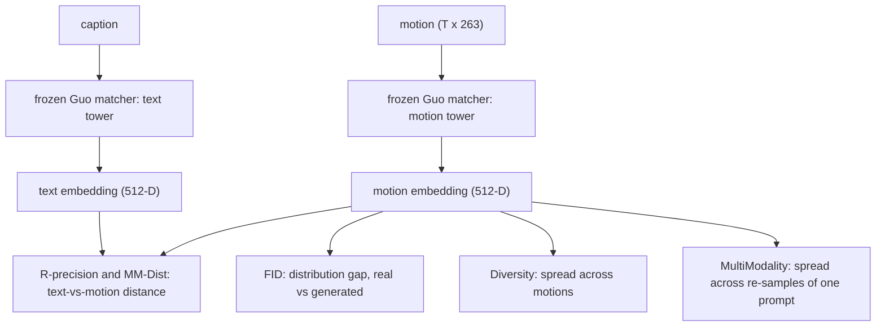

# Lesson 14 -- Evaluation metrics: what the numbers mean

> Lessons 8-13 describe the generator. This lesson defines the metrics for its quality.
> Contribution B requires twin parity on these quality metrics at bounded streaming cost (Lesson 13).
> A lower cost supports this claim only if the quality is equal.
> The definitions use `evaluation\metrics.py` and `evaluation\evaluator.py`.
> The evaluator reuses the frozen Guo et al. (CVPR 2022) matcher.
> The current protocol has differences from the published protocol.

## 14.0 The picture

The frozen matcher produces a shared space with 512 dimensions. The metrics use features from this space.

- FID measures a distance between two distributions of motion features.
- R-precision measures retrieval accuracy.
- MM-Dist measures the distance between each caption and its motion.
- Diversity measures distances between motions from different samples.
- MultiModality measures distances between samples for the same caption.

R-precision uses distances to rank motions, but its output is an accuracy. The shared matcher alone does not establish an identical evaluation protocol.

## 14.1 The shared embedding space (the one assumption)

All metrics use $(N, 512)$ features from the frozen Guo matcher. Each row contains the features for one caption or motion. The matcher maps captions and motions into a shared space where matched pairs are close.

The features are raw outputs from the matcher. The matcher applies no final L2 normalization. The helper functions in `evaluation\embeddings.py` also return these outputs without L2 normalization.

We do not retrain the matcher. We reuse the established evaluator feature space so that the metrics have the same feature definitions as published work.

A comparison also depends on the sample population and the evaluation procedure. The same matcher does not remove differences in sample selection, motion length, or random draws.

## 14.2 FID -- distributional realism

FID represents the real and generated motion features as two Gaussian distributions. The functions `fid` and `frechet_gaussian_distance` calculate the Frechet distance between them:
$$
\mathrm{FID} = \lVert \mu_r - \mu_g \rVert_2^2 \;+\; \mathrm{Tr}\!\Big(\Sigma_r + \Sigma_g - 2\big(\Sigma_r \Sigma_g\big)^{1/2}\Big),
$$
Here, $\mu,\Sigma$ are the mean and covariance of each set of $(N,512)$ features. The subscripts identify the real and generated sets.

The first term measures the difference between the means. The trace term measures the difference between the covariances. Thus, FID measures agreement between distributions, rather than the quality of one sample.

A lower FID is better. The Gaussian assumption is an approximation. The sample size $N$ introduces bias into the estimate. The tokenizer audit in Lesson 7 therefore compares splits at equal $N$.

## 14.3 R-precision -- does the motion match the text

The function `r_precision` measures retrieval accuracy. For each caption, it ranks the paired motion against $31$ distractors ($\text{pool\_size}=32$) by Euclidean distance. It then checks whether the paired motion is in the top-$k$:
$$
\mathrm{R@}k = \frac{1}{M}\sum_{i=1}^{M} \mathbb{1}\!\big[\,\mathrm{rank}(\text{true motion}_i) \le k\,\big],\qquad k\in\{1,2,3\}.
$$
The indicator is one when the paired motion satisfies the rank condition. The average gives the fraction of successful retrievals. For generator evaluation, the paired motion is the generated sample for that caption.

A higher R-precision is better. The metric tests whether the caption retrieves its motion among alternative motions.

The current implementation uses complete groups of 32 samples. Each caption has the other 31 motions in its group as distractors. An incomplete final group does not contribute.

Report the pool size and the seed policy. The protocol permutes the sample order before the retrieval test. The function uses seed 0 for the distractor order.

## 14.4 MM-Dist -- text-to-motion closeness

The function `mm_dist` calculates the mean Euclidean distance between paired text and motion features:
$$
\mathrm{MM\text{-}Dist} = \frac{1}{M}\sum_{i=1}^{M}\lVert t_i - m_i \rVert_2.
$$
Here, $t_i$ is the text feature vector and $m_i$ is the paired motion feature vector. Each pair contributes one distance.

A lower MM-Dist is better. This metric measures caption agreement without a distractor pool. R-precision also depends on the alternative motions in that pool.

## 14.5 Diversity -- does the model avoid collapse

The function `diversity` calculates the average distance over $300$ random pairs of generated motion features:
$$
\mathrm{Diversity} = \frac{1}{P}\sum_{(a,b)}\lVert m_a - m_b \rVert_2,\qquad P=300.
$$
The current implementation draws both indices with replacement and uses seed 0. A pair can contain the same sample twice. Such a pair contributes zero distance.

Diversity detects mode collapse. A model that produces the same motion for every caption has a Diversity near zero. Lesson 8 describes this failure for T2M-GPT with greedy sampling.

The target is a value close to the ground-truth (GT) Diversity. An excessive value can indicate noise. An insufficient value can indicate collapse.

## 14.6 MultiModality -- variation within one prompt

One caption can describe several valid motions. MultiModality measures the variation among repeated samples for that caption.

The current implementation uses the first requested captions from the evaluation set. It requests $k$ generated samples per caption, then draws ten pairs of feature vectors with replacement:
$$
\mathrm{MModality} = \frac{1}{M}\sum_{i=1}^{M}\ \frac{1}{Q}\sum_{q=1}^{Q}\lVert m_{i,a_{i,q}} - m_{i,b_{i,q}}\rVert_2,\qquad Q=10.
$$
Here, $M$ is the number of captions that contribute to the average. Each pair index refers to one of the generated samples for that caption.

The calculation does not average all distinct pairs. A pair can use the same sample twice. The pair generator uses `np.random.default_rng(0)`.

The motion generation call has no explicit seeds. Thus, the fixed pair seed does not make the complete MultiModality calculation reproducible. Captions with fewer than two generated samples do not contribute.

The generator must produce multiple samples per caption through CFG and nucleus sampling (Lesson 8). The function `calculate_multimodality` therefore belongs to `evaluation\evaluator.py`, outside the shared metric functions.

Like Diversity, MultiModality must support an assessment of valid variation. Its value alone does not establish that each variation is valid. The aim is calibration to GT, rather than the largest possible value.

## 14.7 The protocol (how a number becomes citable)

Select the model on the validation split. Evaluate the selected model on the test split once. That final evaluation can contain 20 generation repetitions.

The current protocol generates motion again for each repetition. It reports the mean and an approximate 95% confidence half-width:
$$
\bar{x} = \frac{1}{R}\sum_{r=1}^{R}x_r,\qquad
h_{95} = 1.96\,\frac{\mathrm{sd}(x_1,\ldots,x_R)}{\sqrt{R}}.
$$
Here, $R$ is the number of generation repetitions. The implementation calculates the standard deviation with `ddof=0`. The reported interval is the mean plus or minus the half-width, not the standard deviation.

The repeated summary covers these metrics:

- FID.
- R@1, R@2, and R@3.
- MM-Dist.
- Diversity.

MultiModality is a separate calculation, once per protocol call. It has no confidence half-width from these repetitions. The optional FID bootstrap also uses a separate calculation on generation run 0.

The current generation seed is `crc32(sample_id) + run`. The caption choice uses that seed. The seed policy gives the twins paired generation seeds.

The protocol uses seed 0 for its metric-order generator. Diversity uses a separate seed 0 on every call. MultiModality also uses seed 0 for its pair draws.

The current sample procedure has these properties:

- It maps mirror IDs to base IDs and removes duplicate base IDs.
- It constructs whole-motion samples and segments that match caption time intervals.
- It truncates each accepted motion to a multiple of the tokenizer downsample factor.
- It does not apply Guo's random one-unit length cut.

Mirror exclusion, fixed Diversity draws, and the MultiModality procedure remain unresolved differences. The official 4648-sample correction and seeds derived from 2026 are drafted, not applied.

Use a GT check as an external check, as Lesson 3 requires. A close GT result supports the matcher and data checks. It does not prove protocol identity.

Attach these fields to every reported result:

- The split.
- The number of clips and evaluation samples.
- The number of generation repetitions.
- The CFG scale.
- The length mode.
- The run-directory ID.
- The seed policy.
- The interval definition.

## 14.8 Big-picture fit

FID, R-precision, and MM-Dist measure the quality dimensions for the twin comparison. Contribution B requires parity on these dimensions before a lower streaming cost supports the claim in Lesson 13.

Diversity and MultiModality test variation across samples and within a caption. They help detect collapse or excessive variation that a FID value alone does not explain.

- The tokenizer's **recon-FID** (Lesson 7) is the same FID of sec. 14.2 applied to encode-decode rather
  than generation -- it caps what any generator on those tokens can reach. So Lessons 7 and 14 use one
  consistent yardstick across both contributions.

## 14.9 Results and their status

The latest recorded GT check gives these comparisons:

- R@3 is 0.799 against the published 0.797.
- MM-Dist is 2.964 against the published 2.974.
- Diversity is 9.505 against the published 9.503.

These values come from the recorded check in `.claude\docs\STATUS.md` dated 2026-11-02. They support the matcher check, but the protocol differences in sec. 14.7 remain.

The earlier lesson records these historical GT comparisons:

- R@1 was 0.514 against the published 0.511.
- Diversity was 9.67 against the published 9.50.
- MM-Dist was 2.977 against the published 2.974.

These historical values do not establish that the current protocol matches the published protocol.

Historical results labelled “20-rep” reused one generated motion set. Their repetitions changed caption choices and batch samples. Their intervals did not include variation from repeated motion generation.

The current code corrects the generation repetitions and the interval calculation. That correction does not update an earlier measured result. Historical model results require a new evaluation before they represent the current protocol.
