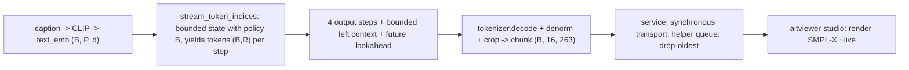

# Lesson 15 -- The live streaming demo: bounded decode to a viewer

> Contribution B produces motion a chunk at a time. A bounded generator state alone does not prove a bounded, nonblocking live pipeline. This lesson separates the generator, the decoder, the transport, and the viewer. The decoder is in `generation\decoder.py`; the interactive viewer is in `studio\viewer.py`. Paths refer to modules below `src\text2motion`.

## 15.0 The picture (with shapes)

The symbols describe these dimensions:

- $B$ is the batch size.
- $P$ is the number of text tokens.
- $d$ is the text feature dimension.
- $R$ is the number of motion token indices per step.
- 263 is the number of HumanML3D features per frame.

The generator produces tokens in sequence. The decoder uses future tokens that the generator already produces before it emits a motion chunk. This lookahead adds a delay; it does not make the generator non-causal.

## 15.1 From bounded state to a bounded pipeline

The Mamba generator produces tokens with $O(1)$ state (Lesson 13). This bound concerns sequence length. It does not state a fixed byte count for every model or batch size.

A live pipeline also needs these limits:

1. A fixed limit on the number of tokens that the decoder retains.
2. A fixed limit on transport buffers and viewer buffers.
3. A fixed limit on the work for each chunk.

A decoder must not retain the full token sequence. A transport buffer must not grow without a limit when the viewer consumes chunks slowly. The work for each chunk must not increase with the elapsed sequence length.

A memory bound does not prevent a wait. A fixed-capacity queue can block its producer when the queue is full. A synchronous socket transfer can also make the producer wait.

The helper queue and the live service use different transport rules. Section 15.3 describes that difference. Neither a generator state bound nor a decoder buffer bound proves a nonblocking whole pipeline.

## 15.2 Windowed decode (decode as tokens arrive)

`StreamingMotionDecoder.stream_tokens` consumes per-step tokens $(B, R)$. The default output chunk contains $\texttt{chunk\_tokens}=4$ token steps.

For the four-token case without context, the shape and denormalization relation is:

$$
\text{window } (B, 4, R)\ \xrightarrow{\ \text{tokenizer.decode}\ }\ (B,\,4\cdot\text{downsample},\,263) = (B, 16, 263)\ \xrightarrow{\ \cdot\sigma+\mu\ }\ \text{denormalised chunk}.
$$

Here, $\mu$ is the feature mean and $\sigma$ is the feature standard deviation. The relation uses a downsample factor of four.

The actual decoder uses overlapping windows. Each window contains left context, the tokens for the output chunk, and future lookahead. The decoder retains only a bounded amount of left context.

Let $L$ denote the left context, $C$ the output chunk size, and $A$ the future lookahead, all in token steps. The maximum token state is:

$$
W = L + C + A.
$$

The decoder follows this sequence:

1. Retain up to $L$ previously emitted token steps.
2. Collect $C+A$ pending token steps.
3. Decode the context and pending tokens together.
4. Apply the feature mean and standard deviation.
5. Crop the frames for the $C$ output token steps.
6. Move the emitted tokens into the bounded left context.

The first output waits for $C+A$ token steps. Four token steps alone do not suffice when the lookahead is nonzero. The decoder keeps the remaining lookahead tokens for the next window.

At the end of a finite sequence, the decoder emits all remaining pending tokens. The final chunk can contain fewer than four token steps.

The tokenizer decoder is non-causal. Left context and lookahead supply the neighboring tokens that its convolutions need. The implementation probes the required context when the caller does not specify it.

The decoder crops overlapping windows; it does not use overlap-add. Boundary behavior depends on adequate context and lookahead. A bounded buffer alone does not prove equality with a full-sequence decode.

## 15.3 The bounded queue: drop-to-latest

`run_producer` is an ordinary function in `generation\decoder.py`. It does not create a daemon thread. A caller can execute the function in a thread.

The function passes each decoded chunk to `__put_drop_oldest`. With a bounded queue, the helper follows this sequence:

1. Attempt to insert the new chunk without a wait.
2. Remove the oldest queued item if the queue is full.
3. Insert the new chunk.

The following contract describes this helper path, not the live service:

$$
\text{producer pace} \perp \text{consumer pace}\quad\Rightarrow\quad \text{a lagging viewer loses old frames, the generator never stalls.}
$$

In this scope, “never stalls” means that the producer does not wait for the consumer to free queue capacity. It does not remove the cost of token generation or decode.

The sentinel is `_END = None`. The producer inserts it with the same drop-oldest helper after the final chunk. The consumer uses it to detect the end of the sequence.

A queue with fixed capacity bounds the number of queued chunks. The caller must supply that capacity. The collection helper, `collect_stream`, retains all chunks for a finite result; it is not a bounded live consumer.

The actual service in `app\service.py` sends each chunk synchronously. The studio deliberately waits when motion extends too far beyond the playback position. Its body-fit queue can also make the studio wait.

These waits can propagate through the live transport to the generator. The live service therefore does not guarantee nonblocking transport from generation to display.

## 15.4 The viewer path

The viewer converts decoded HumanML3D features into a visible body. The service first recovers joints from the denormalized 263 features. Its recovery state carries the root placement across chunks.

The mesh path follows this sequence:

1. Recover joints from the decoded features.
2. Solve the SMPL-X pose analytically from the recovered joints.
3. Interpolate the pose rotations for the display rate.
4. Evaluate the SMPL-X body model.
5. Pass the mesh frames to the aitviewer studio.

`studio\avatar.py` uses `solve_smplx_pose_from_joints`. The mesh path does not directly convert the decoded rot6d features through forward kinematics.

The display uses rotation interpolation for the fitted body. The skeleton display separately uses linear interpolation of joint positions. These operations change the display, not the motion features that the evaluator scores.

A mesh display needs the SMPL-X model files. If those files are absent, the studio can use a skeleton display.

## 15.5 Why this is the thesis's visible payoff

The live demo lets an examiner inspect motion as chunks arrive. It also exposes failures that a feature-space score can miss.

For qualitative inspection, use these checks:

1. Compare the motion and its trajectory with the caption.
2. Inspect whether the feet remain planted during contact.
3. Inspect the direction and extent of joint bends.

Lesson 3.5 describes this qualitative role. A visible mesh does not by itself prove motion validity.

The architectural comparison and the deployed comparison use different state rules. Without a restart, Mamba retains fixed-size recurrent state. A transformer retains a KV cache that increases with the token count.

The current transformer also has a learned-position limit (Lesson 11). Without a restart, it cannot generate an indefinite sequence.

Policy B restarts both deployed twins. The policy rebuilds the generator state from the text and recent motion tokens. A bounded recent context then replaces the full motion history.

Let $K$ denote the restart interval and $H$ the maximum recent context. If $P$ is the text prefix length, the transformer position budget satisfies:

$$
P + H + K \leq \text{maximum learned positions}.
$$

This policy bounds both deployed histories. A periodic restart adds work, but that work has a fixed context limit.

A model-only architecture benchmark does not establish live service behavior. `evaluation\benchmark.py` measures a different scope from the decoder, transport, body fit, and display.

A fixed-size state also does not prove stable caption alignment over time. A recurrent state can change in magnitude while its shape remains fixed. Long-stream semantic tests must therefore accompany memory tests.

## 15.6 Implementation and measured results

The current implementation includes:

- `stream_token_indices` for incremental token generation.
- `StreamingMotionDecoder` for bounded-context decode with lookahead and cropped output.
- `run_producer` for the separate drop-oldest queue helper.
- `studio\viewer.py` for the interactive skeleton and SMPL-X mesh display.
- `scripts\render\render_mesh_demo.py` for offline montage and GIF export.

The interactive consumer already exists. A completed headless MP4 export is not established by the montage and GIF script.

The retained service policy is in `configs\service.yml`. It restarts both twins every eight token steps and retains up to sixteen context token steps. The synchronous service and studio waits remain part of the live path.

The supplied audit reports a long-stream experiment dated 2026-11-03. It uses 32 prompts, 300 seconds per prompt, and seed 2026.

| Model or condition | Reported result |
|---|---|
| Mamba without restart | R@3 falls from 0.72 to 0.09 at 60 seconds. |
| Mamba without restart | State RMS increases 3–5×, with a peak increase of 13×. |
| Mamba with policy B | R@3 remains between 0.47 and 0.69; state RMS remains flat. |
| Transformer with policy B | R@3 remains between 0.63 and 0.66. |
| Per-step text alone | R@3 is 0.13. |

R@3 measures text-motion retrieval accuracy. State RMS measures the root mean square of the state values. Neither measure is a state byte count.

These results support the retained restart policy for both twins. They do not establish stable semantics at every possible duration.

The display check B2.4 appears in `doc\notes\module_ledger.csv`, dated 2026-11-02. It tests linear joint interpolation at factor six on 2189 test clips.

The check reports:

- Median jerk p95 increases from 109 to 2413 m/s³.
- Added bone shortening exceeds 2% in 885 clips.
- Whole-clip interpolation equals chunk interpolation, and the foot-slide check passes.

The jerk and bone results fail the provisional display limits. They concern linear joint interpolation, not the fitted body's rotation interpolation. The evaluator scores remain unchanged because this interpolation affects only the display.

The demo demonstrates incremental generation and bounded-context decode. The retained policy bounds both deployed generator histories. Synchronous transport, display artifacts, and finite semantic tests limit the claim of an indefinite, nonblocking live pipeline.
