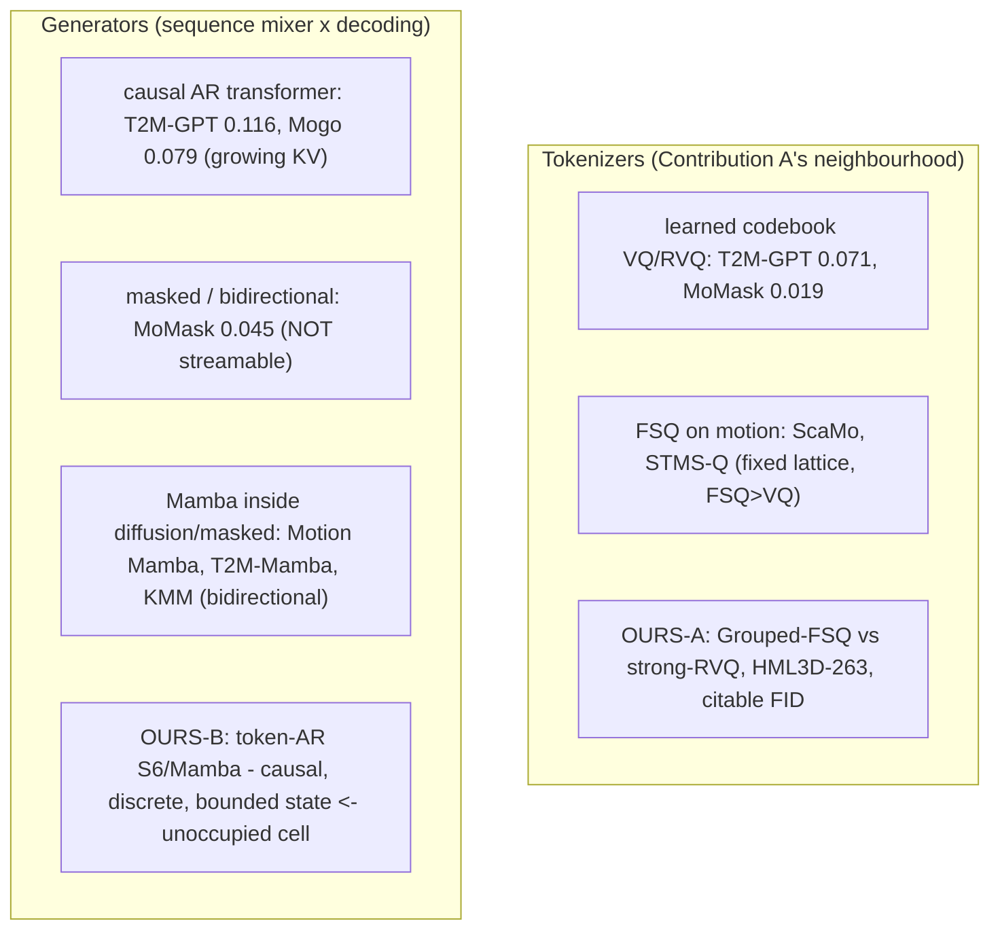

# Lesson 16 -- Related work and positioning: where our two contributions sit

Lessons 1-15 explain the system. This lesson compares the system with other motion methods and defines the scope of each contribution.

Every citation traces to `.claude/docs/references.md`. That file records the arXiv identifiers and the published HumanML3D results. Each comparison must state which property differs.

## 16.0 The landscape

A tokenizer converts motion into discrete tokens. A generator predicts those tokens from a caption and previous tokens. These components address different questions.

Contribution A compares two tokenizers under the same test conditions. Contribution B compares a causal S6/Mamba generator with a transformer that has a matched parameter count.

The diagram identifies the method families. Its numeric labels are published reference values. Section 16.6 contains the result comparisons and their limits.

## 16.1 Contribution A -- Grouped-FSQ vs strong-RVQ on HumanML3D-263

A learned codebook contains vectors that the tokenizer updates during training. Vector quantization, or VQ, selects a codebook vector for an input. Residual vector quantization, or RVQ, applies successive codebooks to the residual errors.

The learned-codebook methods follow this sequence:

1. VQ-VAE introduces the learned codebook (van den Oord, 1711.00937).
2. SoundStream (2107.03312) and EnCodec (2210.13438) use RVQ for audio.
3. T2M-GPT (2301.06052) uses VQ for motion.
4. MoMask (2312.00063) uses RVQ for motion.

Finite scalar quantization, or FSQ, uses fixed scalar levels. It does not require a learned codebook, codebook EMA, or dead-code reset. Here, EMA means an exponential moving average.

The fixed-lattice methods include:

- FSQ (Mentzer 2309.15505).
- ScaMo (2412.14559), which reports FSQ above VQ for motion.
- STMS-Q (2508.08991), which uses FSQ at multiple scales and reports results above MoMask.

A fair comparison must match the number of bits per token step. For codebook sizes $K_1,\ldots,K_G$, the nominal token capacity is:

$$
b=\sum_{g=1}^{G}\log_2 K_g.
$$

Here, $G$ is the number of token groups or codebooks. The value $b$ describes nominal capacity. It does not measure actual token use or reconstruction quality.

Contribution A compares Grouped-FSQ with a strong RVQ baseline on HumanML3D-263 at matched bits per step. The RVQ baseline uses EMA and dead-code reset. Lessons 5-7 explain the tokenizer design and the comparison.

FSQ itself is a known method. The proposed contribution is the controlled HumanML3D-263 comparison with a reported FID. The previous RVQ results do not establish superiority under corrected test conditions. Section 16.6 explains why RVQ must train again.

- **Honest novelty flag:** **AnyMo** (2605.29488, 2026) uses a 4-stage Residual-FSQ tokenizer (close
  to our design) -- but on OmniHuMo, **no** HumanML3D recon-FID, **no** code. It does not scoop us; it
  *tightens* our framing to "matched, citable HumanML3D-263 comparison."

## 16.2 Contribution B -- the first token-autoregressive S6/Mamba motion generator

A token-autoregressive generator predicts the next discrete token from the caption and previous tokens. For a caption $c$ and a sequence $z_1,\ldots,z_T$, the probability has this form:

$$
p(z_1,\ldots,z_T\mid c)
=
\prod_{t=1}^{T}p(z_t\mid z_1,\ldots,z_{t-1},c).
$$

The factor for step $t$ uses no future token. This causal order permits token output before the complete sequence exists.

The causal transformer references include:

- T2M-GPT (2301.06052), which uses a KV-cache.
- Mogo (2412.07797), which uses causal RVQ and explicitly supports streaming.
- AttT2M (2309.00796).

MoMask (2312.00063) uses masked, bidirectional passes. Related methods include MMM (2312.03596) and BAMM (2403.19435). Their bidirectional passes require future context and fail the streaming gate. Their published FID values remain useful quality references.

- **Mamba already in motion -- but never as we use it:** **Motion Mamba** (2403.07487), **T2M-Mamba**
  (2602.01352), **KMM** (2411.06481) all place Mamba *inside diffusion or masked, bidirectional*
  pipelines. **None is a token-autoregressive Mamba/S6 generator.** That is the unoccupied cell
  (selective-scan core: Mamba/S6 2312.00752, S4 2111.00396).

LLaMo (2602.12370, 2026) is the closest rival in this comparison. It supports motion output in real time through a continuous autoregressive latent, as MotionStreamer does. Our generator predicts discrete tokens and uses an SSM. These properties distinguish the methods.

An SSM updates a recurrent state from the previous state and the current input. A general description is:

$$
h_t=f(h_{t-1},z_t,c),\qquad \dim(h_t)=d_h.
$$

For a fixed model configuration, the state dimension $d_h$ does not depend on the sequence length $T$. This property describes recurrent state size. It does not prove that a long motion sequence preserves the caption meaning.

- **Our claim is a 4-conjunct cell:** next-token AND discrete AND causal AND fixed-state SSM. Each
  conjunct is occupied somewhere; their conjunction is not.

## 16.3 What we deliberately are NOT

The large-motion methods study larger datasets or models:

- LMM (2404.01284) uses a diffusion-transformer.
- Being-M0/MotionLib (2410.03311) uses a million-clip dataset and LFQ.
- MotionMillion (2507.07095) studies motion generation at a large data scale.
- MotionGPT (2306.10900) belongs to the large-motion methods.

This thesis studies the sequence mixer under controlled conditions. The intended comparison matches these properties:

- The parameter count.
- The data.
- The seed.
- The training budget.
- The HumanML3D representation.
- The evaluation procedure.

The comparison tests a bounded-state SSM against a causal transformer. A larger dataset or model addresses a separate question. A controlled mechanism comparison does not establish a result at a larger scale.

## 16.4 What we reuse unmodified (so numbers stay comparable)

We reuse the standard HumanML3D-263 representation and the frozen Guo evaluator from CVPR 2022. Lessons 3 and 14 explain these components. We do not retrain the Guo matcher.

The generator text encoder and the evaluator have different roles. The generator uses CLIP to interpret the caption. The evaluator uses the frozen Guo encoders to compute motion and text features.

For generator conditioning, we use CLIP ViT-B/32. Its pooled, projected caption vector has 512 dimensions. A projection converts that vector into a prefix token. T2M-GPT, MoMask, and Mogo use this prefix recipe. Our last-layer unfreeze differs from their frozen encoder policy; Lesson B explains the choice.

T5 is excluded from the controlled encoder comparison. A change from CLIP to T5 changes the generator conditioning and adds another experimental difference. It does not change the frozen Guo feature space that FID uses.

Let $E_m$ denote the frozen Guo motion encoder. The evaluator compares these features:

$$
u_i=E_m(x_i),\qquad \hat{u}_i=E_m(\hat{x}_i).
$$

Here, $x_i$ is a reference motion and $\hat{x}_i$ is a generated motion. The generator text encoder does not appear in this feature calculation.

A shared matcher does not prove that two evaluation procedures are identical. The current code still differs from the reference procedure:

- `src\text2motion\motion\storage.py` removes mirror prefixes and merges the resulting identifiers.
- `src\text2motion\evaluation\metrics.py` uses fixed Diversity draws, with seed 0 by default.
- `src\text2motion\evaluation\evaluator.py` uses the first captions for MultiModality.
- MultiModality uses unseeded generation and a pair generator with seed 0.
- MultiModality draws ten pairs with replacement, so a motion can pair with itself.
- The evaluator does not apply the Guo random length cut.

The official 4648-sample list and seeds derived from 2026 are draft corrections. They are not applied. The current code must remain distinct from that proposed procedure.

We cite the published generator values as quality references. We do not retrain those baseline generators. Section 16.6 separates their published values from our measured results.

## 16.5 Big-picture fit

Contribution A studies Grouped-FSQ against strong RVQ on HumanML3D-263 under matched conditions. Corrected RVQ results are necessary before the thesis can claim controlled superiority.

Contribution B occupies the token-autoregressive, discrete, causal SSM cell. The comparison separates methods by these properties:

- The model and data scale.
- Discrete tokens or continuous latents.
- Causal or bidirectional computation.
- The dataset.
- The state mechanism.

Both contributions use the field's frozen evaluator. Protocol differences still limit direct numeric comparisons. The thesis must state those differences beside the results.

The novelty claim remains a 4-conjunct cell no published motion model occupies. That claim is separate from the measured tokenizer result and from proof of evaluation equivalence.

## 16.6 Results and limits of the comparisons

### Published reference values

These values come from the cited methods. They are reference values, not results from our models.

| Method | Citation | Measure | Published value |
|---|---|---|---|
| T2M-GPT | 2301.06052 | Reconstruction FID | 0.071 |
| MoMask | 2312.00063 | Reconstruction FID | 0.019 |
| MoMask | 2312.00063 | MPJPE | 29.5 mm |
| FSQ | Mentzer 2309.15505 | Reported code use | ~100% |
| T2M-GPT | 2301.06052 | Generation FID | 0.116 |
| Mogo | 2412.07797 | Generation FID | 0.079 |
| AttT2M | 2309.00796 | Generation FID | 0.112 |
| MoMask | 2312.00063 | Generation FID | 0.045 |

The MoMask reconstruction values define the published tokenizer target. Its generation FID defines a published quality reference, although its bidirectional passes fail the streaming gate.

### Our tokenizer result

The frozen FSQ tokenizer has a recorded reconstruction FID of 0.0170. A replication gives 0.016963. This replication supports the FSQ measurement.

The old RVQ scores contain defects that invalidate a controlled superiority claim:

- The encoder and codebook EMA states did not match.
- The code assignment order used inconsistent codebook values.
- The default quantizer dropout previously caused a crash.

The RVQ assignment correction affects future training. It does not correct old checkpoints or their results. Corrected RVQ must train again before the comparison can establish superiority. Lesson 7.0a must therefore remain a historical comparison.

### The evaluator check

The latest check passes real motion through our evaluator. Its values are close to the published values:

| Measure | Our latest check | Published reference |
|---|---|---|
| R@3 | 0.799 | 0.797 |
| MM-Dist | 2.964 | 2.974 |
| Diversity | 9.505 | 9.503 |

These values support a check of the evaluator outputs. They do not prove protocol identity. Mirror exclusion, fixed Diversity draws, MultiModality pair selection, and the absent random length cut remain differences.

The thesis can report the replicated FSQ result and the frozen matcher reuse. It must not present the old RVQ comparison as corrected evidence. It must also distinguish the current evaluation procedure from the draft corrections.
