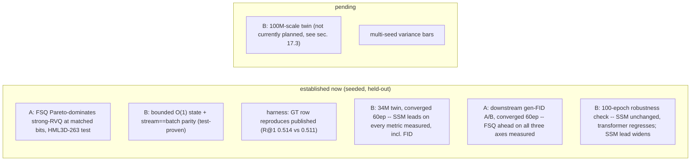

# Lesson 17 -- Limitations, scope, and conclusion

> The closing bookend. It consolidates every honesty caveat scattered through Lessons 1-16 into one
> place, separates **what is established now** from **what is pending**, and states the contribution
> at its true scope. A committee rewards a precise limitations section; over-claiming is the failure
> mode it punishes. All claims here are grounded in the lessons they summarise.

## 17.0 Established vs pending

## 17.1 What is established now

- **Contribution A (proven, seeded, held-out):** at matched bits/step on HumanML3D-263 **test**, the
  Grouped-FSQ tokenizer has lower recon-FID than a strong EMA+reset RVQ at every cell **and** carries 0
  codebook parameters -> Pareto-dominance (Lessons 7, 7.0a). Best FSQ reaches the MoMask reconstruction
  ceiling (~0.019-0.020) at 8 codes/step.
- **Contribution B (structural part, proven):** the SSM backbone has horizon-independent state and
  `step`==`forward` parity (`test_parity_mamba`), so the $O(1)$ memory / $O(L)$ compute asymptotics are
  facts about the architecture (Lessons 12-13), not experimental hopes.
- **Contribution B (quality part, measured at the 34M pilot scale, converged and robustness-checked):**
  the controlled twin table (Lesson 19, Table 1) is complete on the full 2189-clip test split at a
  converged 60-epoch budget -- the SSM **leads the transformer on every metric measured**, including
  FID (0.121 vs 0.132), reversing an earlier 18-epoch reading that had shown the transformer ahead on
  FID. A further 40-epoch extension (100 total) leaves the SSM's checkpoint and result unchanged, while
  the transformer's val-selected checkpoint at 100 epochs generalizes worse to test than at 60 --
  widening the SSM's lead rather than closing it (sec. 17.2).
- **Downstream tokenizer A/B (done, converged):** an FSQ-token generator beats an RVQ-token generator
  end-to-end at a converged 60-epoch budget (FID 0.132 vs 0.294, R@1 statistically tied) -- FSQ leads
  on all three axes now measured: reconstruction, codebook health, and downstream generation
  (Lesson 7.4).
- **Harness validity:** the GT row reproduces published metrics (Lesson 14), so the evaluator/data
  wiring is correct before any model row is trusted.

## 17.2 What is pending (do not over-claim)

- **The 34M controlled twin is now converged and robustness-checked (sec. 17.1), not merely
  re-verified.** Extending both twins a further 40 epochs (100 total) found no improvement for either:
  the Mamba's best-by-val checkpoint stayed at epoch 30 throughout, and the transformer's val-selected
  epoch-100 checkpoint scored worse on the full test split than its epoch-60 one, despite a better
  validation score -- read as the data-constrained regime (sec. 17.3, dissertation sec. 6.1) rather
  than an optimization failure, since training loss decreased smoothly for both models the entire time.
  The **100M-scale** twin remains unmeasured entirely, and is not currently planned (sec. 17.3).
- **Streaming benchmark (DONE):** measured on 100M twins (`eval.streaming_bench`) -- Mamba state
  2.68 MB flat at every horizon vs transformer KV growing 76.7 MB @ 1024 -> 303 MB @ 4096 -> 605 MB @
  8192 (O(L), ~225x at 8192); the bounded-memory claim is empirically confirmed (Lesson 13.5). Latency
  crosses over near L ~ 6500 -- reported as a corroborating trend since the longest horizons are near
  the 4 GB test card's memory limit; the memory result carries no such caveat.
- **Downstream tokenizer A/B (DONE, converged):** an FSQ-token generator beats an RVQ-token generator
  end-to-end at a converged 60-epoch budget (FID 0.132 vs 0.294, R@1 statistically tied) -- FSQ leads
  on all three axes now measured.
- **Generalization audit (DONE):** `outputs/generalization.md` -- gap = test - train <= 0 for 13/15
  cells -> no overfitting; FSQ dominance holds equal-N (Lesson 7.2).
- **Single seed:** no variance bars yet; the dominance in Lesson 7.0a is at one seed.

## 17.3 Scope and constraints (deliberate boundaries)

- **Compute:** a 4 GB local GPU caps local scale; the 100M-parameter twin has not been pursued, and is
  not currently planned even with more compute -- the 100-epoch robustness check (sec. 17.1) found that
  more training on the current data budget helps neither twin, and dissertation sec. 6.1's
  entropy-budget analysis argues more *capacity* on the same fixed data would push further into the
  same over-parameterised regime, not away from it. The tokenizer matrix and the 34M controlled twin
  are therefore the measured contributions, with more/more-diverse fine-tune data -- not scale -- left
  as the effective future lever.
- **Representation:** the citable track is **body-only HumanML3D-263**; whole-body SMPL-X 168 (hands)
  and face are **deferred** (ADR 0001) -- a demo target, not a citable-FID claim.
- **Demo:** the producer pipeline is implemented; the aitviewer SMPL-X mesh render is Phase 5
  (Lesson 15.4) -- engineering, not a research risk.
- **Baseline honesty:** our strong-RVQ is intentionally a *fair* baseline (shared enc/dec/budget), not
  MoMask's heavily-tuned RVQ (0.019). We claim a controlled FSQ>RVQ result, **not** "beats the best-ever
  RVQ" (Lesson 7.4).
- **Concurrent work:** AnyMo (2026) uses a similar Residual-FSQ tokenizer but on a different dataset
  with no released code or HumanML3D FID; our framing is tightened accordingly (Lesson 16.1).

## 17.4 Threats to validity and their mitigations

| Threat | Mitigation (status) |
|---|---|
| selection leak onto test (tokenizer) | switched to val-select / test-once (done in trainer) |
| FID is sample-size biased | equal-$N$ across splits in the generalization audit (Lesson 7) |
| single-seed point estimates | multi-seed variance bars (planned) |
| mirror-map indices not pinned to code | verify against regeneration code (Lesson 4a caveat) |
| window-boundary artifacts in streaming decode | overlap-add refinement (Lesson 15.2; not on the claim path) |

## 17.5 Conclusion

This thesis makes two contributions, each at a precise, defended scope. **(A)** A Grouped-FSQ motion
tokenizer that, in a controlled rate-distortion experiment on HumanML3D-263, **Pareto-dominates** a
strong RVQ baseline -- lower distortion at every matched rate with zero codebook parameters -- and
whose advantage carries through to downstream generation at a converged epoch budget. **(B)** The
first **token-autoregressive S6/Mamba** motion generator, whose bounded recurrent state gives $O(1)$
streaming memory against the transformer twin's growing KV-cache -- a structurally proven efficiency
advantage, measured at the 34M pilot scale to **lead the transformer on every quality metric measured**
once both are converged, a lead confirmed rather than eroded by a further 40-epoch robustness check.
Quality at 100M scale remains open, and is not currently planned (sec. 17.3). Both are measured on the
field's own unmodified evaluator, so the numbers are comparable, and the open items above are stated
plainly rather than hidden.

> **Bottom line:** the established results are the FSQ dominance plus its downstream confirmation (A),
> and the bounded-state structure plus a converged, robustness-checked quality lead over the
> transformer twin (B); pending is B's scale-up to 100M (not currently planned) and multi-seed variance
> bars throughout. The contribution is the *controlled, citable* pairing of a better tokenizer with the
> first discrete causal-SSM streaming generator -- and the honesty about exactly which claims are
> evidenced today.
