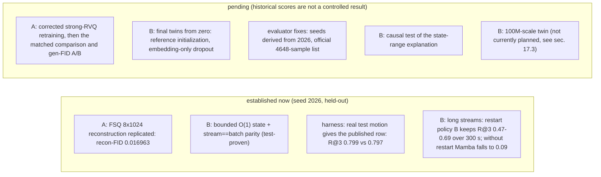

# Lesson 17 -- Limitations, scope, and conclusion

> This lesson collects the limitations from Lessons 1-16. It separates established facts from historical results and work that remains incomplete. Each claim has a defined scope.

## 17.0 Established vs pending

The diagram separates structural evidence from claims that require new experiments. Section 17.6 contains all numerical results.

## 17.1 What is established now

### Contribution A: the tokenizer

Grouped-FSQ represents motion with discrete codes and has no codebook parameters. The tokenizer uses the HumanML3D-263 representation.

The reconstruction result has a separate replication. This replication supports the FSQ result itself.

The historical RVQ comparison does not establish controlled superiority. The RVQ runs contain defects in these parts:

- The encoder and the codebook use mismatched EMA states.
- The code assignment order contains a defect.
- The default quantizer dropout previously causes a crash.

A corrected RVQ baseline needs a new run. Lessons 7 and 7.0a describe the historical matrix.

### Contribution B: the generator structure

The SSM backbone has a recurrent state whose size does not depend on the sequence length. The tests establish `step`==`forward` parity through `test_parity_mamba`.

The architecture therefore has $O(1)$ memory and $O(L)$ compute for token generation. Lessons 12-13 explain these properties.

These properties do not establish stable text alignment over an unrestricted stream. A fixed state size limits memory; it does not limit state values or preserve caption relevance.

### Contribution B: the service policy

The service retains policy B for both twins. This policy periodically resets the backbone and restores a bounded context from recent tokens.

The policy bounds both the Mamba state and the transformer history. Without this policy, the transformer reaches its learned-position limit.

The structural comparison with a transformer cache that grows with the sequence length describes a different execution policy. It does not describe the deployed twins.

### The decoder and the viewer

The decoder keeps bounded left context and future lookahead. It decodes overlapping windows and emits only the frames that belong to the current output chunk.

The first output requires `chunk_tokens + lookahead` tokens, unless the stream ends earlier. The final flush emits the remaining frames.

The interactive SMPL-X mesh viewer exists. It recovers joints from HumanML3D-263 features and analytically solves the SMPL-X pose from those joints.

The display interpolates rotations between pose samples. Offline montage and GIF export also exist. These exports do not establish complete MP4 export.

### The evaluator

The evaluator reuses the frozen Guo matcher. This reuse preserves the matcher feature space.

It does not establish an identical evaluation protocol. The current evaluator creates caption-aligned motion pieces and excludes mirror IDs.

The current protocol also retains these differences:

- Diversity uses fixed random draws with seed 0.
- MultiModality uses its current caption selection and pair procedure.
- The Guo random length cut is absent.

The official sample-list correction and seeds derived from 2026 remain drafts. The code does not apply these corrections.

## 17.2 What is pending (do not over-claim)

### Corrected generator comparisons

The historical twin runs do not establish convergence or a controlled quality lead. Resume froze the evaluated EMA weights.

A later epoch label therefore does not prove that the evaluated model contains later weights. A smooth decrease in the training loss does not resolve this defect.

The historical runs also contain other confounds:

- The model initialization contains defects.
- The backbone dropout differs between the twins.
- The crop choices remain fixed in data workers.
- Resume affects the evaluated EMA weights.

The final twins must train from zero with the reference initialization and the shared embedding-only dropout policy. Resume from an old checkpoint mixes experimental conditions.

The 100M-scale quality comparison remains unmeasured. It is not currently planned.

### Corrected tokenizer comparisons

The downstream FSQ/RVQ comparison remains historical. Corrected RVQ training must precede a controlled claim about reconstruction or downstream generation.

The historical generalization audit remains available at `outputs/generalization.md`. Its equal-$N$ comparisons address sample-count differences.

Those comparisons do not correct defects in the baseline. They also do not establish the absence of overfit across all conditions.

### Multiple seeds

The historical matrix uses one seed. Multiple independent training seeds and variance estimates remain incomplete.

A separate FSQ replication does not replace a comparison across training seeds.

### The complete service benchmark

The existing benchmark measures the models alone. It does not measure the complete service or its restart policy.

A service benchmark must include these components:

- The periodic backbone reset.
- The tokenizer decoder.
- The synchronous transport.
- The SMPL-X pose solution.
- The display and playback waits.

The service sends chunks synchronously. The studio can wait for playback and for space in the pose-solution queue.

The drop-oldest queue helper therefore does not guarantee nonblocking transport through the complete system.

## 17.3 Scope and constraints (deliberate boundaries)

### Compute and capacity

A local GPU limits the feasible model size. The tokenizer matrix and the pilot twin runs form the historical experimental scope.

The longer historical runs do not establish a data-constrained regime. The resume defect prevents that conclusion.

Dissertation sec. 6.1 gives an entropy-budget argument about model capacity and a fixed dataset. This argument remains a hypothesis for the current experiments.

The evidence does not establish that more capacity cannot help. It also does not establish that more data is the only effective future option.

The 100M-scale quality comparison remains outside the current plan. More data and more varied data remain possible future options.

### Representation

The citable track uses body-only HumanML3D-263. Whole-body SMPL-X 168, hands, and face remain deferred under ADR 0001.

The SMPL-X mesh display does not change this scope. A body pose derived from recovered joints is not a whole-body generation result.

### Demo scope

The producer pipeline and the interactive mesh viewer exist. Lesson 15.4 describes the viewer.

The current modules are:

- `src\text2motion\generation\decoder.py`
- `src\text2motion\studio\viewer.py`
- `src\text2motion\evaluation\metrics.py`
- `src\text2motion\evaluation\evaluator.py`
- `src\text2motion\evaluation\benchmark.py`

The demo remains a separate engineering component. Its transport and display limitations require explicit checks.

### Baseline scope

The strong-RVQ baseline shares the encoder, decoder, and experimental budget with FSQ. This design intends a controlled comparison.

The historical defects prevent a verified fairness claim. Corrected RVQ training must establish the intended comparison.

MoMask uses a separately tuned RVQ. A controlled comparison with the project baseline does not establish superiority over every RVQ tokenizer.

### Concurrent work

- **Concurrent work:** AnyMo (2026) uses a similar Residual-FSQ tokenizer but on a different dataset
  with no released code or HumanML3D FID; our framing is tightened accordingly (Lesson 16.1).

## 17.4 Threats to validity and their mitigations

| Threat | Mitigation (status) |
|---|---|
| Selection of a tokenizer through test results | The trainer selects through validation and evaluates the test split once. |
| FID bias from different sample counts | The generalization audit uses equal-$N$ samples across splits (Lesson 7). |
| Estimates from one seed | Multiple training seeds and variance estimates remain planned. |
| Unsupported joint counts in the mirror map | Tests establish mirror involution for 22 and 52 joints. Inputs with 25-51 joints remain unsupported. |
| Artifacts at decoder window boundaries | The decoder uses bounded left context and future lookahead, then crops each output window (Lesson 15.2). |
| Text alignment degrades during a long stream | The service retains periodic reset policy B for both twins. |
| Display interpolation changes motion geometry | The display requires separate jerk and bone-length checks. The evaluator does not use these display frames. |
| Historical RVQ defects | A corrected RVQ baseline requires a new run before a superiority claim. |
| Historical twin confounds | Both final twins require new runs with reference initialization and embedding-only dropout. |
| Evaluation protocol differs from the reference | The sample-list and seed corrections remain drafted, not applied. |
| A model benchmark differs from the service | Report model-only results separately from service results under policy B. |

The decoder context reduces boundary errors. It does not establish that every emitted frame equals a full-sequence decode at the start or end of a stream.

The mirror tests establish behavior for the supported layouts. They do not make every intermediate joint count valid.

The display has its own validity limits. A visually smooth sequence can still contain excessive jerk or changes in bone length.

## 17.5 Conclusion

This thesis studies two contributions within a defined scope.

Contribution A is a Grouped-FSQ motion tokenizer for HumanML3D-263. It has no codebook parameters, and its reconstruction result has a separate replication.

Controlled superiority over strong-RVQ remains unverified. The historical baseline defects also limit the downstream FSQ/RVQ claim.

Contribution B is the first **token-autoregressive S6/Mamba** motion generator. Its recurrent structure gives $O(1)$ memory for token generation.

The deployed transformer also has bounded history under policy B. The service therefore requires a comparison that includes the reset cost for both twins.

The long-stream evidence separates memory size from semantic stability. The retained policy restores recent context and the text prefix at each reset.

The historical pilot scores do not establish a converged quality lead. Corrected runs must establish that comparison.

The evaluator reuses the field's frozen matcher, but the current protocol retains differences. The historical scores require explicit protocol and checkpoint qualifications.

The thesis pairs a discrete tokenizer with the first discrete causal-SSM streaming generator. The supported claims concern replicated FSQ reconstruction and bounded recurrent structure.

The quality comparison, corrected RVQ comparison, and multiple-seed evidence remain incomplete. Quality at the larger scale remains outside the current plan.

## 17.6 Results and their limits

### FSQ reconstruction and the historical baseline

The FSQ 8-code result was 0.0170 recon-FID. A separate test replication gives 0.016963 across 2189 clips, with 3 clips excluded as too short.

The replication uses seed 2026. It also records MPJPE of 106.9 mm and feature L2 of 0.587.

The MPJPE uses global positions without alignment. These two reconstruction measures are first records, not comparisons with a published baseline.

The MoMask reference remains approximately 0.019-0.020 recon-FID, with 0.019 as the separately tuned RVQ reference. The FSQ result uses 8 codes per step.

FSQ has 0 codebook parameters. The historical matrix reports lower reconstruction FID at every matched-rate cell.

The historical generalization audit records test-minus-train gaps at or below zero in 13/15 cells. It also reports FSQ superiority with equal sample counts.

The RVQ defects prevent these historical comparisons from establishing controlled Pareto dominance. They require corrected RVQ training.

### Historical generator scores

The historical pilot uses approximately 34M parameters. The reported 60-epoch twin scores give Mamba FID 0.121 and transformer FID 0.132.

An earlier 18-epoch comparison places the transformer ahead on FID. These records describe different historical checkpoints; they do not establish a verified convergence trend.

The nominal Mamba “e60” result evaluates a 30-epoch model. The transformer “e100” result evaluates weights from its resume point.

The nominal extension adds 40 epochs, for 100 total. Frozen evaluated EMA weights invalidate the conclusion that this extension proves robustness or a wider Mamba lead.

The historical downstream comparison gives FSQ-token generation FID 0.132 and RVQ-token generation FID 0.294. It reports a statistical tie for R@1.

This comparison does not establish converged downstream superiority. It retains the RVQ defects and the historical generator confounds.

The historical generation population contains 2189 clips. It is not the current caption-aligned evaluation population.

The tokenizer reconstruction count of 2189 remains valid. The drafted official generation list contains 4648 samples, but the evaluator does not apply that correction.

### Ground-truth checks and protocol limits

The historical ground-truth row reports R@1 0.514 against the published 0.511. This agreement checks part of the evaluator pipeline.

It does not prove protocol identity. The latest ground-truth check gives these results:

- R@3 is 0.799 against the published 0.797.
- MM-Dist is 2.964.
- Diversity is 9.505.

The evaluator still removes mirror IDs. Diversity uses seed 0, and the Guo random length cut remains absent.

MultiModality uses the first captions and unseeded generation. It draws ten pairs per caption with replacement, with pair seed 0.

Self-pairs are possible. The seed changes derived from 2026 and the official sample-list correction remain drafted.

Current repetitions regenerate motion and report a mean with a 95% confidence half-width. The half-width is 1.96 times the standard deviation divided by the square root of the repetition count.

The historical “20-rep” results reuse one generated population. MultiModality is a separate calculation that runs once.

These differences prevent the ground-truth agreement from establishing direct comparability for every historical model score.

### Historical model-only benchmark

The local GPU has 4 GB of memory. The historical benchmark uses 100M twins and reports these state sizes:

- Mamba state remains 2.68 MB at every measured horizon.
- Transformer KV state reaches 76.7 MB at 1024 tokens.
- Transformer KV state reaches 303 MB at 4096 tokens.
- Transformer KV state reaches 605 MB at 8192 tokens.

The final horizon gives an approximate 225-fold state-size ratio. These values remain historical model-only measurements.

The benchmark enlarges the transformer position capacity. It omits the service restart policy and the other service components.

The historical latency crossover occurs near L ~ 6500. The longest horizons approach the local GPU memory limit, so this trend requires caution.

The state measurements do not establish a deployed crossover. Policy B bounds both deployed histories.

Kernel availability has changed since the historical benchmark. The CUDA graph comparison also remains asymmetric.

### Long-stream semantic stability

The supplied measurement dated 2026-11-03 uses 32 prompts, streams of 300 seconds, and seed 2026.

Without restart, Mamba R@3 falls from 0.72 to 0.09 at 60 seconds. The state RMS grows by 3-5 times, with a peak of 13 times.

Policy B resets both twins every 8 tokens and restores up to 16 context tokens.

Mamba under policy B maintains R@3 between 0.47 and 0.69, with flat state RMS. The transformer under policy B achieves R@3 between 0.63 and 0.66.

Per-step text alone gives R@3 0.13. It does not resolve the observed long-stream failure.

These results support the retained reset policy for both twins. They do not establish unrestricted semantic stability from bounded memory alone.

### Display artifacts

The display check uses interpolation factor 6 across 2189 test clips. Whole-clip and chunk outputs agree, and the foot-slide check passes.

Linear joint interpolation raises the median jerk p95 from 109 to 2413 m/s³. It shortens bones by more than 2% in 885 clips.

The tokenizer output alone has median bone-length error p95 of 4.6% against the reference motion.

These findings concern display frames. They do not change the evaluator scores.
