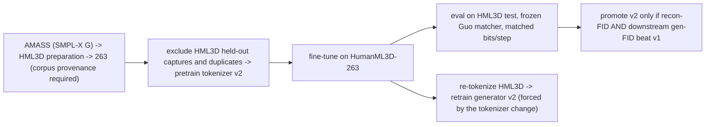

# Lesson 18 -- Scaling the tokenizer with data (not just codes)

This lesson describes a future experiment. Lesson 6.6a increases the tokenizer capacity through more bits per step. This lesson increases the amount of data for tokenizer pretraining.

The proposed corpus is full AMASS, with derivative datasets as later options. The experiment requires a new tokenizer version and new generator versions. Complete the experiment before you freeze the final generator if its results must appear in the final comparison.

The method uses `src\text2motion\motion\preparation.py`, the E7b plan lever, and the Being-M0 / MotionLib references in `.claude/docs/references.md`. The current tokenizer command does not implement AMASS pretraining.

## 18.0 The versioned pipeline

The diagram describes the proposed experiment. The preparation code exists, but the corpus and the tokenizer pretraining path require further work. Section 18.8 gives the recorded results and the current limitations.

Exclude HumanML3D validation and test source captures before tokenizer pretraining. Exclude their file variants and duplicate captures too. An exclusion only at the later generator token-pack stage does not protect the tokenizer experiment.

## 18.1 Two orthogonal axes of tokenizer capacity

The tokenizer has two separate capacity axes:

- Codes: the bits per step $=R\log_2 V$ determine the nominal information capacity of a token step.
- Data: the corpus determines the variety of motion that the encoder and decoder encounter.

Here, $R$ is the number of codes per step, and $V$ is the vocabulary size for each code. Lesson 6.6a describes the code axis.

A tokenizer can have enough bits but too little data to learn the motion distribution. More data can improve its reconstruction at the same number of bits. This improvement depends on whether insufficient data limits the tokenizer.

You can increase either axis. This lesson examines only the data axis.

## 18.2 Rule 1 -- the tokenizer is the generator's vocabulary (no hot-swap)

The generator in Lesson 8 predicts token indices from a specific tokenizer. A new tokenizer can assign different indices to the same motion. These changes alter the generator targets.

A new tokenizer therefore requires new token data and a new generator version:

$$
\text{tokenizer v2} \;\Rightarrow\; \text{re-tokenize data} \;\Rightarrow\; \text{generator v2}.
$$

Encode the data again with tokenizer v2. Retrain each generator that uses those tokens. Do not replace tokenizer v1 while you retain its trained generator.

Lesson 17 requires a frozen tokenizer before the final generator experiment. Train tokenizer v2 first if you intend to use it for the final results. A later tokenizer change requires a full generator retrain.

## 18.3 Rule 2 -- the citable evaluation stays on HumanML3D-263

The FID comparison in Lessons 7, 14, and 16 uses HumanML3D-263 and the frozen Guo evaluator. The project has no comparable AMASS FID protocol.

Pretrain on AMASS. Fine-tune on HumanML3D-263. Evaluate on the HumanML3D test split with the frozen matcher:

$$
\text{pretrain (AMASS)} \to \text{fine-tune (HML3D-263)} \to \text{eval (HML3D test, frozen matcher)},
$$

The Being-M0 / MotionLib references support this method: increase the pretraining corpus, then return to the reference distribution for evaluation.

The tokenizer must not encounter HumanML3D validation or test source captures during AMASS pretraining. HumanML3D derives from AMASS, so different filenames do not prove that two captures are independent.

Use the official HumanML3D index to identify the held-out source captures. Apply the exclusions before tokenizer pretraining. Require valid corpus provenance before you use the corpus.

## 18.4 Feasibility and implementation requirements

The donor AMASS release is SMPL-X G. The preparation path in `src\text2motion\motion\preparation.py` uses the SMPL-X body model to produce HumanML3D-263 features. Its source resolver handles differences between dataset folder names.

The preparation path alone does not establish that the corpus is ready. The current corpus builder requires a complete `pose_manifest.json`. It also checks the corpus recipe through `corpus_manifest.json`.

The exclusion helpers identify held-out source captures and duplicate pose files. The duplicate check compares file sizes and SHA-256 hashes. Apply these exclusions to the corpus that tokenizer v2 actually reads.

The current tokenizer command uses the HumanML3D train split. Its loader is in `src\text2motion\app\training.py`. The YAML field `data.sources` does not select AMASS for tokenizer pretraining because no code reads that field.

AMASS currently passes through the frozen tokenizer to produce tokens for generator pretraining. This operation does not train the tokenizer. Implement an AMASS tokenizer pretraining path before you attempt the proposed experiment.

The FSQ tokenizer has an encoder and a decoder with convolution layers. The referenced configuration uses width 512 for both networks. The FSQ quantizer has no learned codebook parameters.

For a fixed model, batch size, and window length, more data increases the steps per epoch. It does not increase the VRAM requirement per batch. The original feasibility estimate uses a 4 GB GPU; verify the selected configuration before the full run.

## 18.5 Will it help? -- the rate-distortion check (be honest)

The distortion curve $D(r)$ describes reconstruction error at a rate $r$. More data can lower this curve if insufficient data limits the tokenizer.

HumanML3D derives from AMASS. Additional AMASS data therefore comes mainly from the same distribution as the HumanML3D test data. This overlap can limit the extra reconstruction benefit.

MoMask provides a reference reconstruction result, not an established minimum error. A result below that reference does not show how much further improvement remains. Section 18.8 gives the recorded values.

- Where it genuinely wins: **out-of-distribution robustness** (motions the generator invents that
  HML3D under-covers), the **deferred whole-body / SMPL-X track**, and as a clean **ablation row**.

So the honest hypothesis is "small recon-FID gain on HML3D, larger robustness/coverage gain" -- and
either outcome is a reportable finding.

## 18.6 The protocol (a controlled ablation, not a silent swap)

Use the Lesson 7 protocol: matched bits per step, the same HumanML3D test population, and seed 2026. Keep the matcher and the evaluation settings identical between v1 and v2.

1. Verify the corpus provenance and its preparation recipe.
2. Exclude HumanML3D validation and test source captures, their file variants, and duplicates before tokenizer pretraining.
3. Implement the AMASS loader for tokenizer pretraining.
4. Pretrain tokenizer v2 on the permitted AMASS corpus.
5. Fine-tune tokenizer v2 on the HumanML3D train split with the selected configuration.
6. Freeze tokenizer v2 and encode the data again.
7. Retrain the generators that use tokenizer v2.
8. Compare v1 and v2 on reconstruction FID and downstream generator FID.
9. Select v2 only if it improves both measures.
10. Otherwise, retain v1 and report v2 as a separate experiment.

The unsuccessful variant can also provide an initial tokenizer for the deferred whole-body experiment. This use does not establish a whole-body benefit.

The larger corpus is a separate experimental treatment. Report whether it improves either measure, both measures, or neither measure. Do not replace the baseline without this comparison.

## 18.7 Big-picture fit

The thesis has two mechanism comparisons:

- Contribution A compares FSQ with RVQ at matched bits per step.
- Contribution B compares an SSM generator with a transformer generator at a matched budget.

The amount of tokenizer pretraining data is a separate variable. Keep it fixed within each mechanism comparison. Report the data experiment separately as future work or an ablation.

AMASS or derivative datasets can supply the pretraining data. HumanML3D-263 remains the dataset for fine-tuning and comparable evaluation. Each new tokenizer version requires new token data and new generator versions.

The experiment requires both a reconstruction FID improvement and a downstream generator FID improvement before v2 replaces v1. This rule separates the data effect from the two mechanism comparisons.

## 18.8 Recorded results and current limitations

The original preparation report gives approximately 78% HumanML3D coverage from the donor AMASS release. This value is historical coverage, not evidence that full AMASS tokenizer pretraining is ready.

The October 26 regeneration indexed 11,676 clips from 14,616 index rows. It recorded 2,940 rows without a pose file. The feature stage wrote 23,134 clips and failed on 218 outputs, which represent 109 clips and their mirrors.

The failed source captures are shorter than the ranges in the HumanML3D index. These preparation results do not describe a complete corpus for the proposed tokenizer experiment.

The October 30 record states that raw AMASS is absent and `pose_data` has no pose manifest. The corpus cannot currently be rebuilt through the checked preparation path. The recorded generator pretraining path uses legacy `AMASS_263` features with held-out names excluded when it builds the token pack.

That later exclusion does not establish valid provenance for tokenizer pretraining. The proposed experiment requires valid corpus provenance and exclusions before the tokenizer learns from AMASS.

The recorded FSQ tokenizer result at eight codes is reconstruction FID 0.0170, against the MoMask reference of approximately 0.019. The FSQ value already falls below that reference, so 0.019 is not a reconstruction limit.

The tokenizer README states that nobody has run the AMASS tokenizer pretraining experiment. The proposed v2 therefore has no measured reconstruction FID or downstream generator FID.
