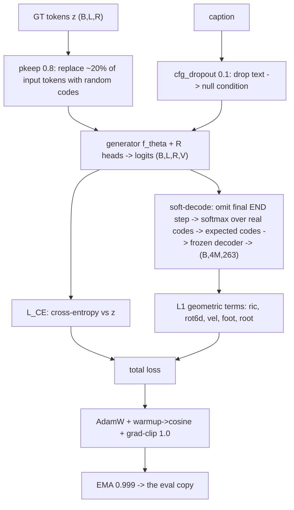

# Applied Lesson B -- Escaping the plateau: the training recipe and reproducibility

> Companion to Lesson A. Lesson A explains the loss and optimizer mathematics.
> Lesson B explains the complete recipe and the requirements for reproducible evidence.
> The current definitions are in `src\text2motion\generation\contracts.py`.
> The implementation is in `nn_model.py`, `nn_backbones.py`, `trainer.py`, and `losses.py`.
> Section B.9 contains all historical results and measured comparisons.

## B.0 The training step (with shapes)

The batch has B samples and R codebooks. L is the padded token sequence length, including the final appended END position when END is enabled. V is the vocabulary size.

The trainer first trims the motion frames to a multiple of the tokenizer downsample factor. The default factor is four. The tokenizer converts the retained frames to motion tokens.

The cross-entropy loss compares the logits with the clean targets. The trainer changes only the input tokens. A length mask excludes padded target positions from the loss.

The geometric loss uses the soft decoder. This path excludes END vocabulary entries before the softmax. When END is enabled, it also removes the final appended time position.

Let M denote the number of motion-token positions that remain. The decoder produces four frames per motion token. Its output shape is therefore `(B,4M,263)`, not `(B,L,263)`.

For each codebook, the soft decoder computes an expected code vector from the probabilities of the real codes. The tokenizer combines these vectors and decodes them. The tokenizer parameters remain frozen, but the loss gradient passes through the decoder to the generator.

The fixed-weight loss has this form:

$$
\mathcal{L}
=
\mathcal{L}_{\mathrm{CE}}
+
\sum_i w_i\mathcal{L}_i.
$$

The default geometric terms compare these feature groups:

- The root features.
- The root-relative joint positions, `ric`.
- The six-dimensional joint rotations, `rot6d`.
- The joint velocities, `vel`.
- The foot-contact features, `foot`.

The optional dynamics terms are `foot_skate` and `accel`. The first penalizes horizontal foot displacement when the target indicates contact. The second compares the second differences of the generated and target joint positions.

Both dynamics weights default to zero. The configuration `configs\generator\gen_pilot_fsq8x1024_dynamics.yaml` enables `w_foot_skate: 10.0` and `w_accel: 18.0`. These settings define an experiment; they do not establish a quality gain.

## B.1 Why this chapter exists

A model can have a smooth loss curve and still reach a plateau below the required quality. This chapter explains the controls around the loss and optimizer.

The cure is not one trick but a **set of constraints applied together**; dropping any one re-opens the
plateau. We list each with its mechanism and our value.

The checklist specifies the recipe. A controlled experiment must establish the effect of each setting. Section B.9 separates the historical evidence from the current implementation.

## B.2 The plateau-avoidance levers (the consolidated checklist)

| Lever | Mechanism | Our setting |
|---|---|---|
| Full data + mirror | enough signal to learn the distribution | all clips, train-only mirror (Lesson 4a) |
| Losses beyond CE | CE compares codes; geometry compares motion features | term-split L1 via soft-decode; optional dynamics terms (Lesson A) |
| EMA on eval | the parameter average reduces variation between updates | $\beta=0.999$ |
| Long enough schedule | the learning rate decreases across the selected run | warmup 1000 -> cosine over the whole run |
| Don't fully freeze text | a frozen encoder caps text grounding | unfreeze last layer + LN + projection |
| Non-greedy sampling | greedy collapses (T2M-GPT) | nucleus + temperature + CFG (Lesson 8) |
| Scale the generator | 5M is too small | current twins: approximately 34M; larger presets do not establish trained quality (Lesson 13 shapes) |
| FID early and often | validation detects a quality plateau | val FID every few epochs; sanity-overfit first |

The single-batch overfit gate checks the model, data, loss, and optimizer before a full run. Its default learning rate remains 0.003. Section B.9 gives the evidence for an explicit 0.0003 rate in this gate.

### B.2a Initialization and the shared dropout policy

The initial parameter values affect the scale of the motion and text features. The current implementation uses the reference initialization for both twins.

The initialization has these components:

- The token embeddings and learned positions use a normal distribution with a standard deviation of 0.02.
- The linear biases start at zero, except for the specialized Mamba initialization.
- The residual output projections use Kaiming initialization and a scale that depends on the network depth.
- The initial Mamba time steps use a log-uniform distribution between 0.001 and 0.1.

For a residual output projection, the scale is:

$$
W_{\mathrm{residual}}
=
\frac{W_{\mathrm{Kaiming}}}{\sqrt{n_{\mathrm{res}}N}},
$$

where N is the number of layers. The value of `n_res` is one for Mamba and two for the Transformer.

The Mamba implementation sets the bias through the inverse softplus. Thus, the initial positive time step follows the specified distribution. Lesson 12 explains the recurrence and the role of the time step.

Both twins use only the shared embedding dropout, `emb_drop`. The backbones have no additional dropout. New final runs must start from zero because a resumed run would combine different dropout policies.

### B.2b Optional text at every motion step

The default generator uses a text prefix. The optional setting `per_step_text=True` also adds the projected text vector to every motion-token embedding.

For a motion embedding e and a projected text vector q:

$$
e' = e + q.
$$

This option requires `text_prefix_len=1`. An all-zero text condition adds no per-step text vector. The default remains `per_step_text=False`; the available implementation does not establish adoption.

## B.3 CFG training dropout (so guidance exists at inference)

Classifier-free guidance needs conditional and unconditional predictions. The trainer obtains both paths in one network. It replaces the text condition with a null condition with probability $p_{\text{drop}}=0.1$:

$$
c' = \begin{cases} \varnothing & \text{with prob } p_{\text{drop}} \\ c & \text{otherwise} \end{cases},
\qquad p_{\text{drop}} = \texttt{cfg\_dropout} = 0.1.
$$

The null condition lets the network learn $p_\theta(z\mid\varnothing)$. At inference, CFG combines the conditional and unconditional logits:

$\ell_\varnothing + s(\ell_c-\ell_\varnothing)$

Here, s controls the guidance strength. Without null-condition examples, the unconditional logits $\ell_\varnothing$ have no corresponding training objective. Section B.9 gives the historical pilot result.

## B.4 pkeep -- fighting exposure bias

Teacher forcing uses the ground-truth previous tokens. At inference, the generator uses its own previous tokens. These tokens can contain errors.

This difference is exposure bias. The trainer introduces input errors with `pkeep`. It keeps each input token with probability $\texttt{pkeep}=0.8$ and otherwise replaces it with a random real code.

The expected replacement fraction is 20%. The targets remain clean. The loss therefore asks the generator to predict the correct token from an imperfect input history.

## B.5 Not freezing the text encoder

A fully frozen CLIP encoder was a plateau cause: the motion task cannot adapt the text features at
all.

The current configuration permits updates to these parts of CLIP:

- The last Transformer layer.
- The final layer normalization.
- The text projection.

The settings are `unfreeze_last_n=1` and `unfreeze_projection=True`. All other CLIP parameters remain frozen.

The optimizer uses a separate rate for the permitted text parameters: $10^{-5}$ vs $2\times10^{-4}$ for the generator. The smaller text rate limits the size of each update to the pretrained features.

## B.6 Reproducibility -- what turns a number into evidence

Each quantitative claim must identify its run and evaluation protocol. A configuration alone does not establish reproduction.

The requirements are:

1. Record the root seed and each derived seed.
2. Record the numerical precision and deterministic settings.
3. Record the configuration, Git commit, and library versions.
4. Record the checkpoint identity and evaluation protocol.
5. Select the model on validation data and reserve test data for the final evaluation.

### B.6a The root seed and the current exception

The owner policy specifies one root seed, `seed=2026`. The twins, tokenizer experiments, and evaluation should derive their random choices from this root.

The evaluator does not yet satisfy this policy. Its caption choices use independent CRC32-derived seeds. Its multimodality calculation uses a fixed seed of zero. The diversity function also defaults to zero.

These definitions are in `evaluation\evaluator.py` and `evaluation\metrics.py`. The proposed seed corrections remain unapplied. A manifest with `seed=2026` therefore does not establish one-root-seed evaluation.

### B.6b Deterministic settings and precision

The application can enable `deterministic=True`. It disables cuDNN benchmark selection and enables deterministic cuDNN behavior.

However, `app\bootstrap.py` calls `use_deterministic_algorithms` with `warn_only=True`. An operation without a deterministic implementation can produce a warning instead of a failure. This setting does not guarantee bitwise reproduction.

The precision setting also matters. The default TF32 policy changes numerical reproduction of older results. Record the precision policy with the result.

### B.6c Run records and model selection

The function `start_run` in `app\run_log.py` records the configuration, Git commit, and library versions. The configuration contains the configured seed. The run also records metrics in `metrics.jsonl`.

Each number in an ADR or the dissertation must identify its run directory. The record must distinguish the live parameters from the EMA parameters.

Use validation data for model selection. Score the test data once for the final selected model and protocol. Lessons 7 and 14 explain this separation.

## B.7 The schedule, precisely

$$
\eta(t) = \begin{cases}
\eta_{\max}\,\dfrac{t}{T_{\text{warm}}} & t \le T_{\text{warm}}=1000 \\[2mm]
\eta_{\min} + (\eta_{\max}-\eta_{\min})\,\tfrac12\big(1+\cos\frac{\pi (t-T_{\text{warm}})}{T-T_{\text{warm}}}\big) & t > T_{\text{warm}}
\end{cases}
$$

Here, t is the optimizer step. T is the planned total number of optimizer steps. The warmup increases the rate to its maximum.

The minimum rate is $\eta_{\min}=0.01\,\eta_{\max}$ (`lr_min_ratio`). After warmup, the cosine decreases the rate across the full planned run.

Choose the schedule horizon before the run. The default request specifies 60 epochs, but this value does not establish convergence or the epoch with the best quality.

A resume with a different horizon requires an explicit schedule extension. This change can cause a jump in the learning rate. Record it as a change to the experiment.

## B.8 What to hold onto

1. Use the B.2 checklist for the complete recipe.
2. Use CFG dropout 0.1 to train the null-condition path required by guidance.
3. Use pkeep 0.8 to introduce errors into the input history while the targets remain clean.
4. **Partial text-encoder unfreezing** lifts the cap a frozen encoder imposes.
5. Record the seed, precision, manifests, checkpoint identity, and validation selection.
6. Distinguish an implemented setting from a measured quality gain.

## B.9 Results and limits of the evidence

### The prior attempt and the CFG pilot

The prior attempt reached top-1 accuracy of approximately 12%, against approximately 25% for MoMask. It did not compute FID. This comparison explains the reason for the rebuild.

The pilot reported a $-42\%$ FID change at $s{=}5$ (Lesson 8.9). This is a historical result for CFG, not proof that the complete current recipe prevents every plateau.

### The historical twin comparison

The historical Mamba e60 evaluation used an EMA copy frozen at epoch 30. The Transformer e100 evaluation used its EMA copy from the resume point.

These evaluations do not establish a matched comparison of converged twins. They also do not establish that longer runs leave quality unchanged. Historical conclusions about no gain from dynamics ablations are invalid for the same EMA reason.

The historical twins also started from AMASS-pretrained weights. Thus, their results do not represent matched runs from the current initialization.

The older Mamba initialization retained approximately one token of useful state. It does not establish useful long memory. The current initialization requires new runs before a quality comparison.

The current twins have approximately 34M parameters. Larger presets exist, but their size does not establish trained quality at that scale.

### The single-batch overfit gate

At seed 2026, the tested per-step Transformer variants failed the gate at a learning rate of 0.003. A rate of 0.0003 passed and improved the gate behavior for all four tested variants.

Those variants cover both backbones with prefix-only and per-step text. The gate default remains 0.003, pending a decision. The ledger records these results under G1 and T4.

A gate pass confirms that the tested path can fit one batch. It does not establish generalization or final motion quality.

### Numerical reproduction

Reruns with identical configurations produced different results. The warning-only deterministic policy therefore does not support a bitwise reproduction claim.

A reproducible result needs a verified evaluation protocol and complete run records. The unresolved evaluator seed policy remains a limitation.
