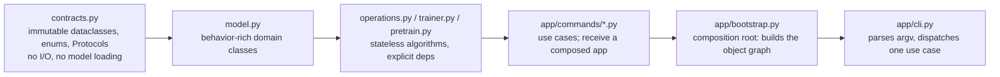

# Applied Lesson C -- Contracts: the declarative boundary between pipeline stages

> Companion to Lessons A and B (A/B = the loss, optimizer and training recipe; **C = the typed
> boundary objects those recipes are configured through, and what breaks when two of them silently
> disagree**). Every finding here is grounded in the actual `contracts.py` files and was caught while
> running the transformer+RVQ downstream-generation ablation (Lesson 7's "open confirmation"), not
> invented after the fact.

## C.0 The dependency rule (ADR 0004)

Each pipeline stage (`motion`, `tokenization`, `generation`, `evaluation`, `studio`) owns exactly one
`contracts.py`: the frozen dataclasses, `StrEnum`s, and `Protocol`s that describe what crosses that
stage's boundary. Nothing downstream constructs its own ad-hoc dict of parameters -- every stage
receives a typed contract object. The promise a contract makes is narrow but load-bearing: **two
values that must agree, declared in one dataclass or across two, actually do agree** -- and if a config
file lets them drift, something should refuse to run rather than silently building the wrong model.

## C.1 Why this chapter exists

Four real defects surfaced this session, all in the same family: **a value with more than one place
it could be read from, and no check that those places agreed.** None were math bugs, none were caught
by the test suite before they were exercised end-to-end, and three of the four had already been
sitting in the codebase across earlier sessions without ever being triggered -- because nobody had run
that exact contract combination before. That is the actual argument for this chapter: contracts don't
prevent bugs by existing; they prevent bugs when the boundary is *verified*, not merely *declared*.

## C.2 The inventory

| Stage | File | Declares |
|---|---|---|
| motion | `motion/contracts.py` | `Split`, `PreparationStage`, `MotionDataConfig`, `TextAnnotation`, `PreparationRequest` |
| tokenization | `tokenization/contracts.py` | `TokenizerKind`, `FiniteScalarStackLayout`, `TokenizerConfig`, `ResidualVectorQuantizationConfig`, `TokenizeRequest`, `TrainTokenizerRequest` |
| generation | `generation/contracts.py` | `Backbone`, `GeneratorConfig`, `TextEncoderConfig`, `LossWeights`, `GeneratorTrainingConfig`, `SamplingConfig`, `GeneratorTrainingRequest`, `GeneratorPretrainingRequest` |
| evaluation | `evaluation/contracts.py` | `GenerationEvaluationProtocol`, `GenerationEvaluationReport`, `GenerationEvaluationSet`, `StreamingBenchmarkProtocol` |
| studio | `studio/contracts.py` | `ViewerHost`, `MotionInferenceClientPort` (structural `Protocol`s, not dataclasses -- ISP at the GUI/network boundary) |

`app/config.py`'s `ApplicationConfig` composes one instance of each stage's top-level config into a
single object, loaded by `app/config.py::load_config` and checked by
`app/config.py::validate_config` before any command runs.

## C.3 Case study 1 -- vocabulary size that assumed one tokenizer kind

`run_pretrain` (`app/commands/generator.py:183`) builds the generator's embedding table size before
any tokenizer checkpoint is loaded -- pretraining runs on pre-tokenized AMASS packs, so it only needs
the *shape* of the vocabulary, not real tokenizer weights. The vocabulary size was computed as
$$
V = \prod_{i} \texttt{fsq\_levels}_i,
$$
unconditionally -- correct for FSQ, and silently wrong for RVQ, where the codebook size is a single
declared integer (`ResidualVectorQuantizationConfig.codebook_size`), not a level product. For an RVQ config, `fsq_levels`
still resolves to its dataclass default `(8, 5, 5, 5)`, so $V$ silently came out to $1000$ regardless
of the real codebook size ($1024$ in every RVQ config this project uses). The generator trained
against a vocabulary $24$ tokens too small; the first out-of-range RVQ token index crashed CUDA with a
scatter-gather assertion deep inside the embedding lookup -- correct behavior, wrong diagnosis distance
from the actual defect.

Fix (`app/commands/generator.py:186`): branch on `config.tokenizer.kind` and read
`config.rvq_baseline.codebook_size` for RVQ, matching how `ResidualVectorQuantizationTokenizer.codebook_size`
(`tokenization/nn_model.py:418`) already derives it for the real tokenizer object. `pretrain` had simply
never been exercised against an RVQ config before -- `run_twins.sh`'s `transformer_rvq` pair calls the
same code path and would have failed identically on the (never-yet-run) cloud campaign.

## C.4 Case study 2 -- a value the gate and training are *supposed* to disagree on

The mandatory overfit gate (`sanity-overfit`, CLAUDE.md's golden rule) captures
`resolved_generator_config` with `dropout` forced to $0$ for a clean, deterministic overfit signal
(`app.resolve_generator_spec(..., dropout=0.0)`). Real training resolves the same config with
its normal dropout ($0.1$ by default). `OverfitGate.verify_setup` (`app/checkpoint.py:174`) then
compared the gate's `resolved_generator_config` against training's **by strict equality, including
dropout** -- so *any* config with nonzero dropout would pass its gate and then fail its own
verification one command later, unconditionally. This check was added 2026-08-18, after every prior
successful training run in this repository (the FSQ pilot twin included) -- it had literally never
been exercised end to end before this session.

Fix (`app/checkpoint.py:182-198`): exclude `dropout` from the comparison dict on both sides before
checking equality; every other architecture field (`codebook_size`, `num_codebooks`, `d_model`, ...)
still must match exactly. Regression test:
`tests/app/test_overfit_gate.py::test_overfit_gate_ignores_dropout_difference_from_training_config`.

## C.5 Case study 3 -- the same knob, present on one sibling contract and not the other

`GeneratorPretrainingRequest` always had `num_workers: int = 0`. `GeneratorTrainingRequest` -- the
sibling contract for the fine-tune command, used for the exact same DataLoader -- did not have the
field at all, and `train-generator`'s own argument parser never exposed `--num_workers`. Nothing
crashed; the DataLoader simply always ran with zero workers, and the fine-tune stage paid the full
cost of synchronous, non-overlapped batch preparation on every run, with no way to opt out short of
editing the source.

Fix: added `num_workers: int = 0` to `GeneratorTrainingRequest`
(`generation/contracts.py:137`), the `--num_workers` flag to the `train-generator` subparser
(`app/cli.py:114`), and threaded it into the loader call (`app/commands/generator.py:100`). Measured
effect after also adding `pin_memory` / `persistent_workers` / `prefetch_factor` to
`MotionDataModule`'s loaders (`motion/datasets.py`): epoch time on the transformer+RVQ fine-tune
dropped from ~15 min to ~9 min, a ~40% reduction, with a one-time ~15s worker-spawn cost absorbed once
per run rather than once per epoch.

## C.6 Case study 4 -- one quantity, two dataclasses, no cross-check

`TokenizerConfig.num_quantizers` and `ResidualVectorQuantizationConfig.num_quantizers` describe the same architectural fact
(how many residual quantizer stages an RVQ tokenizer has) but are two independent fields, set
independently in YAML (`tokenizer: {num_quantizers: 8}` and `rvq_baseline: {num_quantizers: 8}`).
`app/bootstrap.py:76` and `app/commands/evaluation.py:92` resolve the **generator's** `num_codebooks`
from `tokenizer.num_quantizers`; the **tokenizer model itself** is built from
`rvq_baseline.num_quantizers` (`tokenization/nn_model.py:354`). Every config in this repository happens
to keep the two numbers equal today -- verified directly, not assumed -- but nothing enforced it, and
the failure mode is the same class as C.3: a generator embedding table shaped for the wrong number of
codebooks, discovered only by a crash deep in an unrelated kernel.

Fix: `validate_config` (`app/config.py:208-217`) now raises loud, at config-load time, if
`tokenizer.kind == RVQ` and the two fields disagree -- before any model is constructed, not after.
Regression test:
`tests/generation/test_generator_upgrades.py::test_config_rejects_rvq_num_quantizers_mismatch`.

## C.7 The pattern underneath all four

Every case is the same shape: **a quantity that either (a) is declared in two places that must agree,
or (b) is computed two different ways depending on a branch nobody wrote, with the "default" branch
silently taken.** None of the four were caught by unit tests, because unit tests exercise one contract
at a time; all four only surfaced when two contracts were exercised *together*, for the first time, in
a configuration nobody had run before (RVQ pretraining; a gate with nonzero dropout; the fine-tune
DataLoader; an RVQ generator's vocabulary). The generalizable lesson is not "write more tests" -- it is
**push the check to the boundary that owns both values** (`validate_config`, run once at load time)
rather than trusting that every call site downstream will happen to agree.

## C.8 What to hold onto

1. A `contracts.py` module is a *promise*, not a guarantee -- `validate_config` is where promises
   between two contracts get enforced, and it should grow every time a cross-contract assumption is
   found the hard way (C.6 followed exactly the pattern C.3 first exposed).
2. A value that legitimately differs between two call sites (dropout: gate vs. training, C.4) is a
   comparison to *exclude*, not a bug to paper over -- fail loud on the fields that must match, and
   only those.
3. Sibling contracts for near-identical operations (`GeneratorTrainingRequest` /
   `GeneratorPretrainingRequest`, C.5) drift apart silently unless someone diffs them; a missing field
   does not raise an error, it just quietly disables a capability.
4. None of these four defects were exotic -- each is a config file loaded exactly as documented,
   producing wrong behavior with no exception raised until deep inside a kernel. That is what "fail
   loud, no silent fallbacks" is actually defending against.
