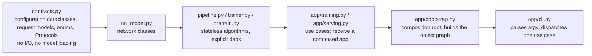

# Applied Lesson C -- Contracts: the declarative boundary between pipeline stages

> Companion to Lessons A and B. Lessons A and B describe the loss, the optimizer, and the training recipe.
> Lesson C describes the typed objects that configure these operations and the checks that detect inconsistent values.
> The four historical defects arose during the transformer+RVQ ablation for downstream generation, which Lesson 7 calls the "open confirmation".

## C.0 The dependency rule (ADR 0004)

A contract defines the data that one stage gives to another stage. A configuration contract defines the values that an operation requires.

A type check confirms that a value has the required type. A separate check must confirm that related values agree.

For example, two integer fields can each be valid but have different values. If both fields describe the same quantity, the application must require equality.

Each pipeline stage owns one `contracts.py` module:

- `motion`
- `tokenization`
- `generation`
- `evaluation`
- `studio`

These modules declare configuration dataclasses, request models, enums, and structural interfaces called `Protocol`s. Many dataclasses are frozen, but some contracts are mutable.

A frozen dataclass prevents assignment to its fields. It does not make every object inside those fields immutable.

The request contracts include Pydantic models. These models validate command inputs and provide the fields from which the CLI derives its flags.

The studio also declares the mutable dataclass `SmplxFitResult`. The motion domain classes now reside in `motion/contracts.py`; the former `motion/model.py` module was merged into it.

The network modules use the name `nn_model.py`. These distinctions replace the earlier rule that every contract is an immutable dataclass.

A typed object makes the expected fields explicit. The application must still reject inconsistent values before it constructs a model.

## C.1 Why this chapter exists

The historical investigation found four defects related to configuration contracts. Each defect involved a value with multiple sources, an incorrect source, or an absent field.

The defects were:

1. The pretrain operation used the FSQ vocabulary formula for RVQ.
2. The gate check required equal dropout values where a deliberate difference was necessary.
3. The fine-tune request omitted a field that the pretrain request already exposed.
4. Two contracts declared the RVQ stage count without a check for equality.

These defects concerned configuration and interface checks. The existing tests did not detect them before the investigation exercised the relevant combinations.

Three defects already existed across earlier sessions without a reported failure. The relevant contract combinations had not been exercised.

A contract declaration alone does not prevent these defects. A check must compare the values at the point that has access to both contracts.

## C.2 The inventory

| Stage | File | Declares |
|---|---|---|
| motion | `motion/contracts.py` | `Split`, `PreparationStage`, `MotionDataConfig`, `TextAnnotation`, `PreparationRequest`, Pydantic command requests, and motion domain classes |
| tokenization | `tokenization/contracts.py` | `TokenizerKind`, `FiniteScalarStackLayout`, `TokenizerConfig`, `ResidualVectorQuantizationConfig`, `TokenizeRequest`, `TrainTokenizerRequest` |
| generation | `generation/contracts.py` | `Backbone`, `GeneratorConfig`, `TextEncoderConfig`, `LossWeights`, `GeneratorTrainingConfig`, `SamplingConfig`, `GeneratorTrainingRequest`, `GeneratorPretrainingRequest`, and Pydantic command requests |
| evaluation | `evaluation/contracts.py` | `GenerationEvaluationProtocol`, `GenerationEvaluationReport`, `GenerationEvaluationSet`, `StreamingBenchmarkProtocol` |
| studio | `studio/contracts.py` | `ViewerHost`, `StudioLaunchArguments`, `MotionInferenceClientPort` as structural `Protocol`s; `SmplxFitResult` as a mutable dataclass |

The studio protocols apply the interface segregation principle, or ISP, at the GUI and network interfaces. A consumer depends on the interface it requires.

`ApplicationConfig` in `app/config.py` combines the configuration objects into one application configuration.

`app/config.py::load_config` constructs this object and calls `app/config.py::validate_config`. The checks run before the command constructs its models.

## C.3 Case study 1: a vocabulary size that assumed one tokenizer kind

The vocabulary size determines the number of rows in a token embedding table. Every token index must refer to a row in that table.

`app/training.py::run_pretrain` resolves this size before it loads any tokenizer checkpoint. The operation uses AMASS token packs that were encoded earlier.

It therefore requires the vocabulary shape without the tokenizer weights.

The historical code always used the FSQ formula:

$$
V = \prod_{i} \texttt{fsq\_levels}_i,
$$

For FSQ, each level specifies the number of available scalar values. Their product gives the number of combinations.

For RVQ, `ResidualVectorQuantizationConfig.codebook_size` directly declares the vocabulary size of each codebook. The FSQ level product does not define this size.

An RVQ configuration can still contain the default `fsq_levels` tuple `(8, 5, 5, 5)`. The historical formula therefore produced $V$ equal to $1000$.

The real RVQ vocabulary depends on the selected configuration. It is not $1024$ in every RVQ configuration.

For example, `configs/tokenizer/rvq_l4_512.yaml:30` declares `codebook_size: 512`. The application must read this field instead of the unrelated FSQ defaults.

The current branch in `app/training.py::run_pretrain` uses:

- `config.rvq_baseline.codebook_size` for RVQ.
- The product of `config.tokenizer.fsq_levels` for FSQ.

This resolution agrees with the actual tokenizer vocabulary. `FrozenMotionTokenizer.codebook_size` reads `self.network.codebook_size` in `tokenization/nn_model.py:260-261`.

The same pretrain operation serves the `transformer_rvq` pair in `run_twins.sh`. Before the fix, that pair also used the incorrect branch.

The historical failure and its vocabulary difference appear in C.9.

## C.4 Case study 2: a value that deliberately differs between the gate and training

The mandatory overfit gate tests whether the model can fit one real batch. The `sanity-overfit` skill specifies this prerequisite.

The gate calls `app.resolve_generator_spec(..., dropout=0.0)`. It records a `resolved_generator_config` with dropout equal to $0$.

Real training resolves the architecture with its configured dropout, which is $0.1$ by default. These two configurations deliberately differ in this field.

The earlier `OverfitGate.verify_setup` required strict equality between the complete configuration dictionaries. It therefore rejected any nonzero dropout after the gate passed.

The historical account dates this check to 2026-08-18. It followed the earlier successful runs, including the FSQ pilot twins.

The relevant sequence had not been exercised from the gate through the start of training before that investigation.

The current check in `app/checkpoint.py:204-229` removes `dropout` from both dictionaries before it compares them.

All other resolved architecture fields must agree, including:

- `codebook_size`
- `num_codebooks`
- `d_model`

The check also verifies the configuration hash, the tokenizer hash, and the backbone. It then validates the gate metrics.

The regression test is:

`tests/app/test_overfit_gate.py::test_overfit_gate_ignores_dropout_difference_from_training_config`.

### C.4a The current dropout policy and the gate learning rate

Both generator backbones now use embedding-only dropout. The shared generator applies the configured dropout through `emb_drop` in `generation/nn_model.py`.

The Mamba blocks do not add backbone dropout. The transformer attention explicitly uses `dropout_p=0.0` in `generation/nn_backbones.py:288`.

The gate disables embedding dropout. Real training uses the configured embedding dropout.

This policy keeps the dropout location consistent between the twins. The gate exception permits a deliberate probability difference without permitting other architecture differences.

`ApplicationConfig.seed` defaults to the root seed 2026. The application uses this seed for its random generators and passes it to the motion repository.

The gate learning rate is a separate value. `OverfitGateRequest.lr` still defaults to `3e-3` in `generation/contracts.py:196`.

`SanityOverfitRequest.lr` derives its default from that contract. The proposed change to `0.0003` remains pending; the current default is `0.003`.

A gate failure can result from the selected learning rate. It does not, by itself, prove that the architecture or the text path has a defect.

The measurements that support this distinction appear in C.9.

## C.5 Case study 3: a field present in one related contract but absent from the other

`num_workers` specifies the number of worker processes that prepare data batches. A value of zero prepares the batches in the main process.

The historical `GeneratorPretrainingRequest` declared `num_workers: int = 0`. The related `GeneratorTrainingRequest` did not declare this field.

The fine-tune command also lacked a `--num_workers` flag. Its DataLoader therefore always used zero workers.

This omission caused no exception. The user could not select worker processes through the documented command interface.

The current `GeneratorTrainingRequest` declares `num_workers: int = 0`. The Pydantic `TrainGeneratorRequest` exposes the same field for the command.

The CLI now derives flags from the selected request model. It does not require a manually maintained `train-generator` subparser flag.

`app/cli.py:131-136` calls `add_class_arguments` and validates the parsed request. This mechanism exposes `--num_workers` from `TrainGeneratorRequest`.

`app/training.py::run_train_generator` passes `args.num_workers` to the captioned batch loader.

The loaders in `motion/datasets.py` also configure:

- `pin_memory`
- `persistent_workers`
- `prefetch_factor`

Persistent workers remain active when `num_workers` is positive. Prefetch applies only when worker processes exist.

The historical timing results appear in C.9. They describe the combined changes, not an isolated effect of the request field.

## C.6 Case study 4: one quantity in two dataclasses without a check

An RVQ tokenizer has a sequence of residual quantizer stages. Each stage has a codebook.

The generator must use the same codebook count as the tokenizer.

Two independent fields describe the stage count:

- `TokenizerConfig.num_quantizers`
- `ResidualVectorQuantizationConfig.num_quantizers`

The YAML can assign each field separately. The historical example used `tokenizer: {num_quantizers: 8}` and `rvq_baseline: {num_quantizers: 8}`.

`ApplicationContext.resolve_generator_spec` in `app/bootstrap.py` derives the generator count from `config.tokenizer.num_quantizers`. The benchmark path also uses this resolution.

The tokenizer factory uses `config.rvq_baseline` to construct the RVQ network. See `tokenization/nn_model.py::build_tokenizer_network`.

The historical investigation found equal counts in the repository configurations. That agreement depended on the configuration author because no cross-contract check enforced it.

A mismatch gives the generator an incorrect codebook count. A later tensor operation can then fail far from the configuration fields.

The current `validate_config` checks this equality for RVQ in `app/config.py:343-354`. It raises `ValueError` if the counts differ.

The error occurs during configuration load, before model construction.

The regression test is:

`tests/generation/test_generator_upgrades.py::test_config_rejects_rvq_num_quantizers_mismatch`.

## C.7 The common cause

These cases show several ways that a configuration interface can fail:

- Two fields describe one quantity without a check for equality.
- A formula applies to one tokenizer kind but runs for another kind.
- A check compares a field that deliberately differs between operations.
- A related request omits a field and silently removes a capability.

A test of one contract can confirm its types and local constraints. It cannot establish every required relation with another contract.

The historical investigation exercised the contracts together. The relevant combinations included RVQ pretrain, a gate with nonzero training dropout, and the fine-tune DataLoader.

A shared check belongs at the point that has access to both values. `validate_config` owns relations between configuration objects.

`OverfitGate.verify_setup` owns the relation between the recorded gate and the requested training setup. Each check must define which values require equality.

The CLI derives its fields from request models. This removes a separate manual flag declaration that can disagree with a request.

## C.8 Rules to retain

1. Check related configuration fields in `validate_config`.
2. Resolve each quantity from the contract that defines it.
3. Select the vocabulary rule from the tokenizer kind.
4. Compare only the fields that must agree between the gate and training.
5. Keep the dropout policy consistent between the twins.
6. Compare related request models for absent fields.
7. Use the root seed 2026 for experiment setup.
8. Distinguish a failed gate measurement from a confirmed implementation defect.

Typed contracts make the expected inputs explicit. Configuration checks detect inconsistent inputs, while request-derived flags reduce duplicate declarations.

An absent field can remove a capability without an exception. An incorrect vocabulary can instead fail inside a CUDA kernel.

Both cases require checks near the source of the incorrect configuration.

## C.9 Results and historical evidence

### The historical vocabulary failure

The failed RVQ run required $1024$ codes. The incorrect FSQ formula allocated $1000$ rows, so the generator vocabulary was $24$ tokens too small.

The first token index outside the allocated range caused a CUDA scatter-gather assertion in the embedding lookup.

This failure describes that historical configuration. It does not establish a vocabulary size for every RVQ configuration.

### The historical data-loader result

The combined request and loader changes reduced the transformer+RVQ fine-tune epoch time from approximately 15 minutes to approximately 9 minutes.

The reported reduction was approximately 40%. Worker creation took approximately 15 seconds once per run instead of once per epoch.

These measurements include the worker field and the loader options. They do not isolate the contribution of each change.

### The gate learning-rate measurements

The ledger records G1 and T4 on 2026-11-02. Both measurements use the root seed 2026.

G1 tests transformer per-step text with two text gains and two learning rates. Each arm allows 1000 steps.

Both arms at `0.0003` pass by step 76. Both arms at `0.003` fail, with token accuracies of 0.50 and 0.86.

The text gains are 1 and 0.1. The gain of 0.1 exists only in a scratchpad code copy.

T4 compares the gate across both backbones and both text modes:

| Backbone | Text mode | Pass step at LR 0.0003 | Result at LR 0.003 |
|---|---|---|---|
| Mamba | Prefix | 51 | Pass at step 151 |
| Mamba | Per-step | 76 | Pass at step 226 |
| Transformer | Prefix | 51 | Pass at step 1276 |
| Transformer | Per-step | 101 | Fail at 5000 steps |

The lower learning rate passes all four tested setups in fewer steps. These measurements support a gate rate change for these setups.

They do not establish the best learning rate for full training. The default gate rate change remains pending.

The current code still defaults to `0.003`. The measurements do not imply that the proposed default is already implemented.
